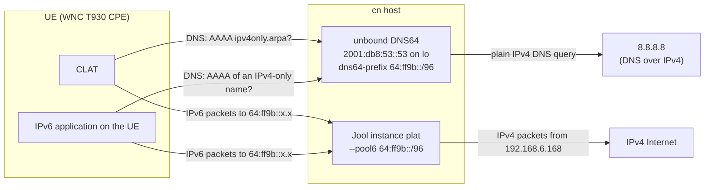
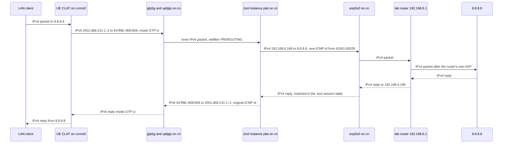
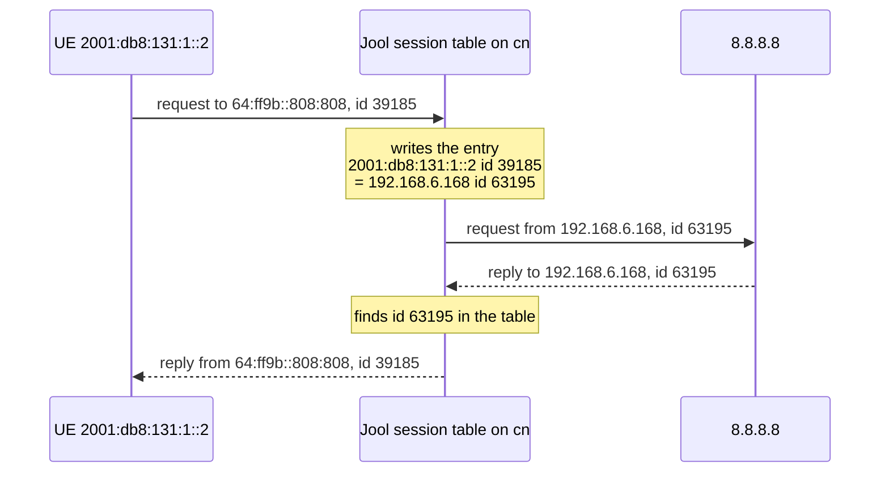

# FINDING: the PLAT for 464XLAT on `cn` — Jool translates `64:ff9b::/96` packets to IPv4, unbound DNS64 only makes up the `64:ff9b::` DNS answers

| Field | Value |
|---|---|
| Date | 2026-10-14 |
| Repo | free5gc (the `cn` host runs this tree; the PLAT itself runs on `cn`, outside the tree) |
| Tree | `/home/loren/Downloads/source_code/free5gc_use_open5gs_ipv6/free5gc` |
| Branch | `my-changes-v4.0.1` (submodule `NFs/smf` on `my-smf-changes-v1.3.2`) |
| Commit | `37c302c` (submodule `NFs/smf` at `6385550`, submodule `NFs/upf` at `ddb2bb3`) |
| Symptom | **Not applicable.** Nothing failed; this records how the PLAT on `cn` works. |
| Scope | What Jool and unbound are, what `64:ff9b::/96` means, how an IPv4 address is written inside it, how Jool and unbound relate, which packet path a translated packet takes through `cn`, and where the UE gets its IPv6 DNS server. The install steps are not here; they are in the HOWTO listed in §10. |
| Fix | **Not applicable.** Nothing is being fixed. |
| Rounds | **Not applicable.** No diagnose-and-fix cycle. |
| Status | **Changed, not re-confirmed.** The §3 checks were run on `cn` and on the UE on 2026-10-13, and every check printed the expected result. §1 was extended on 2026-10-14 without re-running them; see §9. |
| Prior art | none |

---

## SECTION 0. The summary — what the topic is, in plain words, before any detail

464XLAT lets an IPv4-only device behind the UE reach the IPv4 Internet over an IPv6-only PDU session. It
uses two translators. The CLAT (customer-side translator) on the UE turns each IPv4 packet into an IPv6
packet. The PLAT (provider-side translator) on `cn` turns that IPv6 packet back into an IPv4 packet and
sends it to the Internet from the `cn` IPv4 address `192.168.6.168`.

On `cn` the PLAT is two programs with two separate jobs:

- **Jool** is a kernel module that translates packets. Every IPv6 packet whose destination is inside
  `64:ff9b::/96` is turned into an IPv4 packet. The IPv4 destination is the last 32 bits of the IPv6
  destination, so `64:ff9b::808:808` becomes `8.8.8.8`.
- **unbound** is a DNS server running as DNS64 at `2001:db8:53::53`. It never touches data packets. When a
  name has only an IPv4 address, unbound answers with a made-up IPv6 address inside `64:ff9b::/96`. The UE
  CLAT uses one such answer (for `ipv4only.arpa`) to learn the prefix that Jool translates.

The two programs never talk to each other. The only thing they share is the prefix `64:ff9b::/96`, which is
set separately in each program's configuration.

## SECTION 1. How it works — the mechanism, in enough detail to reason about the topic

### The terms

| Term | Meaning |
|---|---|
| 464XLAT | A method (RFC 6877) that carries IPv4 traffic across an IPv6-only network by translating twice: IPv4 to IPv6 on the UE, then IPv6 back to IPv4 in the operator network. |
| CLAT | The customer-side translator. It runs on the UE (here the WNC T930 CPE) and turns IPv4 packets from the LAN client into IPv6 packets addressed into the NAT64 prefix. |
| PLAT | The provider-side translator. It runs in the operator network (here on the `cn` host) and turns those IPv6 packets back into IPv4 packets. A PLAT is a stateful NAT64. |
| NAT64 | Any translator from IPv6 to IPv4. "Stateful" means it keeps a session table, like IPv4 NAT, so many IPv6 users can share one IPv4 address. |
| DNS64 | A DNS server that makes up an IPv6 answer (an AAAA record) for a name that has only an IPv4 answer (an A record). |
| AAAA record / A record | The DNS record types that hold an IPv6 address and an IPv4 address. |
| `64:ff9b::/96` | The Well-Known Prefix that RFC 6052 reserves for IPv4/IPv6 translation. |

### What the two packages are

Both packages were installed on `cn` with `apt`, on Ubuntu 22.04 with kernel `5.15.0-198-generic`.

| Package | What it is | What it does on `cn` |
|---|---|---|
| `jool-dkms` | The source of the Jool kernel module, version 4.1.7. DKMS (Dynamic Kernel Module Support) compiles out-of-tree kernel modules for each installed kernel. | DKMS built the `jool` module for `5.15.0-198-generic`. `modprobe jool` loads that module into the kernel. |
| `jool-tools` | The `jool` command-line program. | `jool instance add "plat" --netfilter --pool6 64:ff9b::/96` creates the NAT64 instance named `plat`. `jool -i plat session display` shows its session table. |
| `linux-headers-5.15.0-198-generic` | The kernel header files for the running kernel. | DKMS needs these headers to compile the Jool module. |
| `unbound` | A caching DNS resolver. Its `dns64` module turns it into a DNS64 server. | It listens on `2001:db8:53::53`, forwards every query to `8.8.8.8` over IPv4, and makes up `64:ff9b::` answers for names with no IPv6 address. Its configuration file is `/etc/unbound/unbound.conf.d/dns64.conf`. |

The unbound configuration written on `cn` is these nine lines:

```
server:
  interface: 2001:db8:53::53
  ip-freebind: yes
  access-control: 2001:db8::/32 allow
  module-config: "dns64 validator iterator"
  dns64-prefix: 64:ff9b::/96
forward-zone:
  name: "."
  forward-addr: 8.8.8.8
```

| Line | What it does |
|---|---|
| `interface: 2001:db8:53::53` | unbound listens only on this address. It therefore does not clash with `systemd-resolved`, which listens on `127.0.0.53` port 53. |
| `ip-freebind: yes` | unbound may bind to `2001:db8:53::53` even when that address is not yet on `lo`, for example early at boot. |
| `access-control: 2001:db8::/32 allow` | unbound answers queries from every UE pool, because every pool is inside `2001:db8::/32`. |
| `module-config: "dns64 validator iterator"` | unbound runs the `dns64` module first, then DNSSEC validation, then normal lookup. The `dns64` module must come before `validator`, because a made-up AAAA record carries no DNSSEC signature. |
| `dns64-prefix: 64:ff9b::/96` | unbound builds made-up answers inside this prefix. The prefix must equal Jool's `--pool6`. |
| `forward-zone` with `forward-addr: 8.8.8.8` | unbound sends every query to `8.8.8.8` over IPv4, because `cn` has no IPv6 route to the Internet. |

### How an IPv4 address is written inside `64:ff9b::/96`

An IPv4 address is 32 bits. An IPv6 address is 128 bits. The prefix `64:ff9b::/96` fixes the first 96
bits, and the IPv4 address fills the last 32 bits. Each IPv4 byte becomes two hexadecimal digits.

| IPv4 address | Bytes in decimal | Bytes in hexadecimal | Last two IPv6 groups | Full IPv6 address |
|---|---|---|---|---|
| `8.8.8.8` | 8, 8, 8, 8 | `08 08 08 08` | `0808:0808`, written `808:808` | `64:ff9b::808:808` |
| `192.0.0.170` | 192, 0, 0, 170 | `c0 00 00 aa` | `c000:00aa`, written `c000:aa` | `64:ff9b::c000:aa` |
| `192.0.0.171` | 192, 0, 0, 171 | `c0 00 00 ab` | `c000:00ab`, written `c000:ab` | `64:ff9b::c000:ab` |

IPv6 notation drops the leading zeros inside each group, so `00aa` is written `aa`. The four all-zero
groups between `64:ff9b` and `c000` are written as `::`. The full form of `64:ff9b::c000:aa` is
`64:ff9b:0000:0000:0000:0000:c000:00aa`.

Jool performs the reverse step on every packet. Jool reads the last 32 bits of the IPv6 destination and
uses them as the IPv4 destination. No table of hosts is needed, so one prefix covers the whole IPv4
Internet.

### How Jool and unbound relate

Jool works on **packets**. unbound works on **names**. A name lookup and the packets that follow it are
separate events, and only the prefix connects them.



The table below lists who uses each program.

| Traffic | Uses unbound? | Uses Jool? | Why |
|---|---|---|---|
| The CLAT's prefix discovery: an AAAA query for `ipv4only.arpa` (RFC 7050) | Yes | No | The query goes to `2001:db8:53::53`, which is a normal local IPv6 address on `cn`. The destination is not inside `64:ff9b::/96`, so Jool ignores it. |
| unbound's own upstream query to `8.8.8.8` | — | No | unbound sends this query from `cn` over native IPv4. The session that set up the PLAT stated that Jool in `--netfilter` mode translates only packets that arrive from another device, not packets that `cn` sends itself. |
| IPv4 traffic from the LAN client, after the CLAT translated it | No | Yes | The CLAT addresses each packet to `64:ff9b::` plus the IPv4 destination. Jool translates it. |
| IPv4 DNS queries from the LAN client to `8.8.8.8` | No | Yes | The CLAT turns them into IPv6 packets to `64:ff9b::808:808`, so they cross Jool like any other IPv4 traffic. This is why DNS works through the CLAT even with no DNS64 at all. |
| A UE-native IPv6 application that looks up an IPv4-only name | Yes | Yes | unbound returns a `64:ff9b::` address, and the application then sends its packets to that address through Jool. |

### Why a DNS64 server is needed, and why unbound

The CLAT must know which prefix the PLAT translates. Three methods exist:

1. The operator sends the prefix in the Router Advertisement as a PREF64 option (RFC 8781). The free5gc
   Router Advertisement has no PREF64 option; see *Where the UE gets its IPv6 DNS server* below for the
   code that builds that Router Advertisement.
2. The prefix is set by hand on the UE (the CLAT `ip6prefix` option).
3. The CLAT asks DNS for the AAAA record of `ipv4only.arpa` (RFC 7050). That name has only the IPv4
   addresses `192.0.0.170` and `192.0.0.171`. A DNS64 server returns `64:ff9b::c000:aa` and
   `64:ff9b::c000:ab`. The CLAT drops the last 32 bits and keeps `64:ff9b::/96`.

Method 3 is how a public operator network works, and it needs a DNS64 server. unbound was chosen for these
reasons:

- The WNC T930 CPE team's request named it: "unbound with `module-config: "dns64 iterator"`".
- DNS64 is built into unbound. The lines `module-config` and `dns64-prefix` turn it on, with no plugin
  or script.
- Ubuntu packages unbound. It runs as the `unbound` systemd service, so it starts again after a reboot.
- unbound can forward over IPv4. `cn` has no IPv6 route to the Internet, so unbound forwards every query
  to `8.8.8.8` over IPv4 and performs the DNS64 step locally.

Other DNS servers also have DNS64: BIND9 (the `dns64` option), PowerDNS Recursor, and CoreDNS (the
`dns64` plugin). Google runs a public DNS64 server at `2001:4860:4860::6464`, but the lab cannot use it,
because `cn` has no IPv6 route to the Internet.

`★ Insight ─────────────────────────────────────`
- DNS64 does not translate any packets. It only changes DNS answers. Jool does all the packet
  translation. If the prefix in unbound differs from the prefix in Jool, the UE sends packets to a prefix
  that Jool ignores.
- `dns64` must come before `validator` in `module-config`. A made-up AAAA record carries no DNSSEC
  signature, so the validator would reject it if the validator ran first.
- The CLAT does not need DNS64 when the prefix is set by hand on the UE (the `ip6prefix` option). DNS64 is
  needed only for automatic prefix discovery, which is how a public network works.
`─────────────────────────────────────────────────`

### The packet path through `cn`

The free5gc UPF runs on `cn` itself, with N3 address `5.5.5.2` and the `gtp5g` kernel module as the
forwarder. N3 is the 3GPP interface that carries UE traffic in GTP-U tunnels between the radio side and
the UPF. `gtp5g` removes the GTP-U header from each uplink packet and hands the inner IPv6 packet to the
`cn` kernel on the `upfgtp` interface. Jool runs on the same host, so the IPv6 packet reaches Jool without
any route for `64:ff9b::/96`.



- **Netfilter hook.** `--netfilter` hooks Jool into the kernel's netfilter PREROUTING stage. That stage
  sees every packet arriving on `upfgtp` before the kernel routes it.
- **Session table.** Jool rewrites the ICMP identifier, or the TCP or UDP port, the same way IPv4 NAT
  rewrites a port. The run on 2026-10-13 showed the UE identifier `39185` leave `cn` as `63195`. The session
  entry is what turns each IPv4 reply back into the right IPv6 packet.
- **Empty pool4.** pool4 is the set of IPv4 addresses and ports that Jool uses as the shared source. It was
  left empty. With an empty pool4, Jool uses the address of the outgoing interface, `192.168.6.168` on
  `enp5s0`, with ports `61001`–`65535`. `ip route get 8.8.8.8` on `cn` printed
  `8.8.8.8 via 192.168.6.1 dev enp5s0 src 192.168.6.168 uid 0`.
- **Two layers of NAT.** `192.168.6.168` is a private address, so the lab router `192.168.6.1` translates
  it again toward the Internet. That is allowed. The RFC 6052 private-address restriction applies to the
  IPv4 destination inside `64:ff9b::/96`, not to Jool's own source address.
- **Return path.** The IPv6 reply is routed to the UE prefix through `upfgtp`. The UPF installs those
  routes at startup, as *Why `2001:db8:53::53` sits on `lo`* below shows.

### What "stateful" means

A stateful NAT64 remembers each connection in a session table. Jool needs that memory to send each reply
back to the right UE.

Every UE shares one IPv4 address on `cn`, `192.168.6.168`. An IPv4 reply from `8.8.8.8` is addressed only
to `192.168.6.168`, and that address does not say which UE sent the request. So when Jool translates a
request, Jool writes an entry in its session table. When the reply arrives, Jool looks up the entry and
finds the UE's IPv6 address.

The session table on `cn` held this entry during the ping on 2026-10-13 (the full capture is in §2):

```
Expires in 0:00:19.596
Remote: 8.8.8.8#63195    2001:db8:131:1::2#39185
Local: 192.168.6.168#63195    64:ff9b::808:808#39185
```

| Side of the entry | Address and ICMP identifier |
|---|---|
| IPv6 side, toward the UE | `2001:db8:131:1::2`, identifier `39185` |
| IPv4 side, toward the Internet | `192.168.6.168`, identifier `63195` |



1. **Request.** The UE sent `2001:db8:131:1::2` → `64:ff9b::808:808` with identifier `39185`. Jool sent
   `192.168.6.168` → `8.8.8.8` with identifier `63195`, and recorded the pair in the table.
2. **Reply.** `8.8.8.8` answered `192.168.6.168` with identifier `63195`. Jool found `63195` in the table
   and turned the reply into `64:ff9b::808:808` → `2001:db8:131:1::2` with identifier `39185`.

The IPv4-side identifier (for TCP and UDP, the port) is what tells one UE's flow apart from another's. Two
UEs that ping `8.8.8.8` at the same moment get two different identifiers on the IPv4 side. That is how one
IPv4 address serves every UE. A home IPv4 NAT router works the same way.

`Expires in 0:00:19.596` shows that each entry is temporary. When no packet uses an entry for a while,
Jool deletes the entry, and the identifier or port can be used again.

Jool can also run as a stateless translator, called SIIT (Stateless IP/ICMP Translation), through a
separate command, `jool_siit`. The two modes differ as follows:

| Property | Stateful NAT64 (the PLAT on `cn`) | Stateless translation (SIIT) |
|---|---|---|
| Memory | Jool keeps a session table with one entry per flow. | No table is kept. Each packet is translated by a fixed address rule. |
| IPv4 addresses needed | One shared address, `192.168.6.168`, serves every UE. | Each IPv6 host needs its own IPv4 address. |
| Ports and ICMP identifiers | Jool rewrites them, as the capture shows with `39185` becoming `63195`. | They pass through unchanged. |
| Who can start a connection | Only the IPv6 side, the UE, can start one. An IPv4 packet that matches no entry has nowhere to go, so a host on the Internet cannot open a new connection to a UE. | Either side can start one, because the address rule works in both directions. |

A PLAT must be stateful, because an operator has far more UEs than public IPv4 addresses. That is why
`jool instance add "plat" --netfilter --pool6 64:ff9b::/96` creates a stateful NAT64 instance.

`★ Insight ─────────────────────────────────────`
- The `--pool6 64:ff9b::/96` direction needs no memory, because the IPv4 destination is simply the last
  32 bits of the IPv6 destination. Only the reverse direction needs the table: no rule can turn the
  reply's destination, `192.168.6.168`, back into a UE address.
- The table also explains why nobody on the IPv4 Internet can reach a UE through the PLAT first. Only
  traffic that the UE starts works, which fits a CPE whose LAN clients connect outward.
- pool4 sets the range that Jool picks the new identifiers and ports from. With pool4 empty, Jool uses
  ports `61001`–`65535` on `192.168.6.168`, which is why `63195` was chosen.
`─────────────────────────────────────────────────`

### Why `2001:db8:53::53` sits on `lo`, and not on a pool gateway

The UPF puts the first address of each IPv6 pool on `upfgtp` at startup.
`NFs/upf/internal/forwarder/driver.go:126-138`:

```go
				// WNC: Assign gateway IPv6 address to upfgtp interface
				// Use the first address in the pool as the gateway
				gatewayIP := calculateGatewayIPv6(dst6)
				if gatewayIP != nil {
					// Use the pool prefix length for the gateway address on the interface
					ones, _ := dst6.Mask.Size()
					err = link.AddIPv6Address(gatewayIP, ones)
					if err != nil {
						logger.MainLog.Warnf("WNC: Failed to assign IPv6 gateway address for DNN %s: %v", dnn.Dnn, err)
						// Don't fail completely - routing still works
					} else {
						logger.MainLog.Infof("WNC: Assigned IPv6 gateway %s/%d to upfgtp for DNN %s",
							gatewayIP, ones, dnn.Dnn)
```

`2001:db8:126::1` is one of those gateway addresses; it belongs to the `vzwadmin` pool. The `upfgtp`
interface, with all its addresses, is deleted when the UPF stops and created again when the UPF starts. A
DNS server bound to `2001:db8:126::1` would therefore depend on the UPF and on an unrelated slice.
`2001:db8:53::53/128` on `lo` stays in place across UPF restarts. No pool or interface in the config files
uses `2001:db8:53::`. The UE can reach an address on `lo`, because the `cn` kernel accepts a packet for any
of its local addresses, and the uplink packet rule `permit out ip from assigned to any` allows every
destination.

### Where the UE gets its IPv6 DNS server

The UE gets its IPv6 DNS server from one place only: the `dns.ipv6` value for its slice and DNN in the SMF
configuration. The SMF puts that address in the PCO (Protocol Configuration Options, a field of the NAS
PDU Session Establishment Accept).

The SMF records the UE's request for an IPv6 DNS server.
`NFs/smf/internal/sbi/processor/gsm_handler.go:114-115`:

```go
			case nasMessage.DNSServerIPv6AddressRequestUL:
				smCtx.ProtocolConfigurationOptions.DNSIPv6Request = true
```

The SMF then adds the configured address to the PCO, only when the UE asked for it.
`NFs/smf/internal/context/gsm_build.go:154-160`:

```go
		// IPv6 DNS
		if smContext.ProtocolConfigurationOptions.DNSIPv6Request {
			errAddDNSServerIPv6Address := protocolConfigurationOptions.AddDNSServerIPv6Address(smContext.DNNInfo.DNS.IPv6Addr)
			if errAddDNSServerIPv6Address != nil {
				logger.GsmLog.Warnln("Error while adding DNS IPv6 Addr: ", errAddDNSServerIPv6Address)
			}
		}
```

The Router Advertisement does **not** carry a DNS server. The SMF builds it with only the RA header and
one Prefix Information option. `NFs/smf/internal/context/router_advertisement.go:34-37`:

```go
	// IPv6 RA Option Types (RFC 4861)
	RAOptionTypeSourceLinkLayer = 1
	RAOptionTypePrefixInfo      = 3
	RAOptionTypeMTU             = 5
```

and `NFs/smf/internal/context/router_advertisement.go:68-69`:

```go
func BuildRouterAdvertisement(ipv6Prefix net.IP, prefixLen uint8, dstAddr net.IP) []byte {
	// ICMPv6 message: RA header (16 bytes) + Prefix Information Option (32 bytes).
```

No RDNSS option type (25, the RA option that lists DNS servers) is defined. `config/upfcfg.yaml:381-383`
still holds a DNS list under `routerAdvertisements.default`:

```yaml
    dns:
      - 2001:4860:4860::8888
      - 2001:4860:4860::8844
```

A search of the Go code under `NFs/upf` for a `Dns` field or an RDNSS option found nothing, so the UPF
loads that list and never sends it. Editing it changes nothing on the UE.

The DNS64 address therefore goes into `dns.ipv6`. The repository holds two versions of the SMF
configuration, and `config/smfcfg.yaml` is a relative symbolic link to the one in use:

| File | `dns.ipv6` in all 56 slice and DNN entries |
|---|---|
| `config/smfcfg_google_dns.yaml` | `2001:4860:4860::8888` |
| `config/smfcfg_unbound_dns64.yaml` | `2001:db8:53::53` |
| `config/smfcfg.yaml` | a symbolic link to `smfcfg_unbound_dns64.yaml` |

One entry from `config/smfcfg_unbound_dns64.yaml:30-33`:

```yaml
        - dnn: fast.t-mobile.com # Data Network Name
          dns: # the IP address of DNS
            ipv4: 8.8.8.8
            ipv6: 2001:db8:53::53
```

The SMF reads `dns.ipv6` only when a PDU session is set up. A session that already exists keeps its old
DNS server until it is released and set up again.

### Effect on dual-stack PDU sessions

DNS64 changes what a dual-stack session sees. For a host with only an IPv4 address, unbound now returns a
`64:ff9b::` AAAA record. A UE usually prefers IPv6, so its traffic to that host goes through Jool even
though the UE also has a native IPv4 address. Traffic still works, but a capture shows `64:ff9b::`
traffic where native IPv4 traffic used to be. The `ipv4: 8.8.8.8` lines are unchanged, so dual-stack
sessions keep their IPv4 DNS server.

## SECTION 2. Evidence — how the mechanism was established: which tree was read, and what was seen on a unit

**Provenance.** The free5gc tree
`/home/loren/Downloads/source_code/free5gc_use_open5gs_ipv6/free5gc` was read on 2026-10-13 and again on
2026-10-14, at superproject commit `37c302c`, submodule `NFs/smf` at `6385550` and submodule `NFs/upf` at
`ddb2bb3`. The captures below were taken on 2026-10-13 on the `cn` host (Ubuntu 22.04, kernel
`5.15.0-198-generic`, Jool `4.1.7`) and on the UE (WNC T930 CPE). The UE PDU session was on `ccmni2`,
slice SST 1 / SD `0007d0`, DNN `fast.t-mobile.com`, UE address `2001:db8:131:1::2`. The full session
transcript is
`claude_session_transcript/2026-10-14-003857-enable-plat-on-cn.txt`.

The transcript wrapped long lines at the terminal width. The captures below rejoin each wrapped line at
its wrap point; no other character was changed.

**Seen on the UE, ping into the NAT64 prefix:**

```
~ #   ping -6 -c 4 -I ccmni2 64:ff9b::808:808
PING 64:ff9b::808:808(64:ff9b::808:808) from 2001:db8:131:1::2 ccmni2: 56 data bytes
64 bytes from 64:ff9b::808:808: icmp_seq=1 ttl=114 time=15.4 ms
64 bytes from 64:ff9b::808:808: icmp_seq=2 ttl=114 time=14.3 ms
64 bytes from 64:ff9b::808:808: icmp_seq=3 ttl=114 time=13.3 ms
64 bytes from 64:ff9b::808:808: icmp_seq=4 ttl=114 time=14.2 ms

--- 64:ff9b::808:808 ping statistics ---
4 packets transmitted, 4 received, 0% packet loss, time 3006ms
rtt min/avg/max/mdev = 13.347/14.317/15.408/0.731 ms
```

**Seen on `cn`, the IPv6 side on `upfgtp`:**

```
[root@75N0-01N0SA-sled2-CN free5gc]#   tcpdump -ni upfgtp ip6 and net 64:ff9b::/96
tcpdump: verbose output suppressed, use -v[v]... for full protocol decode
listening on upfgtp, link-type RAW (Raw IP), snapshot length 262144 bytes
18:28:28.023754 IP6 2001:db8:131:1::2 > 64:ff9b::808:808: ICMP6, echo request, id 39185, seq 1, length 64
18:28:28.028681 IP6 64:ff9b::808:808 > 2001:db8:131:1::2: ICMP6, echo reply, id 39185, seq 1, length 64
18:28:29.023726 IP6 2001:db8:131:1::2 > 64:ff9b::808:808: ICMP6, echo request, id 39185, seq 2, length 64
18:28:29.028143 IP6 64:ff9b::808:808 > 2001:db8:131:1::2: ICMP6, echo reply, id 39185, seq 2, length 64
18:28:30.026216 IP6 2001:db8:131:1::2 > 64:ff9b::808:808: ICMP6, echo request, id 39185, seq 3, length 64
18:28:30.030945 IP6 64:ff9b::808:808 > 2001:db8:131:1::2: ICMP6, echo reply, id 39185, seq 3, length 64
18:28:31.028722 IP6 2001:db8:131:1::2 > 64:ff9b::808:808: ICMP6, echo request, id 39185, seq 4, length 64
18:28:31.033316 IP6 64:ff9b::808:808 > 2001:db8:131:1::2: ICMP6, echo reply, id 39185, seq 4, length 64
^C
8 packets captured
8 packets received by filter
0 packets dropped by kernel
```

**Seen on `cn`, the Jool session table:**

```
[root@75N0-01N0SA-sled2-CN free5gc]# jool -i plat session display --icmp --numeric
---------------------------------
Expires in 0:00:19.596
Remote: 8.8.8.8#63195    2001:db8:131:1::2#39185
Local: 192.168.6.168#63195    64:ff9b::808:808#39185
---------------------------------
```

**Seen on `cn`, the IPv4 side on `enp5s0`:**

```
[root@75N0-01N0SA-sled2-CN free5gc]#   tcpdump -ni enp5s0 icmp and host 8.8.8.8
tcpdump: verbose output suppressed, use -v[v]... for full protocol decode
listening on enp5s0, link-type EN10MB (Ethernet), snapshot length 262144 bytes
18:28:28.023825 IP 192.168.6.168 > 8.8.8.8: ICMP echo request, id 63195, seq 1, length 64
18:28:28.028640 IP 8.8.8.8 > 192.168.6.168: ICMP echo reply, id 63195, seq 1, length 64
18:28:29.023787 IP 192.168.6.168 > 8.8.8.8: ICMP echo request, id 63195, seq 2, length 64
18:28:29.028112 IP 8.8.8.8 > 192.168.6.168: ICMP echo reply, id 63195, seq 2, length 64
18:28:30.026273 IP 192.168.6.168 > 8.8.8.8: ICMP echo request, id 63195, seq 3, length 64
18:28:30.030914 IP 8.8.8.8 > 192.168.6.168: ICMP echo reply, id 63195, seq 3, length 64
18:28:31.028779 IP 192.168.6.168 > 8.8.8.8: ICMP echo request, id 63195, seq 4, length 64
18:28:31.033285 IP 8.8.8.8 > 192.168.6.168: ICMP echo reply, id 63195, seq 4, length 64
^C
8 packets captured
8 packets received by filter
0 packets dropped by kernel
```

The IPv6 request for `seq 1` reached `upfgtp` at `18:28:28.023754`, and the translated IPv4 request left
`enp5s0` at `18:28:28.023825`, 0.071 ms later. The translation happens inside the kernel, with no
user-space program in the path. The 14 ms round trip is almost all Internet latency to `8.8.8.8`.

**Seen on `cn`, the DNS64 answer:**

```
[root@75N0-01N0SA-sled2-CN free5gc]#   dig AAAA ipv4only.arpa @2001:db8:53::53

; <<>> DiG 9.18.39-0ubuntu0.22.04.6-Ubuntu <<>> AAAA ipv4only.arpa @2001:db8:53::53
;; global options: +cmd
;; Got answer:
;; ->>HEADER<<- opcode: QUERY, status: NOERROR, id: 34859
;; flags: qr rd ra; QUERY: 1, ANSWER: 2, AUTHORITY: 0, ADDITIONAL: 1

;; OPT PSEUDOSECTION:
; EDNS: version: 0, flags:; udp: 1232
;; QUESTION SECTION:
;ipv4only.arpa.            IN    AAAA

;; ANSWER SECTION:
ipv4only.arpa.        17981    IN    AAAA    64:ff9b::c000:ab
ipv4only.arpa.        17981    IN    AAAA    64:ff9b::c000:aa

;; Query time: 36 msec
;; SERVER: 2001:db8:53::53#53(2001:db8:53::53) (UDP)
;; WHEN: Tue Oct 13 18:35:08 CST 2026
;; MSG SIZE  rcvd: 98
```

**Seen on the UE, the DNS64 answer through `ccmni2`** (after the two UE routes described in §7 were
added):

```
~ #   nslookup -type=AAAA ipv4only.arpa 2001:db8:53::53
Server:         2001:db8:53::53
Address:        [2001:db8:53::53]:53

Non-authoritative answer:
Name:   ipv4only.arpa
Address: 64:ff9b::c000:ab
Name:   ipv4only.arpa
Address: 64:ff9b::c000:aa
```

**Seen in the end-to-end CLAT test.** After the SMF handed out `2001:db8:53::53`, the user reported the
CLAT test with the words "It works." The CLAT's own output was not captured.

## SECTION 3. Check it yourself — what to run on your own unit today, and what the commands should print

On `cn`:

```
jool instance display
jool -i plat global display | grep -E "pool6|enabled"
dig AAAA ipv4only.arpa @2001:db8:53::53
ip -6 addr show dev lo | grep 2001:db8:53::53
```

- `jool instance display` should print one row with name `plat` and framework `netfilter`.
- The `global display` line should print `manually-enabled: true` and `pool6: 64:ff9b::/96`.
- `dig` should answer `64:ff9b::c000:aa` and `64:ff9b::c000:ab`.
- The `lo` check should print `inet6 2001:db8:53::53/128`.

On the UE, with an IPv6 PDU session up:

```
ping -6 -c 4 -I ccmni2 64:ff9b::808:808
ip -6 route get 2001:db8:53::53
nslookup -type=AAAA ipv4only.arpa 2001:db8:53::53
```

- The ping should get four replies from `64:ff9b::808:808`.
- `ip -6 route get` must show the same `ccmni` interface as the PDU session under test. If it shows
  another interface, `nslookup` times out for a reason that has nothing to do with `cn`; see §7.

Then, on `cn`, `jool -i plat session display --icmp --numeric` should list a session from the UE address.

## SECTION 4. Effect on your plan — does what you were about to do still work?

The WNC T930 CPE team asked for a NAT64 gateway to test 464XLAT on the lab ORAN, and asked two questions.

| Question from the CPE team | Answer |
|---|---|
| Which core software runs the UPF? | The free5gc UPF, written in Go, from the `my-changes-v4.0.1` branch of this repository. It uses the `gtp5g` kernel module and runs on the `cn` host, with N3 and N4 address `5.5.5.2`. N4 is the PFCP interface on which the SMF programs the UPF. |
| Can the UPF route `64:ff9b::/96` to a separate host? | Yes, because `gtp5g` hands packets to the `cn` kernel and normal kernel routing applies. This lab does not need it, because Jool runs on `cn` itself. |

The request's check, `ping6 64:ff9b::808:808` from the UE, passes. The PLAT covers every PDU session,
because Jool matches only the destination prefix and ignores the slice, DNN and UE pool. Only the DNS part
is set per slice and DNN, and `config/smfcfg_unbound_dns64.yaml` sets it for all 56 entries.

## SECTION 5. Alternatives — other ways to reach the same goal, when the planned route is ruled out

| Alternative | When it applies |
|---|---|
| A separate NAT64 host. `cn` routes `64:ff9b::/96` to it with `ip -6 route add 64:ff9b::/96 via <NAT64-host-IPv6>`, and that host routes each UE pool back to `cn`. | When Jool cannot run on `cn`, for example when `jool-dkms` does not build for the `cn` kernel. This route was described in the source session but never run. |
| A Network-Specific Prefix such as `2001:db8:64::/96` in place of `64:ff9b::/96`. | When the test needs private IPv4 destinations, which RFC 6052 forbids inside the Well-Known Prefix. Jool `--pool6` and unbound `dns64-prefix` must both change. |
| The CLAT prefix set by hand on the UE (the `ip6prefix` option), with no DNS64. | When only the data path is under test, not prefix discovery. DNS still works, because the CLAT carries IPv4 DNS queries to `8.8.8.8` through Jool. |
| Another DNS64 server: BIND9, PowerDNS Recursor or CoreDNS. | When unbound is not wanted on `cn`. |
| A PREF64 option (RFC 8781) in the Router Advertisement. | Not available. The free5gc Router Advertisement has no PREF64 option; adding one would be an SMF code change. |

## SECTION 6. The reusable rules — what to carry from this finding to similar situations

- A NAT64 translator and a DNS64 server never talk to each other. They agree only on a prefix that is
  configured separately in each program, so a prefix change must be made in both places, and in the UE
  CLAT when the CLAT prefix is set by hand.
- When the UPF and the kernel forwarder run on the same host, any kernel feature that hooks netfilter on
  that host sees decapsulated UE traffic on `upfgtp` without any extra route.
- In this free5gc tree, the UE learns its IPv6 DNS server only from `dns.ipv6` in the SMF configuration.
  A DNS change for UEs goes into the SMF configuration, not into `upfcfg.yaml`.
- A service that UEs must reach should listen on an address on `lo`, not on an address that the UPF
  creates on `upfgtp`, because the UPF deletes `upfgtp` and its addresses every time the UPF stops.

## SECTION 7. Traps — what looks true and is not; check each claim before trusting it

- **`ping -I ccmni2` passes while the CLAT fails.** `-I ccmni2` forces the interface and the source
  address. BusyBox `nslookup` and the CLAT have no such option, so they follow the UE routing table. On
  2026-10-13 the UE default IPv6 route pointed to `ccmni1`, which could not reach the core, so `nslookup`
  timed out while `ping -I ccmni2` succeeded. The UE output was:

  ```
  2001:db8:53::53 from :: via fe80::1 dev ccmni1 proto static src 2001:db8:131:1::2 metric 1024 pref medium
  ```

  The fix for the test was two host routes on the UE through `ccmni2`, one for `2001:db8:53::53/128` and
  one for `64:ff9b::/96`. In the field, the CPE itself must send CLAT and DNS traffic through the PDN
  interface that carries the CLAT.
- **Editing `routerAdvertisements.default.dns` in `upfcfg.yaml` looks like the DNS setting.** That list is
  never sent to the UE; see §1. The source session first claimed both paths carried the DNS server, and
  then corrected itself after reading the SMF Router Advertisement code.
- **A ping to a lab address through `64:ff9b::` fails, and the PLAT looks broken.** Jool does not
  translate the Well-Known Prefix to private IPv4 destinations such as `10.x` or `192.168.x` (RFC 6052).
  Test with a public address such as `8.8.8.8`.
- **A ping from `cn` itself to `64:ff9b::808:808` fails.** Jool in `--netfilter` mode translates only
  packets that arrive from another device. Test from the UE.
- **A dual-stack session suddenly shows `64:ff9b::` traffic.** That is DNS64 doing its job, not a fault;
  see *Effect on dual-stack PDU sessions* in §1.

## SECTION 8. Limits — what this finding does not establish, and what would settle the open question

- The end-to-end CLAT result rests on the user's report "It works." The CLAT's discovered prefix and its
  translated traffic were not captured. A capture of `jool -i plat session display --numeric` during a LAN
  client `ping 8.8.8.8`, with no `ip6prefix` set on the UE, would settle it.
- Only ICMP sessions were captured in Jool. TCP and UDP translation was not captured.
- The comparison with stateless translation (`jool_siit`) in *What "stateful" means* describes the two
  Jool modes in general. `jool_siit` was never run on `cn`. The claim that a host on the IPv4 Internet
  cannot open a connection to a UE was not tested either.
- The statement that Jool `--netfilter` ignores packets that `cn` sends itself came from the source
  session's description of Jool. It was not tested on `cn`.
- The statement that the UPF never uses the `routerAdvertisements.dns` list rests on a code search, not on
  a capture of the Router Advertisement on the UE.
- DNSSEC validation with `"dns64 validator iterator"` was not tested beyond `ipv4only.arpa`, which
  returned answers.
- The setup does not survive a reboot of `cn`: the Jool instance and the `lo` address must be added
  again. unbound survives, because it is a systemd service. Persistence was not built.
- The effect of DNS64 on the `ims` and `sos` DNNs was not tested. IMS usually finds its servers through
  P-CSCF addresses rather than this DNS server, so those two DNNs are the first to roll back if IMS tests
  change behaviour.

## SECTION 9. Revisions — update history, and what forced each change

```
2026-10-14 — added the §1 subsection "What "stateful" means": the Jool session table, walked through
  with the 2026-10-13 session entry from §2, and a comparison with stateless translation (SIIT,
  `jool_siit`). Added the untested parts of that comparison to §8.
  Claim band: yes. Status dropped to "Changed, not re-confirmed"; the §3 checks were not re-run.

2026-10-14 — first written, from the session that set up the PLAT on cn on 2026-10-13
  (`claude_session_transcript/2026-10-14-003857-enable-plat-on-cn.txt`).
  The SMF file names follow commit `37c302c`, which renamed the DNS64 version to
  `config/smfcfg_unbound_dns64.yaml` and made `config/smfcfg.yaml` a symbolic link to it.
  Claim band: yes. Status "Confirmed" rests on the 2026-10-13 checks in §2.
```

## SECTION 10. Related — other docs connected to this doc

- `2026-10-14_wnc_HOWTO_enable_plat_nat64_dns64_on_cn_VIA_jool_on_upf_host_and_dns64_addr_in_smfcfg_AVOID_upfcfg_ra_dns_list_not_sent_to_ue.md`
  — the runbook that sets up this PLAT on a new `cn` host. This doc explains what that runbook builds.
- `2026-10-15_wnc_ISSUE_du_cannot_register_on_cu_F1SetupFailure_DUE_TO_unattended_upgrade_restarted_systemd_networkd_detaching_br_ng_ports_on_CN.md`
  — a DU registration failure on the same `cn` host that was first blamed on this PLAT. The PLAT was ruled
  out; the cause was an automatic `systemd` upgrade that detached the ports of `br-ng`.
