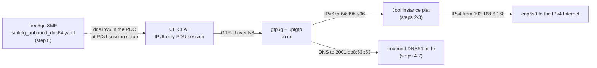

# HOWTO: enable the PLAT (NAT64 + DNS64) on a `cn` host — Jool on the UPF host itself, and the DNS64 address in the SMF config, not in `upfcfg.yaml`

| Field | Value |
|---|---|
| Date | 2026-10-14 |
| Repo | free5gc (the `cn` host runs this tree; most steps run on the `cn` host outside the tree) |
| Tree | `/home/loren/Downloads/source_code/free5gc_use_open5gs_ipv6/free5gc` |
| Branch | `my-changes-v4.0.1` (submodule `NFs/smf` on `my-smf-changes-v1.3.2`) |
| Commit | `37c302c` (submodule `NFs/smf` at `6385550`, submodule `NFs/upf` at `ddb2bb3`) |
| Symptom | **Not applicable.** No failure; this is a procedure doc. |
| Scope | Setting up Jool as the NAT64 (the PLAT) and unbound as the DNS64 server on the `cn` host, and handing the DNS64 address to UEs through the free5gc SMF. It does not cover the UE CLAT configuration, and it does not make the setup survive a reboot. How the pieces work is explained in the FINDING listed in §11. |
| Fix | **Not applicable.** Nothing is being fixed. |
| Rounds | **Not applicable.** No diagnose-and-fix cycle. |
| Status | **Runbook changed, not re-verified.** Every step ran on `cn` on 2026-10-13. Step 8 now uses the symbolic link from commit `37c302c`, which has not been run on `cn`; see §10. |
| Prior art | none |

**What gets built**, in one picture. The FINDING listed in §11 explains each box.



---

## SECTION 0. Prerequisites — what to have in place, or the runbook fails partway

| Prerequisite | What fails without it |
|---|---|
| The `cn` host runs Ubuntu 22.04. The run on 2026-10-13 used kernel `5.15.0-198-generic`. | The package names and the unbound include directory `/etc/unbound/unbound.conf.d/` are Ubuntu's. On another distribution, `apt` does not exist and unbound reads a different directory. |
| A root shell on `cn`. | Every command in §1 is written without `sudo`. |
| `apt` can reach the Ubuntu archive. | Steps 2 and 5 cannot install the packages. |
| `cn` reaches the IPv4 Internet. `ip route get 8.8.8.8` must print a route. | Jool has no egress interface, and unbound cannot forward queries to `8.8.8.8`. |
| The free5gc UPF runs on `cn`, with the `gtp5g` module and the `upfgtp` interface. | Jool on `cn` never sees UE packets. With the UPF on another host, use the separate-host route in §8. |
| The free5gc checkout on `cn` is at commit `37c302c` or later, so it holds `config/smfcfg_unbound_dns64.yaml` and `config/smfcfg_google_dns.yaml`. | Step 8 has no DNS64 version of the SMF config to link to. |
| The UE already reaches `cn` over an IPv6 PDU session. An IPv6-only PDU session needs the IPv4 N3 F-TEID `5.5.5.2`, which the SMF at `NFs/smf` commit `6385550` provides. | No IPv6 packet from the UE reaches `upfgtp`, so nothing reaches Jool or unbound. |

## SECTION 1. Runbook — the steps to complete the task, start to finish

All steps run on `cn` as root, except steps 9 and 10, which run on the UE.

**Step 0. Read-only checks.** These show the running kernel, the interface `cn` uses for IPv4 Internet
traffic, and the current forwarding settings.

```
uname -r
ip route get 8.8.8.8
sysctl net.ipv4.ip_forward net.ipv6.conf.all.forwarding
```

Note the `dev` and `src` in the `ip route get` output. Jool uses that `src` address as the shared IPv4
source.

**Step 1. Turn on forwarding.** Skip this step if Step 0 already printed `1` for both settings.

```
sysctl -w net.ipv4.ip_forward=1
sysctl -w net.ipv6.conf.all.forwarding=1
```

**Step 2. Install Jool.** This installs the kernel headers for the running kernel, the Jool module source
(built by DKMS), and the `jool` command.

```
apt install -y linux-headers-$(uname -r) jool-dkms jool-tools
dkms status | grep jool
```

`dkms status` must show `jool` as `installed` for the kernel that `uname -r` printed. If the build failed,
stop; see §5.

**Step 3. Load Jool and start the NAT64 instance.** This creates one stateful NAT64 instance named `plat`
for the prefix `64:ff9b::/96`. `jool instance add` prints nothing when it succeeds.

```
modprobe jool
jool instance add "plat" --netfilter --pool6 64:ff9b::/96
jool instance display
jool -i plat global display | grep -E "pool6|enabled"
jool -i plat pool4 display
```

**Step 4. Add the DNS64 address to `lo`.** `2001:db8:53::53` is outside every UE pool, and an address on
`lo` survives UPF restarts. §6 explains why a pool gateway address is not used.

```
ip -6 addr add 2001:db8:53::53/128 dev lo
```

**Step 5. Install unbound.** The install creates `/etc/unbound/unbound.conf.d/`. Do not run Step 6 before
the `ls` shows that directory; see §5.

```
apt install -y unbound
ls /etc/unbound/unbound.conf.d/
```

The `ls` should list at least `root-auto-trust-anchor-file.conf`.

**Step 6. Write the DNS64 configuration.** Each command writes one line of
`/etc/unbound/unbound.conf.d/dns64.conf`. The first command uses `tee` without `-a`, so it creates the
file; every later command appends.

```
echo 'server:' | tee /etc/unbound/unbound.conf.d/dns64.conf
echo '  interface: 2001:db8:53::53' | tee -a /etc/unbound/unbound.conf.d/dns64.conf
echo '  ip-freebind: yes' | tee -a /etc/unbound/unbound.conf.d/dns64.conf
echo '  access-control: 2001:db8::/32 allow' | tee -a /etc/unbound/unbound.conf.d/dns64.conf
echo '  module-config: "dns64 validator iterator"' | tee -a /etc/unbound/unbound.conf.d/dns64.conf
echo '  dns64-prefix: 64:ff9b::/96' | tee -a /etc/unbound/unbound.conf.d/dns64.conf
echo 'forward-zone:' | tee -a /etc/unbound/unbound.conf.d/dns64.conf
echo '  name: "."' | tee -a /etc/unbound/unbound.conf.d/dns64.conf
echo '  forward-addr: 8.8.8.8' | tee -a /etc/unbound/unbound.conf.d/dns64.conf
```

**Step 7. Check the configuration, restart unbound, and test DNS64 on `cn`.**

```
unbound-checkconf
systemctl restart unbound
dig AAAA ipv4only.arpa @2001:db8:53::53
```

**Step 8. Hand the DNS64 address to UEs through the SMF.** In the free5gc directory on `cn`, point
`config/smfcfg.yaml` at the DNS64 version of the SMF config, then check it. The link target is relative, so
the link keeps working if the free5gc directory is copied or moved.

```
ln -sfn smfcfg_unbound_dns64.yaml config/smfcfg.yaml
ls -l config/smfcfg.yaml
grep -c "ipv6: 2001:db8:53::53" config/smfcfg.yaml
grep -c "2001:4860:4860" config/smfcfg.yaml
```

The `ls -l` must show `config/smfcfg.yaml -> smfcfg_unbound_dns64.yaml`. The two counts must be `56` and
`0`. Do not edit `routerAdvertisements` in `config/upfcfg.yaml`; see §5.

Then restart free5gc the way this `cn` host normally starts it, so the SMF reads the new file.

**Step 9. On the UE, route the DNS64 address and the NAT64 prefix through the PDU session under test.**
This step is needed only when the UE's default IPv6 route points to a different `ccmni` interface; see
§5. On 2026-10-13 the session under test was on `ccmni2`:

```
ip -6 route add 2001:db8:53::53/128 via fe80::1 dev ccmni2 metric 100
ip -6 route add 64:ff9b::/96 via fe80::1 dev ccmni2 metric 100
```

**Step 10. On the UE, set up the PDU session again.** The SMF hands out `dns.ipv6` only when a session is
set up, so release the session under test and set it up again. A new session can take the interface down,
and the kernel then deletes routes through that interface, so check the Step 9 routes afterwards and add them again if
they are gone. Remove any CLAT prefix set by hand (the `ip6prefix` option), so the CLAT discovers the
prefix through DNS64.

## SECTION 2. Verify — how to confirm the result is a real success, not a false pass

**Check the NAT64 alone.** On `cn`, start two captures, each in its own terminal:

```
tcpdump -ni upfgtp ip6 and net 64:ff9b::/96
tcpdump -ni enp5s0 icmp and host 8.8.8.8
```

On the UE:

```
ping -6 -c 4 -I ccmni2 64:ff9b::808:808
```

Then on `cn`:

```
jool -i plat session display --icmp --numeric
```

The ping must get four replies, and the session table must list the UE address. Read the two captures
together:

| `upfgtp` capture | `enp5s0` capture | Meaning |
|---|---|---|
| request and reply | request and reply | The PLAT works, and the UE should get replies. |
| request only | nothing | Jool did not translate the packet. Check `dmesg | grep -i jool` on `cn`. |
| request only | request only | The translated packet left `cn`, but `8.8.8.8` did not reply. Check that the lab router `192.168.6.1` translates `192.168.6.168` to the Internet. |
| nothing | nothing | The UE did not send the packet to the core. Check the UE IPv6 route; see §5. |

**Check DNS64 from the UE.** Both commands must succeed without `-I`, because the CLAT has no `-I`:

```
ip -6 route get 2001:db8:53::53
nslookup -type=AAAA ipv4only.arpa 2001:db8:53::53
```

`ip -6 route get` must show the interface of the session under test. `nslookup` must return
`64:ff9b::c000:aa` and `64:ff9b::c000:ab`.

**Check the full 464XLAT path.** After Step 10, check that the UE received `2001:db8:53::53` as its DNS
server. On an Android-based modem, `getprop | grep -i dns` usually lists the DNS server for each `ccmni`
interface. Then run `ping 8.8.8.8` from the LAN client, and on `cn` run:

```
jool -i plat session display --numeric
```

It must list sessions from the UE address.

## SECTION 3. Limits — what the runbook cannot tell you, and what still needs a full test

- **The setup does not survive a reboot of `cn`.** After a reboot, Step 1 (unless the sysctl settings are
  persistent), `modprobe jool`, `jool instance add`, and the Step 4 `ip -6 addr add` must be run again.
  unbound survives, because it is a systemd service. Making the rest persistent has not been done.
- **The end-to-end CLAT result was reported, not captured.** On 2026-10-13 the user reported "It works."
  The CLAT's discovered prefix and a TCP or UDP Jool session were not captured.
- **Only one slice was tested.** The CLAT test used slice SST 1 / SD `0007d0`, DNN `fast.t-mobile.com`.
  The other 55 `dns.ipv6` entries received the same address but were not tested.
- **Dual-stack sessions change behaviour.** With DNS64, a dual-stack UE reaches IPv4-only hosts through
  Jool rather than over native IPv4. The effect on the `ims` and `sos` DNNs was not tested.
- **Step 8 with the symbolic link has not been run on `cn`.** On 2026-10-13 the DNS64 SMF config was
  pasted over `config/smfcfg.yaml` as a plain file. The content is byte-for-byte the same, but the link
  step itself is untested.

## SECTION 4. Revert — how to get back to a clean state, and what is left behind

These undo steps were stated in the source session:

```
jool instance remove "plat"
```

`jool instance remove "plat"` stops all translation in one command.

In the free5gc directory on `cn`, point the SMF back at Google DNS, then restart free5gc and set up the UE
PDU session again:

```
ln -sfn smfcfg_google_dns.yaml config/smfcfg.yaml
```

On the UE, remove the Step 9 routes:

```
ip -6 route del 2001:db8:53::53/128 dev ccmni2
ip -6 route del 64:ff9b::/96 dev ccmni2
```

**What is left behind:** the `jool` kernel module stays loaded, the packages stay installed, the address
`2001:db8:53::53/128` stays on `lo`, and unbound keeps running with
`/etc/unbound/unbound.conf.d/dns64.conf`. Removing the `lo` address, the unbound file and the packages is
**Not recorded.** The source session never ran or stated those steps.

## SECTION 5. Traps — the result may look correct but is wrong; check before you trust it

- **Editing `routerAdvertisements.default.dns` in `config/upfcfg.yaml` does nothing.** That list is never
  sent to the UE. The free5gc Router Advertisement carries no DNS option, and the UE gets its IPv6 DNS
  server only from `dns.ipv6` in the SMF config. The source session first said both places had to change,
  then corrected itself after reading the SMF code. The FINDING listed in §11 quotes that code.
- **`ping -I ccmni2` passes while DNS and the CLAT fail.** `-I` forces the interface. BusyBox `nslookup`
  and the CLAT follow the UE routing table instead. On 2026-10-13 the UE default IPv6 route pointed to
  `ccmni1`, which could not reach the core, so `nslookup` timed out while `ping -I ccmni2` worked:

  ```
  ~ #   ip -6 route get 2001:db8:53::53
  2001:db8:53::53 from :: via fe80::1 dev ccmni1 proto static src 2001:db8:131:1::2 metric 1024 pref medium
  ~ #   nslookup -type=AAAA ipv4only.arpa 2001:db8:53::53
  ;; connection timed out; no servers could be reached
  ```

  Step 9 is the workaround for the test. In the field, the CPE itself must send CLAT and DNS traffic
  through the PDN interface that carries the CLAT.
- **The `tee` lines in Step 6 fail when unbound is not installed.** `tee` creates a file but not its
  directory. On 2026-10-13 the Step 6 lines were run before Step 5 and printed
  `tee: /etc/unbound/unbound.conf.d/dns64.conf: No such file or directory` nine times. Nothing was
  written, so the lines can be run again after Step 5.
- **The DNS change goes into the slice the session really uses.** `dns.ipv6` is set per slice and DNN.
  The UE address `2001:db8:131:1::2` belongs to the `2001:db8:131::/48` pool, which is slice SST 1 / SD
  `0007d0`, not the SD `000001` slice named in the CPE team's request. Setting all 56 entries, as
  `config/smfcfg_unbound_dns64.yaml` does, avoids this trap.
- **A session that already exists keeps its old DNS server.** Restarting the SMF is not enough; Step 10
  sets the session up again.
- **A ping to a private IPv4 address through `64:ff9b::` fails.** Jool does not translate the
  Well-Known Prefix to private destinations such as `10.x` or `192.168.x` (RFC 6052). Test with
  `8.8.8.8`.
- **A ping from `cn` itself to `64:ff9b::808:808` tests nothing.** Jool `--netfilter` translates only
  packets that arrive from another device. Test from the UE.
- **`dkms status` decides whether Jool really built.** If the Ubuntu Jool package is too old for the
  running kernel, the build fails and `modprobe jool` fails. The newer Jool source from `jool.mx` would
  then be needed. On 2026-10-13, Jool `4.1.7` built for `5.15.0-198-generic` without problems.

## SECTION 6. Why not the normal method — the obvious route is slower, blocked, or silently wrong

The CPE team's request described the normal method: a separate NAT64 host, a route on the UPF that sends
`64:ff9b::/96` to it, and a DNS64 server whose address replaces `2001:4860:4860::8888` on the UE. Three
parts of that method are unnecessary or wrong on this lab's `cn`:

- **No separate host and no route are needed (cost).** The free5gc UPF and `gtp5g` already run on `cn`,
  and `cn` already has IPv4 toward the Internet. Jool on `cn` sees UE packets on `upfgtp` through its
  netfilter hook, so the separate host, the route to that host, and the return route all disappear.
- **The DNS64 address must not be a pool gateway (correctness).** The UE already reached
  `2001:db8:126::1`, so that address looked like a natural choice. It is the gateway of the `vzwadmin`
  pool, which the UPF puts on `upfgtp` and deletes every time the UPF stops. `2001:db8:53::53` on `lo`
  does not depend on the UPF.
- **Google's DNS servers cannot be used (correctness).** `cn` has no IPv6 route to the Internet, so
  neither `2001:4860:4860::8888` nor Google's public DNS64 `2001:4860:4860::6464` can be reached. unbound
  forwards to `8.8.8.8` over IPv4 instead.

Two smaller choices in the unbound configuration:

- `module-config: "dns64 validator iterator"` keeps DNSSEC validation on. The `dns64` module must come
  before `validator`, because a made-up AAAA record carries no signature. `"dns64 iterator"` also works,
  but without validation.
- `interface: 2001:db8:53::53` keeps unbound off `127.0.0.53`, where `systemd-resolved` listens, so the two
  do not clash. If `apt install unbound` fails because port 53 is busy, another DNS server such as
  `dnsmasq` or `bind9` holds the port; `ss -lunp | grep :53` shows which program.

## SECTION 7. The reusable rules — what to carry from this runbook to similar tasks

- The NAT64 prefix must be the same in three places: Jool `--pool6`, unbound `dns64-prefix`, and the UE
  CLAT prefix when it is set by hand. A mismatch sends packets to a prefix that nothing translates.
- A service that UEs must reach goes on an address on `lo`, outside every UE pool, never on an address
  the UPF creates on `upfgtp`.
- A DNS server for free5gc UEs is set in `dns.ipv6` of the SMF config, and takes effect only for PDU
  sessions set up after the SMF restart.
- Test every UE-side path without `-I`. Only a test that follows the UE routing table shows what the CLAT
  will do.

## SECTION 8. Variant routes — when to use an alternate route instead of the runbook, and how

**A separate NAT64 host.** Use this when Jool cannot run on `cn`, or when the UPF runs on another host.
Run Steps 2 and 3 on the NAT64 host. On `cn`, route the prefix to it:

```
ip -6 route add 64:ff9b::/96 via <NAT64-host-IPv6>
```

The NAT64 host also needs a route that sends each UE pool, for example `2001:db8:121::/48`, back to `cn`.
This variant was described in the source session but never run.

**A fixed CLAT prefix, without DNS64.** Use this to test only the data path. Run Steps 0 to 3, then set the
UE CLAT prefix by hand to `64:ff9b::/96` (the `ip6prefix` option) and run `ping 8.8.8.8` from the UE or
the LAN client. DNS still works, because the CLAT carries IPv4 DNS queries to `8.8.8.8` through Jool.
Whether this variant was run on 2026-10-13 is **Not recorded.**

**Switching the SMF between the two DNS versions.** Instead of the symbolic link, the SMF can be started
with `-c ./config/smfcfg_google_dns.yaml` or `-c ./config/smfcfg_unbound_dns64.yaml`, because free5gc NFs
take their config path from the `-c` option. This variant was described in the source session but never
run.

## SECTION 9. Worked example — a real run, and the exact output that run printed, to compare against

The run took place on 2026-10-13 on the `cn` host (Ubuntu 22.04). The UE was the WNC T930 CPE, with the
PDU session under test on `ccmni2`, slice SST 1 / SD `0007d0`, DNN `fast.t-mobile.com`, and UE address
`2001:db8:131:1::2`. The transcript wrapped long lines at the terminal width; the outputs below rejoin each
wrapped line at its wrap point. The packet captures, the Jool session table and both DNS64 answers are in
§2 of the FINDING listed in §11 and are not repeated here.

**Step 0** (forwarding was already on, so Step 1 was skipped):

```
5.15.0-198-generic
8.8.8.8 via 192.168.6.1 dev enp5s0 src 192.168.6.168 uid 0
    cache
net.ipv4.ip_forward = 1
net.ipv6.conf.all.forwarding = 1
```

**Step 2 and the start of Step 3:**

```
[root@75N0-01N0SA-sled2-CN free5gc]#   dkms status | grep jool
jool-dkms/4.1.7, 5.15.0-198-generic, x86_64: installed
[root@75N0-01N0SA-sled2-CN free5gc]#   modprobe jool
[root@75N0-01N0SA-sled2-CN free5gc]#
```

**Step 3:**

```
[root@75N0-01N0SA-sled2-CN free5gc]#   jool instance add "plat" --netfilter --pool6 64:ff9b::/96
[root@75N0-01N0SA-sled2-CN free5gc]#   jool instance display
+--------------------+-----------------+-----------+
|          Namespace |            Name | Framework |
+--------------------+-----------------+-----------+
|           b482ac00 |            plat | netfilter |
+--------------------+-----------------+-----------+
[root@75N0-01N0SA-sled2-CN free5gc]#   jool -i plat global display | grep -E "pool6|enabled"
  manually-enabled: true
  pool6: 64:ff9b::/96
  ss-enabled: false
[root@75N0-01N0SA-sled2-CN free5gc]#   jool -i plat pool4 display
+------------+-------+--------------------+-----------------+-------------+
|       Mark | Proto |     Max iterations |         Address |       Ports |
+------------+-------+--------------------+-----------------+-------------+
+------------+-------+--------------------+-----------------+-------------+
```

`ss-enabled: false` refers to Jool's session synchronization, which copies NAT64 sessions between two
Jool hosts for failover. One NAT64 host does not need it. The empty pool4 table is expected: Jool then uses
`192.168.6.168` on `enp5s0`, with ports `61001`–`65535`.

**Steps 5 to 7:**

```
[root@75N0-01N0SA-sled2-CN free5gc]#   ls /etc/unbound/unbound.conf.d/
root-auto-trust-anchor-file.conf
```

The nine Step 6 commands echoed the file's lines:

```
server:
  interface: 2001:db8:53::53
  ip-freebind: yes
  access-control: 2001:db8::/32 allow
  module-config: "dns64 validator iterator"
  dns64-prefix: 64:ff9b::/96
forward-zone:
  name: "."
  forward-addr: 8.8.8.8
```

```
[root@75N0-01N0SA-sled2-CN free5gc]#   unbound-checkconf
unbound-checkconf: no errors in /etc/unbound/unbound.conf
[root@75N0-01N0SA-sled2-CN free5gc]#   systemctl restart unbound
```

**The UE reaches the DNS64 address through `ccmni2`:**

```
~ #   ping -6 -c 4 -I ccmni2 2001:db8:53::53
PING 2001:db8:53::53(2001:db8:53::53) from 2001:db8:131:1::2 ccmni2: 56 data bytes
64 bytes from 2001:db8:53::53: icmp_seq=1 ttl=64 time=8.54 ms
64 bytes from 2001:db8:53::53: icmp_seq=2 ttl=64 time=9.21 ms
64 bytes from 2001:db8:53::53: icmp_seq=3 ttl=64 time=10.2 ms
64 bytes from 2001:db8:53::53: icmp_seq=4 ttl=64 time=9.52 ms

--- 2001:db8:53::53 ping statistics ---
4 packets transmitted, 4 received, 0% packet loss, time 3004ms
rtt min/avg/max/mdev = 8.538/9.366/10.193/0.595 ms
```

**Step 9, after the two routes were added:**

```
~ #   ip -6 route get 2001:db8:53::53
2001:db8:53::53 from :: via fe80::1 dev ccmni2 src 2001:db8:131:1::2 metric 100 pref medium
~ #   ip -6 route get 64:ff9b::808:808
64:ff9b::808:808 from :: via fe80::1 dev ccmni2 src 2001:db8:131:1::2 metric 100 pref medium
```

**Step 8, as run on 2026-10-13.** The SMF config was edited in the local tree with the command below. The
`grep` counts run after it printed `56` new lines and `0` old lines, and a `diff` against the original
showed exactly 56 changed lines:

```
sed -i 's/ipv6: 2001:4860:4860::8888/ipv6: 2001:db8:53::53/' config/smfcfg.yaml
```

The edited file was then pasted onto `cn`, free5gc was restarted, and the PDU session was set up again.
The user reported the end-to-end CLAT test with "It works."

## SECTION 10. Revisions — update history, and which doc or finding forced each change

```
2026-10-14 — first written, from the session that set up the PLAT on cn on 2026-10-13
  (`claude_session_transcript/2026-10-14-003857-enable-plat-on-cn.txt`).
  Step 8 replaces the 2026-10-13 method (sed on smfcfg.yaml, then paste onto cn) with the
  symbolic link to config/smfcfg_unbound_dns64.yaml from commit 37c302c.
  The example DNS64 address 2001:db8:ffff::53 from the start of the source session was
  dropped; 2001:db8:53::53 replaced it.
  Executable: yes. Step 8 has not been re-run on cn, so Status is "Runbook changed, not re-verified".
```

## SECTION 11. Related — other docs connected to this doc

- `2026-10-14_wnc_FINDING_plat_464xlat_on_cn_NAMELY_jool_translates_64_ff9b_96_to_ipv4_VS_unbound_dns64_answers_64_ff9b_addr_for_ipv4_only_names.md`
  — explains what this runbook builds: what Jool and unbound are, how `64:ff9b::/96` maps to IPv4, how the
  two programs relate, and where the UE gets its DNS server. It also holds the packet captures from the
  2026-10-13 run.
- `2026-10-15_wnc_ISSUE_du_cannot_register_on_cu_F1SetupFailure_DUE_TO_unattended_upgrade_restarted_systemd_networkd_detaching_br_ng_ports_on_CN.md`
  — the DU failed to register right after this runbook was automated in `run_free5gc`. The PLAT was
  suspected and ruled out there; the cause was an automatic `systemd` upgrade that detached the ports of
  `br-ng`.
