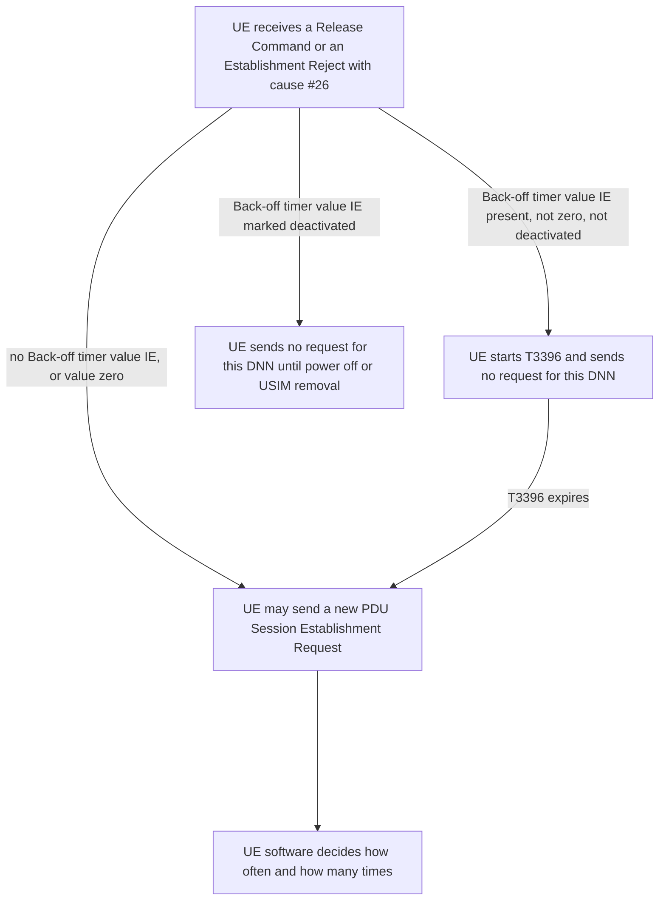
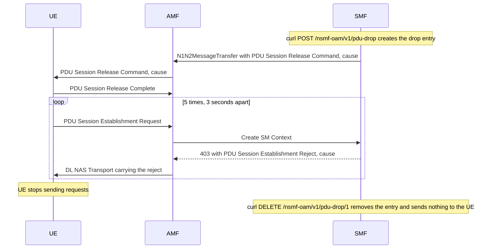

# FINDING: UE PDU session retry — after a release and rejects, the UE stops retrying, and 3GPP TS 24.501 allows it

| Field | Value |
|---|---|
| Date | 2026-10-22 |
| Repo | free5gc (parent repo, with the `NFs/smf` and `NFs/amf` submodules). The UE side was observed on the test UE `imsi-310260000013069`; **Not recorded:** the UE model and modem firmware version were not written down. |
| Tree | `/home/loren/Downloads/source_code/free5gc_use_open5gs_ipv6/free5gc` |
| Branch | `my-changes-v4.0.1` (parent), `my-smf-changes-v1.3.2` (`NFs/smf`), `My-amf-changes-v1.3.2` (`NFs/amf`) |
| Commit | `9c14fec` (parent), `1400d82` (`NFs/smf`), `a3caee8` (`NFs/amf`) |
| Symptom | **Not applicable.** Nothing in the core network failed; this records how the UE retries a dropped PDU session. |
| Scope | How the test UE retries a PDU session after the SMF pdu-drop API releases it and keeps rejecting it, and which TS 24.501 rules govern that. It does not cover the blackhole or silent drop modes, which are not built yet, and it does not cover where in the UE software the retry policy lives. |
| Fix | **Not applicable.** Nothing is being fixed. |
| Rounds | **Not applicable.** No diagnose-and-fix cycle. |
| Status | **Changed, not re-confirmed.** The tester ran plan Task 7 steps 7 and 9 on the cn testbed with AMF commit `a3caee8` and saw the retry behavior in §1; the exact date of that run was not recorded, and it was reported on 2026-10-22. The back-off scope material added to §1 and §3 later on 2026-10-22 comes from the TS 24.501 text, and its §3 checks 5 and 6 have not been run on the UE. |
| Prior art | `2026-10-21_wnc_SPEC_manual_pdu_session_drop_on_smf_VIA_oam_api_FOR_graceful_release_blackhole_and_silent_delete.md` |

---

## SECTION 0. The summary — what the topic is, in plain words, before any detail

When the SMF releases a PDU session and then rejects every new request for it, the test UE retries only a few times and then stops. With no back-off timer, the UE sends 5 requests 3 seconds apart. With a 60-second back-off timer, the UE sends 3 requests, each 60 seconds apart. After that, a person has to trigger the UE before it asks for the PDU session again.

This behavior complies with 3GPP. TS 24.501 says when the UE **must not** send a PDU Session Establishment Request, for example while timer T3396 runs. TS 24.501 does not say how often the UE retries, how many times, or that the UE must ever set the session up again. The retry count and the retry interval are choices made by the UE software.

Restoring the session in the SMF sends nothing to the UE. A UE that has stopped retrying therefore stays without that PDU session until something on the UE side starts a new request.

## SECTION 1. How it works — the mechanism, in enough detail to reason about the topic

### The three retry patterns

| Case | What the network sent | Interval between the UE's requests | Requests before the UE stops | What the UE did next | TS 24.501 rule that applies | Complies |
|---|---|---|---|---|---|---|
| Plan Task 7 step 7, after the AMF fix: release without back-off | A PDU Session Release Command with 5GSM cause #36 "regular deactivation" and no Back-off timer value IE. Each new request then got a PDU Session Establishment Reject with cause #26 "insufficient resources" and no Back-off timer value IE. | 3 seconds | 5 | The UE sent no more requests. The session came back only after a manual trigger on the UE. | 6.3.3.3 gives no rule for cause #36. 6.4.1.4.2 says that after a #26 reject without the IE, the UE "may send" another request. | Yes. "May send" allows retrying and also allows stopping. |
| Plan Task 7 step 9: release with a 60-second back-off | A PDU Session Release Command with cause #26 and a Back-off timer value IE of 60 seconds. Each new request then got a reject with cause #26 and the same 60-second back-off, because the SMF puts the drop entry's back-off into the reject too (see the citation below). | 60 seconds | 3 | The UE sent no more requests. The session came back only after a manual trigger on the UE. | 6.3.3.3 says the UE starts T3396 with the received value, and sends no request for that DNN until T3396 expires. | Yes. The UE waited for T3396 every time, which is the only rule TS 24.501 enforces here. |
| test9, before the AMF fix: the network never answered | The SMF built the reject, but the AMF dropped it, so the UE received nothing. | 16 seconds | 5 for each PDU session ID | The UE gave up on the PDU session ID and started again with a new one: 7, then 9, 11 and 13. Whether it ever stopped was not recorded. | 6.4.1.6: on each expiry of T3580, the UE resends the request "up to four times", and "on the fifth expiry of timer T3580, the UE shall abort the procedure". | Yes. 5 sends per PDU session ID is exactly 1 send plus 4 retransmissions. |

The third row is a different mechanism from the other two. T3580 is the timer the UE runs while it **waits for an answer**. In the first two rows, the UE got an answer every time, so T3580 never expired, and the retry pattern came from the UE software instead.

### What TS 24.501 requires, and what it leaves to the UE

| TS 24.501 clause | What it says | What it leaves open |
|---|---|---|
| [6.3.3.3](https://whatthespec.net/sos/spec/ts-24501/6.3.3.3), UE receives a PDU Session Release Command | The UE considers the PDU session released and answers with PDU Session Release Complete. For cause #26 with a Back-off timer value IE that is neither zero nor deactivated, the UE "shall then start timer T3396 with the value provided in the Back-off timer value IE", and sends no establishment request for that DNN until T3396 expires. For cause #39 "reactivation requested", the UE "should re-initiate the UE-requested PDU session establishment procedure". | Every cause except #39, including #36 and #26, carries no instruction to set the session up again. |
| [6.4.1.4.2](https://whatthespec.net/sos/spec/ts-24501/6.4.1.4.2), UE receives a reject with cause #26 | With the Back-off timer value IE, the UE starts T3396 with that value. Without it, "the UE may send another PDU SESSION ESTABLISHMENT REQUEST message or PDU SESSION MODIFICATION REQUEST message for the same DNN". | How many times, and how soon, the UE sends another request. |
| [6.2.12](https://whatthespec.net/sos/spec/ts-24501/6.2.12), network rejection not due to congestion control | When the network sends no back-off timer with cause #29, #31 or #38, "the UE may use a local back-off timer that has exponential value or a default value", provisioned "using implementation specific means". | This clause does not apply to cause #26, so it does not explain the 3-second interval in step 7. |
| [6.4.1.6](https://whatthespec.net/sos/spec/ts-24501/6.4.1.6), T3580 expires | The UE resends the request; "This retransmission can be repeated up to four times." On the fifth expiry the UE aborts the procedure and releases the PTI. | Whether the UE starts a new procedure afterwards. |

### Which slices and DNNs a back-off blocks

A back-off timer blocks more than the PDU session that received it. The 5GSM cause decides which timer starts, and each timer belongs to a different key. Clauses 6.4.1.4.2 (reject) and 6.3.3.3 (Release Command) use the same three timers:

| 5GSM cause | Timer the UE starts | What the timer belongs to | What the UE must not send while the timer runs |
|---|---|---|---|
| #26 "insufficient resources" | T3396 | The DNN alone: the UE "shall stop timer T3396 associated with the corresponding DNN, if it is running". | Any establishment or modification request "for the same DNN that was sent by the UE", on any slice. |
| #67 "insufficient resources for specific slice and DNN" | T3584 | The slice and DNN together: "the [S-NSSAI of the PDU session, DNN] combination". | A request for that one slice and DNN pair. |
| #69 "insufficient resources for specific slice" | T3585 | The slice alone: "the S-NSSAI of the PDU session". | A request for that slice, with any DNN. |

For each timer, the UE first stops a running timer with the same key, and then starts it again: "The UE shall then start timer T3396 with the value provided in the Back-off timer value IE". A second cause #26 with a back-off therefore replaces the running T3396 for that DNN; the UE never runs two T3396 timers for one DNN. The timers block only new requests. A PDU session that already exists stays up while the timer runs.

The test UE holds its three PDU sessions on three slices of **one** DNN (§2 shows the log lines):

| PDU session ID | Slice (S-NSSAI) | DNN |
|---|---|---|
| 1 | sst 1, sd `000001` | `fast.t-mobile.com` |
| 3 | sst 1, sd `0007d0` | `fast.t-mobile.com` |
| 5, the session dropped in steps 7 and 9 | sst 1, sd `000bb8` | `fast.t-mobile.com` |

So in plan Task 7 step 9, cause #26 with a 60-second back-off on session 5 started T3396 for `fast.t-mobile.com`, which covers all three sessions. Sessions 1 and 3 stayed up. If either one had dropped while T3396 ran, TS 24.501 would have forbidden the UE from requesting it again until T3396 expired.

A pdu-drop entry selects a slice and a DNN, plus an optional SUPI, so the SMF rejects only that slice and DNN pair. Cause #26 tells the UE that the whole DNN is blocked, which is wider than what the SMF blocks. Cause #67 tells the UE exactly the pair that the SMF blocks. The difference matters only when `backoffSeconds` is above 0, because without a Back-off timer value IE no timer starts. The API takes `releaseCause` and `rejectCause` as any value from 0 to 255, and the SMF adds the same Back-off timer value IE for every cause, so a #67 test needs no code change.

### The UE's decision on each Release Command or reject with cause #26



Only the arrows out of the first box are 3GPP rules. The last box is where the test UE chose 5 tries at 3-second intervals, or 3 tries at 60-second intervals.

### The message order in plan Task 7 step 7



The last note is why a UE that has stopped stays down: the restore changes only the SMF's state, and no message tells the UE to try again.

### What the pdu-drop API sends

One `POST /nsmf-oam/v1/pdu-drop` request controls two messages. The Release Command goes once to each matching PDU session when the entry is created, and the reject goes to every new request while the entry exists:

| Message | Request field for the cause | Default cause | Causes the API accepts | Back-off timer value IE |
|---|---|---|---|---|
| PDU Session Release Command | `releaseCause` | #36 "regular deactivation" | any value from 0 to 255, for example #26, #36, #67 or #69 | Included when `backoffSeconds` is above 0. |
| PDU Session Establishment Reject | `rejectCause` | #26 "insufficient resources" | any value from 0 to 255, for example #26, #36, #67 or #69 | Included when `backoffSeconds` is above 0, always with the same value as the Release Command. |

The two messages share one `backoffSeconds` field. The API therefore cannot send a Release Command without a back-off and rejects with one, or two different back-off values. Separate fields were offered on 2026-10-22, and the decision was to keep one field for now.

The API sends any cause in either message, including causes that TS 24.501 defines for only one of them. Cause #36 "regular deactivation" is a release cause, and the TS 24.501 clauses read for this doc give no UE rule for a PDU Session Establishment Reject that carries #36. How the test UE handles a #36 reject was not checked.

A PDU Session Release Command can carry a Back-off timer value IE. TS 24.501 6.3.3.3, which covers the UE receiving a **Release Command**, says that for cause #26 the UE "shall then start timer T3396 with the value provided in the Back-off timer value IE"; the same clause gives the T3584 rule for #67 and the T3585 rule for #69. In plan Task 7 step 9, the UE received a Release Command with cause #26 and a 60-second back-off (§2). Graceful mode passes the drop entry's back-off into the Release Command. `NFs/smf/internal/sbi/processor/pdu_drop.go:175-176`:

```go
	needToSendNotify, removeContext := m.p.requestAMFToReleasePDUResources(
		smContext, entry.ReleaseCause, entry.Backoff)
```

`requestAMFToReleasePDUResources` then builds the Release Command with that cause and back-off. `NFs/smf/internal/sbi/processor/association.go:259`:

```go
	if buf, err := smf_context.BuildGSMPDUSessionReleaseCommandWithBackoff(smContext, cause, false, backoff); err != nil {
```

### Where the core network code sends the reject

The SMF answers a new request that matches a drop entry with the entry's reject cause and the entry's back-off. `NFs/smf/internal/sbi/processor/pdu_session.go:161-165`:

```go
	if entry := p.pduDropRejectEntry(smContext); entry != nil {
		smContext.Log.Infof("#WNC PDU-DROP/REJECT rejecting supi=%s dnn=%s dropId=%s cause=%d backoff=%ds",
			smContext.Supi, smContext.Dnn, entry.DropId, entry.RejectCause, entry.EncodedBackoffSeconds)
		p.makeEstRejectResAndReleaseSMContextWithBackoff(c, smContext,
			entry.RejectCause, entry.Backoff, &smf_errors.N1SmError)
```

The AMF forwards that reject to the UE before it looks at the HTTP error. Before commit `a3caee8`, the AMF dropped the reject, which produced the third row of the table. `NFs/amf/internal/gmm/handler.go:311-315`:

```go
		if n1Reject := smfRejectN1Message(errResponse); n1Reject != nil {
			ue.GmmLog.Warnf("#WNC PDU-DROP/REJECT PDU Session Establishment Request is rejected by SMF"+
				"[pduSessionId:%d], forwarding the reject to the UE", pduSessionID)
			gmm_message.SendDLNASTransport(ue.RanUe[anType], nasMessage.PayloadContainerTypeN1SMInfo,
				n1Reject, pduSessionID, 0, nil, 0)
```

The API checks only that a cause fits in one octet, so causes #26, #67 and #69 are all accepted. `NFs/smf/internal/sbi/processor/pdu_drop.go:119-127`:

```go
func pduDropCause(value *int, def uint8, name string) (uint8, string) {
	if value == nil {
		return def, ""
	}
	if *value < 0 || *value > 255 {
		return 0, name + " must be 0-255"
	}
	return uint8(*value), ""
}
```

## SECTION 2. Evidence — how the mechanism was established: which tree was read, and what was seen on a unit

**Provenance.** The core network code was read in the tree named in the metadata table, on 2026-10-22, at parent commit `9c14fec`, `NFs/smf` commit `1400d82` and `NFs/amf` commit `a3caee8`. The TS 24.501 text was read on 2026-10-22 from whatthespec.net clauses 6.2.12, 6.3.3.3 and 6.4.1.6, and from search-result text for clause 6.4.1.4.2; the 3GPP release those pages show was not recorded.

**Seen, rows 1 and 2 of the table.** These counts come from the tester's report of what the MTK NLT tool showed on the UE. No trace from that tool was saved with this doc. The tester's words, unedited:

> For example in step 7, after UE receive NW's PDU release command with cause #36 without backoff timer, UE will retry (send pdu session request) for 5 times, each time the interval is 3 seconds. After got reject fro 5 times, UE won't re-try anymore. I have to manually trigger UE to send pdu session request to recover.

> Another example in step 9, after UE receive NW's PDU session release command with cause #26 with backoff timer 60 secs, UE will retry after 60 seconds for 3 times, then UE will stop retry anymore, I have to manually trigger UE to send pdu session request to recover.

**Seen, row 3 of the table.** The run before the AMF fix, from `my_logs/test9-manually-release-pdu-session-complete-but-not-sending-pdu-reject-within-timer/free5gc/log/20261021_175404/free5gc.log` in the parent repo tree. The SMF sends the Release Command, builds the reject for each request, and the AMF drops the reject:

```
time="2026-10-21T18:04:29.105526219+08:00" level="info" msg="#WNC PDU-DROP/GRACEFUL-RELEASE dropId=1 release command sent, cause=36" CAT="PduSess" NF="SMF" pdu_session_id="5" supi="imsi-310260000013069"
time="2026-10-21T18:04:29.849895966+08:00" level="info" msg="#WNC PDU-DROP/REJECT rejecting supi=imsi-310260000013069 dnn=fast.t-mobile.com dropId=1 cause=26 backoff=0s" CAT="PduSess" NF="SMF" pdu_session_id="7" supi="imsi-310260000013069"
time="2026-10-21T18:04:29.849948824+08:00" level="warning" msg="NAS Error Response: {0xc0004b16b0 [46 7 4 195 26] []}" CAT="SBI" NF="SMF"
time="2026-10-21T18:04:29.862796353+08:00" level="error" msg="CreateSmContextRequest Error: 403, Forbidden" CAT="Gmm" NF="AMF" amf_ue_ngap_id="RU:65537,AU:1(3GPP)" supi="SUPI:imsi-310260000013069"
```

The UE's requests for PDU session ID 7 arrive 16 seconds apart, five in all, and the sixth request uses PDU session ID 9:

```
time="2026-10-21T18:04:29.849895966+08:00" level="info" msg="#WNC PDU-DROP/REJECT rejecting supi=imsi-310260000013069 dnn=fast.t-mobile.com dropId=1 cause=26 backoff=0s" CAT="PduSess" NF="SMF" pdu_session_id="7" supi="imsi-310260000013069"
time="2026-10-21T18:04:45.866741402+08:00" level="info" msg="#WNC PDU-DROP/REJECT rejecting supi=imsi-310260000013069 dnn=fast.t-mobile.com dropId=1 cause=26 backoff=0s" CAT="PduSess" NF="SMF" pdu_session_id="7" supi="imsi-310260000013069"
time="2026-10-21T18:05:01.881415553+08:00" level="info" msg="#WNC PDU-DROP/REJECT rejecting supi=imsi-310260000013069 dnn=fast.t-mobile.com dropId=1 cause=26 backoff=0s" CAT="PduSess" NF="SMF" pdu_session_id="7" supi="imsi-310260000013069"
time="2026-10-21T18:05:17.896295907+08:00" level="info" msg="#WNC PDU-DROP/REJECT rejecting supi=imsi-310260000013069 dnn=fast.t-mobile.com dropId=1 cause=26 backoff=0s" CAT="PduSess" NF="SMF" pdu_session_id="7" supi="imsi-310260000013069"
time="2026-10-21T18:05:33.910378887+08:00" level="info" msg="#WNC PDU-DROP/REJECT rejecting supi=imsi-310260000013069 dnn=fast.t-mobile.com dropId=1 cause=26 backoff=0s" CAT="PduSess" NF="SMF" pdu_session_id="7" supi="imsi-310260000013069"
time="2026-10-21T18:05:49.998475673+08:00" level="info" msg="#WNC PDU-DROP/REJECT rejecting supi=imsi-310260000013069 dnn=fast.t-mobile.com dropId=1 cause=26 backoff=0s" CAT="PduSess" NF="SMF" pdu_session_id="9" supi="imsi-310260000013069"
```

The same pattern repeats for PDU session IDs 9, 11 and 13 until the log ends at 18:09:02.

**Added later on 2026-10-22, for the back-off scope material in §1.** Clauses 6.4.1.4.2 and 6.3.3.3 were read again from whatthespec.net, this time from the 6.4.1.4.2 page itself, for the rules on causes #26, #67 and #69. The slice and DNN of each of the UE's three PDU sessions come from the same test9 log:

```
time="2026-10-21T17:57:28.918810627+08:00" level="debug" msg="S-NSSAI[sst: 1, sd: 000001] DNN[fast.t-mobile.com]" CAT="PduSess" NF="SMF" pdu_session_id="1" supi="imsi-310260000013069"
time="2026-10-21T17:57:48.753341788+08:00" level="debug" msg="S-NSSAI[sst: 1, sd: 0007d0] DNN[fast.t-mobile.com]" CAT="PduSess" NF="SMF" pdu_session_id="3" supi="imsi-310260000013069"
time="2026-10-21T17:57:50.872000411+08:00" level="debug" msg="S-NSSAI[sst: 1, sd: 000bb8] DNN[fast.t-mobile.com]" CAT="PduSess" NF="SMF" pdu_session_id="5" supi="imsi-310260000013069"
```

## SECTION 3. Check it yourself — what to run on your own unit today, and what the commands should print

Run these on the cn host, where the SMF listens on `127.0.0.2:8000`. Watch the UE in the MTK NLT tool, and the core network in the free5gc log. Replace the SUPI, DNN and slice with your UE's values.

1. Drop one PDU session without a back-off timer:

   ```
   curl -s -i -X POST http://127.0.0.2:8000/nsmf-oam/v1/pdu-drop -H 'Content-Type: application/json' -d '{"mode":"graceful","dnn":"fast.t-mobile.com","snssai":{"sst":1,"sd":"000bb8"},"supi":"imsi-310260000013069"}'
   ```

   The answer is `HTTP/1.1 201 Created` with a `Location: /nsmf-oam/v1/pdu-drop/<dropId>` header. The UE should receive a Release Command with cause #36, then send 5 requests about 3 seconds apart, each answered with a reject carrying cause #26. For each request, the free5gc log should show the SMF line `#WNC PDU-DROP/REJECT rejecting ...` followed by the AMF line `#WNC PDU-DROP/REJECT PDU Session Establishment Request is rejected by SMF[pduSessionId:<id>], forwarding the reject to the UE`.

2. Restore the session **before** the UE runs out of requests. Send this within the first few seconds after step 1, while the UE is still retrying:

   ```
   curl -s -i -X DELETE http://127.0.0.2:8000/nsmf-oam/v1/pdu-drop/<dropId>
   ```

   The answer is `HTTP/1.1 204 No Content`. The UE's next request should be accepted, and the UE interface should get its WAN IP address back without a manual trigger.

3. Repeat step 1, wait until the UE has stopped sending requests, and then run the `DELETE` from step 2. The UE should stay without that PDU session, and the free5gc log should show no new request, until a person triggers the UE.

4. Drop the session with a 60-second back-off timer:

   ```
   curl -s -X POST http://127.0.0.2:8000/nsmf-oam/v1/pdu-drop -H 'Content-Type: application/json' -d '{"mode":"graceful","dnn":"fast.t-mobile.com","snssai":{"sst":1,"sd":"000bb8"},"supi":"imsi-310260000013069","releaseCause":26,"backoffSeconds":60}'
   ```

   The answer contains `"encodedBackoffSeconds":60`. The UE should send its first request no sooner than 60 seconds after the Release Command, then 3 requests in all, 60 seconds apart. Each `#WNC PDU-DROP/REJECT rejecting ...` line in the log should end its message with `backoff=60s`. Restore with the `DELETE` from step 2.

5. Check that cause #26 blocks the whole DNN. Drop session 5 (sd `000bb8`) with cause #26 and a 120-second back-off:

   ```
   curl -s -X POST http://127.0.0.2:8000/nsmf-oam/v1/pdu-drop -H 'Content-Type: application/json' -d '{"mode":"graceful","dnn":"fast.t-mobile.com","snssai":{"sst":1,"sd":"000bb8"},"supi":"imsi-310260000013069","releaseCause":26,"rejectCause":26,"backoffSeconds":120}'
   ```

   Within those 120 seconds, release session 1 (sd `000001`) from the UE side, and then trigger the UE to set it up again. No drop entry covers sd `000001`, so the SMF would accept it. TS 24.501 still forbids the UE from sending the request until T3396 for `fast.t-mobile.com` expires. The free5gc log should show no `S-NSSAI[sst: 1, sd: 000001] DNN[fast.t-mobile.com]` line until about 120 seconds after the Release Command. Restore with the `DELETE` from step 2.

6. Check that cause #67 blocks only the slice and DNN pair. Repeat step 5 with `"releaseCause":67,"rejectCause":67`. This time the UE may request session 1 at once, and the free5gc log should show the `S-NSSAI[sst: 1, sd: 000001] DNN[fast.t-mobile.com]` line within a few seconds of the trigger. The requests for sd `000bb8` should still wait for T3584, 120 seconds. In the MTK NLT tool, the UE should report T3584 rather than T3396; if the UE reports neither, it may not support cause #67.

## SECTION 4. Effect on your plan — does what you were about to do still work?

The plan is to test whether the UE recovers by itself after a temporary operator-side outage on one PDU session. The core network side of that test works. The pdu-drop API releases the session, the SMF rejects new requests, the AMF delivers the rejects, and `DELETE` makes the SMF accept the next request.

The UE side does not recover by itself if the outage lasts longer than the UE's retries: about 15 seconds without a back-off (5 requests, 3 seconds apart), or about 3 minutes with a 60-second back-off (3 requests, 60 seconds apart). A recovery test that restores the session after that point will show the UE staying down. That result describes the UE's retry policy, not a core network defect and not a 3GPP violation.

## SECTION 5. Alternatives — other ways to reach the same goal, when the planned route is ruled out

| Alternative | When it applies |
|---|---|
| Restore the session while the UE is still retrying, as in §3 step 2. | The goal is to show that the UE reconnects once the network is back, and the outage in the test can be kept shorter than the UE's retry window. |
| Change the UE's retry policy so that it keeps retrying, for example with a growing interval, or retries on events such as a cell change. | The product must recover by itself from outages longer than the current retry window. This is a change for the UE team, not for the core network. |
| Send the Release Command with cause #39 "reactivation requested" by setting `"releaseCause":39` in the `POST`. TS 24.501 6.3.3.3 says the UE "should re-initiate" the session after a #39 release. | The goal is to check that the UE follows the one release cause that asks it to reconnect. While the drop entry exists, the reconnect attempts are still rejected with the reject cause, so the retry limit in §1 still applies. |
| Trigger the UE by hand after the restore. | The test only needs the session back, and does not measure automatic recovery. |

## SECTION 6. The reusable rules — what to carry from this finding to similar situations

- TS 24.501 limits when a UE may send a PDU Session Establishment Request, through timers such as T3396 and T3580. It does not set how often or how many times the UE retries after a release or a reject, except for the T3580 limit of 5 sends when no answer arrives. A UE that stops retrying is therefore not a 3GPP violation, and the retry count has to be found in the UE software.
- A restore that changes only core network state sends no message to the UE. Recovery after such a restore depends entirely on the UE sending a new request.
- When the network sends a back-off timer, choose the 5GSM cause whose timer blocks the same scope that the network blocks. Cause #26 starts T3396 for the whole DNN, cause #67 starts T3584 for one slice and DNN pair, and cause #69 starts T3585 for one slice. A cause with a wider scope makes the UE block itself on PDU sessions that the network never refused.
- When the interval between a UE's repeated requests equals a NAS timer that runs while the UE waits for an answer, such as 16 seconds for T3580, suspect that no answer reached the UE. Check the network side before you blame the UE's retry policy.

## SECTION 7. Traps — what looks true and is not; check each claim before trusting it

- **The SMF log line `#WNC PDU-DROP/REJECT rejecting ...` does not prove the UE received the reject.** In test9, the SMF logged that line for every request while the AMF dropped every reject. This cost one full test round and an AMF investigation (fixed in `NFs/amf` commit `a3caee8`, which also names upstream commit `a322195` as the cause). Check for the AMF line `forwarding the reject to the UE`, or for the reject in the UE trace.
- **Retries 16 seconds apart look like a UE retry policy, but they mean the UE got no answer.** That pattern is T3580 retransmission. Check the AMF log for `CreateSmContextRequest Error: 403, Forbidden` before you read anything into the interval.
- **A back-off timer looks like something only a reject carries, but a PDU Session Release Command carries one too.** With `backoffSeconds` above 0, the UE's timer already starts at the Release Command, before the first reject. The UE's first request therefore comes only after the back-off, and the first reject the UE sees restarts that timer instead of starting it. Look for the Back-off timer value IE in the Release Command in the MTK NLT tool, not only in the rejects.
- **A UE that stays down after `DELETE` looks like a failed restore.** Check that `curl -s http://127.0.0.2:8000/nsmf-oam/v1/pdu-drop` returns `[]`, and that a manual trigger on the UE sets up the session. If both hold, the restore worked and the UE had stopped retrying.

## SECTION 8. Limits — what this finding does not establish, and what would settle the open question

- The counts and intervals in rows 1 and 2 of the §1 table come from the tester's report of the MTK NLT tool. No trace was saved with this doc. Saving the MTK NLT trace from §3 steps 1 and 4 would make them checkable.
- Which UE software decides the 5 tries, the 3 tries and the 3-second interval was not identified, and the UE model and firmware were not recorded. Reading the UE's connection manager or modem retry configuration would settle it.
- Whether the UE ever stopped in the no-answer case (row 3) was not recorded, because the log ends at 18:09:02 while the UE was still sending requests for PDU session ID 13.
- Whether the UE recovered by itself in plan Task 7 step 8 (restore), or after a manual trigger, was not recorded. §3 steps 2 and 3 were proposed but not yet run.
- The 16-second value of T3580 is taken from the log. The TS 24.501 timer table that defines T3580's value was not read.
- The TS 24.501 text was read from whatthespec.net, not from the 3GPP document itself. The 3GPP release that each quoted page reflects was not recorded.
- The back-off scope in the §1 subsection "Which slices and DNNs a back-off blocks" rests on the TS 24.501 text alone. Neither the DNN-wide block of cause #26 nor the pair-only block of cause #67 has been observed on the test UE. Running §3 checks 5 and 6 would settle both.
- How the test UE handles a PDU Session Establishment Reject with cause #36, which the API can send through `rejectCause`, was not tested. TS 24.501 defines #36 for releases, so the UE may treat it as an unexpected cause.
- Which 3GPP release added causes #67 and #69, and whether the test UE supports them, was not established. §3 check 6 shows whether the UE starts T3584.

## SECTION 9. Revisions — update history, and what forced each change

2026-10-22 — added the §1 subsection "What the pdu-drop API sends": the causes and back-off of each message, the single shared `backoffSeconds` field, and the evidence that a Release Command carries a back-off. Added a matching trap to §7 and the untested #36 reject to §8. The tester asked which causes and back-off combinations the API supports, and the decision was to keep one `backoffSeconds` field.
  Claim band: yes. Status stays "Changed, not re-confirmed".

2026-10-22 — added the back-off scope of causes #26, #67 and #69 (T3396, T3584, T3585) to §1, the slice and DNN of the UE's three sessions to §1 and §2, checks 5 and 6 to §3, a rule to §6 and two limits to §8. The tester raised the question of whether a cause #26 back-off on one session also blocks the other two sessions.
  Claim band: yes. Status dropped to "Changed, not re-confirmed", because §3 checks 5 and 6 have not been run.

2026-10-22 — first written, from the plan Task 7 live tests of the SMF pdu-drop feature, step 1 (graceful mode).
  Claim band: yes. Status set to "Confirmed" from the tester's run of steps 7 and 9.

## SECTION 10. Related — other docs connected to this doc

- `2026-10-21_wnc_SPEC_manual_pdu_session_drop_on_smf_VIA_oam_api_FOR_graceful_release_blackhole_and_silent_delete.md` — the design of the pdu-drop API whose live tests produced this finding.
- `2026-10-21_wnc_PLAN_step1_graceful_release_FOR_manual_pdu_session_drop_on_smf.md` — the implementation plan; its Task 7 steps 7 and 9 are the tests behind rows 1 and 2 of the §1 table.
- `2026-10-28_wnc_ISSUE_pdu_session_still_rejected_after_delete_pdu_drop_through_API_DUE_TO_upf_crash_on_orphan_session_from_graceful_drop.md` — why the core network kept rejecting the UE after a restore in live test10: the UPF had crashed, so the rejects carried cause #67 and came from no drop entry.
