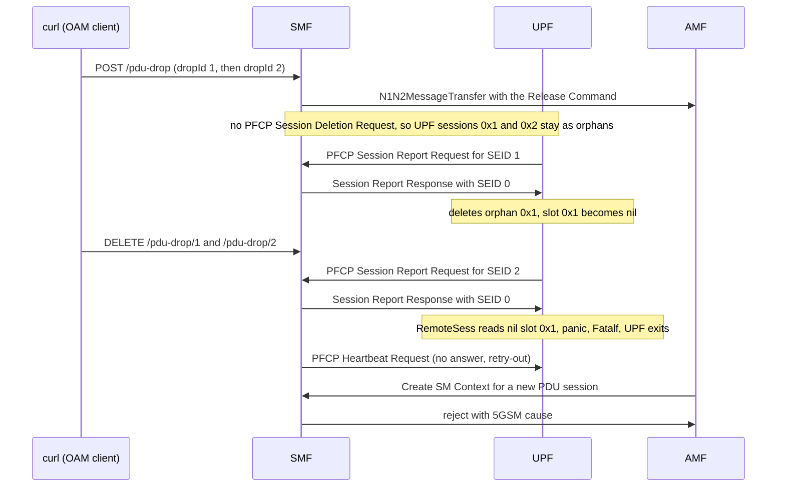
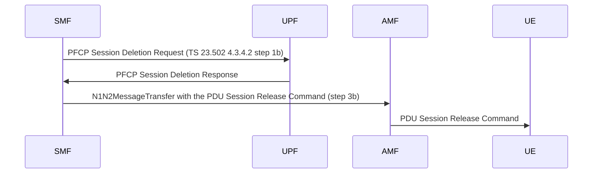
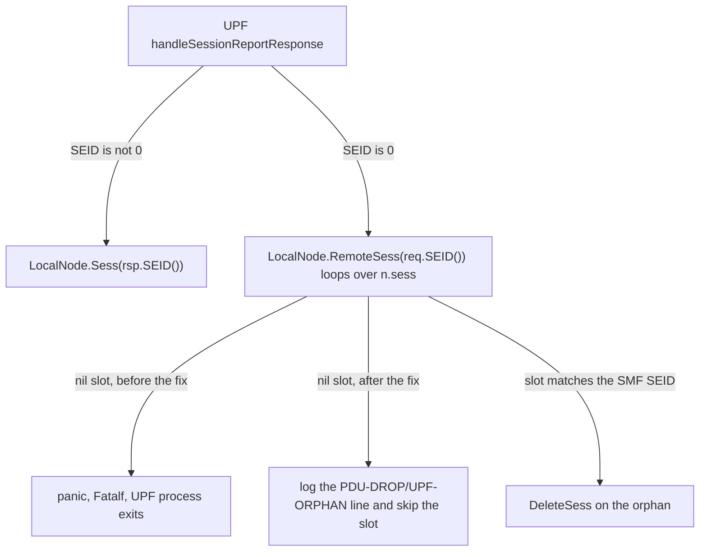

# ISSUE: PDU session still rejected after `DELETE /nsmf-oam/v1/pdu-drop/{dropId}` — the UPF crashed on an orphan session that the graceful drop left behind

| Field | Value |
|---|---|
| Date | 2026-10-28 |
| Repo | `free5gc`, the parent repo, with the NF submodules `NFs/smf`, `NFs/upf` and `NFs/amf` |
| Tree | `/home/loren/Downloads/source_code/free5gc_use_open5gs_ipv6/free5gc` |
| Branch | parent `my-changes-v4.0.1`; `NFs/smf` `my-smf-changes-v1.3.2`; `NFs/upf` `my-upf-changes-v1.2.6`; `NFs/amf` `my-amf-changes-v1.3.2` |
| Commit | parent `9c14fec` feat(smf): drop and restore PDU sessions through the SMF OAM API for UE recovery tests; bump smf/amf. `NFs/smf` `1400d82` feat(smf): add an OAM API to drop and restore PDU sessions for UE recovery tests (graceful mode). `NFs/upf` `ddb2bb3` feat: send UE IPv6 prefix length to gtp5g (PDI attr 8). `NFs/amf` `a3caee8` fix(amf): forward the SMF's PDU Session Establishment Reject to the UE |
| Symptom | `PDUSessionSMContextCreate err: WNC: fail to allocate UE IP` and the reject `[46 14 6 195 67]` (5GSM cause #67), after every drop entry was deleted |
| Scope | Graceful mode (step 1) of the PDU drop API in the SMF, with one UPF at `5.5.5.2`. Blackhole and silent modes (steps 2 and 3) do not exist yet and are not covered. |
| Fix | Three changes, uncommitted at the time of writing: `NFs/smf/internal/sbi/processor/pdu_drop.go`, `NFs/upf/internal/pfcp/node.go` and `NFs/amf/internal/gmm/handler.go`; see §6 |
| Rounds | 3 — all three defects were found in one pass over the test10 logs. The rounds are numbered in the order they were found during that pass; see §3 |
| Status | **Fixed and verified.** |
| Prior art | `2026-10-21_wnc_SPEC_manual_pdu_session_drop_on_smf_VIA_oam_api_FOR_graceful_release_blackhole_and_silent_delete.md` |

---

## SECTION 0. Symptom — evidence collected at the time of the failure

### Verbatim failure output

The tester created two drop entries through the SMF OAM API, deleted both with `DELETE`, and the core
network still rejected every new PDU session. The tester ran these commands (as pasted in the session;
the bodies are shortened here to the fields that the logs below confirm):

```
curl -s -X POST http://127.0.0.2:8000/nsmf-oam/v1/pdu-drop ... (dropId 1: sd 000001, releaseCause 26, backoffSeconds 60)
curl -s -X POST http://127.0.0.2:8000/nsmf-oam/v1/pdu-drop ... (dropId 2: sd 0007d0, backoffSeconds 120)
curl -s -X DELETE http://127.0.0.2:8000/nsmf-oam/v1/pdu-drop/1
curl -s -X DELETE http://127.0.0.2:8000/nsmf-oam/v1/pdu-drop/2
```

From `my_logs/test10-cn-reject-pdu-session-after-i-delete-pdudrop/free5gc/log/20261028_144542/free5gc.log`,
after both `DELETE` calls had succeeded, every PDU Session Establishment Request failed like this:

```
time="2026-10-28T14:52:03.111457816+08:00" level="info" msg="WNC: UPF UPF not associated: UPF[5.5.5.2] not associated with SMF" CAT="CTX" NF="SMF"
time="2026-10-28T14:52:03.111557612+08:00" level="error" msg="PDUSessionSMContextCreate err: WNC: fail to allocate UE IP, Selection Parameter: Dnn: fast.t-mobile.com\nSst: 1, Sd: 000001\n" CAT="PduSess" NF="SMF" pdu_session_id="14" supi="imsi-310260000013069"
time="2026-10-28T14:52:03.111609893+08:00" level="warning" msg="NAS Error Response: {0xc0002c3cb0 [46 14 6 195 67] []}" CAT="SBI" NF="SMF"
time="2026-10-28T14:52:03.112331752+08:00" level="warning" msg="#WNC PDU-DROP/REJECT PDU Session Establishment Request is rejected by SMF[pduSessionId:14], forwarding the reject to the UE" CAT="Gmm" NF="AMF" amf_ue_ngap_id="RU:65538,AU:2(3GPP)" supi="SUPI:imsi-310260000013069"
```

The real failure is earlier in the same file. The UPF died 6 seconds after the drop entries were
removed:

```
time="2026-10-28T14:50:28.570386356+08:00" level="warning" msg="rsp SEID is 0; no this session on remote; delete it on local" CAT="PFCP" LAddr="5.5.5.2:8805" NF="UPF"
time="2026-10-28T14:50:28.570566094+08:00" level="fatal" msg="panic: runtime error: invalid memory address or nil pointer dereference
goroutine 47 [running]:
runtime/debug.Stack()
	/usr/local/go/src/runtime/debug/stack.go:24 +0x5e
github.com/free5gc/go-upf/internal/pfcp.(*PfcpServer).main.func1()
	/home/wnc/Downloads/free5gc_use_open5gs_ipv6/free5gc/NFs/upf/internal/pfcp/pfcp.go:86 +0x4a
panic({0xa4acc0?, 0x1027170?})
	/usr/local/go/src/runtime/panic.go:914 +0x21f
github.com/free5gc/go-upf/internal/pfcp.(*LocalNode).RemoteSess(0xc0004571f0?, 0x2, {0xbf6e00, 0xc000208120})
	/home/wnc/Downloads/free5gc_use_open5gs_ipv6/free5gc/NFs/upf/internal/pfcp/node.go:644 +0x4f
github.com/free5gc/go-upf/internal/pfcp.(*PfcpServer).handleSessionReportResponse(0xc0005528f0, 0xc0001b07e0, {0xbf6e00, 0xc000208120}, {0xbfc698, 0xc0003b0320})
	/home/wnc/Downloads/free5gc_use_open5gs_ipv6/free5gc/NFs/upf/internal/pfcp/session.go:412 +0x192
github.com/free5gc/go-upf/internal/pfcp.(*PfcpServer).rspDispacher(0xc0001aa180?, {0xbfc878?, 0xc0001b07e0?}, {0xbf6e00?, 0xc000208120?}, {0xbfc698?, 0xc0003b0320?})
	/home/wnc/Downloads/free5gc_use_open5gs_ipv6/free5gc/NFs/upf/internal/pfcp/dispacher.go:35 +0x59
github.com/free5gc/go-upf/internal/pfcp.(*PfcpServer).main(0xc0005528f0, 0xc0003ea060)
	/home/wnc/Downloads/free5gc_use_open5gs_ipv6/free5gc/NFs/upf/internal/pfcp/pfcp.go:161 +0xa6d
created by github.com/free5gc/go-upf/internal/pfcp.(*PfcpServer).Start in goroutine 1
	/home/wnc/Downloads/free5gc_use_open5gs_ipv6/free5gc/NFs/upf/internal/pfcp/pfcp.go:222 +0xb8
" CAT="PFCP" LAddr="5.5.5.2:8805" NF="UPF"
time="2026-10-28T14:50:43.247510821+08:00" level="error" msg="PFCP Heartbeat error: SendPfcpHeartbeatRequest error: Request Transaction [38]: retry-out" CAT="Main" NF="SMF"
```

The same panic appears in `my_logs/test10-cn-reject-pdu-session-after-i-delete-pdudrop/free5gc/log/console_free5gc.log`
at line 5304:

```
2026-10-28T14:50:28.570566094+08:00[31m [FATA][UPF][PFCP][LAddr:5.5.5.2:8805] [0mpanic: runtime error: invalid memory address or nil pointer dereference
```

### Variations of the same symptom

- The `pdu_session_id`, the `Sd` value and the second and third bytes of the NAS reject change from one
  request to the next, for example `[46 15 7 195 67]` and `[46 2 8 195 67]`. The fourth byte `195`
  (`0xC3`, PDU Session Establishment Reject) and the fifth byte `67` stay the same.
- Every slice fails, not only the slices that had drop entries. In test10 `Sd: 000001`, `Sd: 0007d0`
  and `Sd: 000bb8` all failed, and `000bb8` never had a drop entry.
- The goroutine number in the panic (`goroutine 47`) and the pointer values change between runs. The
  frames `(*LocalNode).RemoteSess` and `handleSessionReportResponse` stay the same.
- Before the fix, the AMF printed `#WNC PDU-DROP/REJECT` for every SMF reject. After the fix the AMF
  prints `#WNC SMF-REJECT/FORWARD ... with 5GSM cause #67`, which is the line a reader of a newer
  log will see.

### The confirming state

Three facts together separate this bug from a drop entry that is still active:

1. The `DELETE` calls succeeded. The SMF logged `#WNC PDU-DROP/RESTORE removed dropId=1 mode=graceful`
   and `removed dropId=2`, and a second pair of `DELETE` calls at 14:53 got
   `status=404 no drop entry with dropId=1` and `dropId=2`.
2. The SMF did not log `#WNC PDU-DROP/REJECT rejecting` for the failed requests. That line is what the
   SMF writes when a drop entry blocks a request. Instead the SMF logged `fail to allocate UE IP`.
3. The NAS reject carries cause `67`. The drop entries used cause `26`, as the reject at 14:50:01 shows:
   `NAS Error Response: {0xc00080ddd0 [46 10 5 195 26 55 1 126] []}`.

### The sequence

Legend: every row comes from one file,
`my_logs/test10-cn-reject-pdu-session-after-i-delete-pdudrop/free5gc/log/20261028_144542/free5gc.log`.
All NFs write to that file through `logrus`, with a wall-clock timestamp in nanoseconds at `+08:00`. The
`NF=` field names the writer, and the `From` column uses that name. The line number of each quoted line
is given in `Explain`.

| # | From | Time | Evidence | Explain |
|---|---|---|---|---|
| 1 | SMF | 14:49:52.640 | `#WNC PDU-DROP/REGISTRY added dropId=1 mode=graceful dnn=fast.t-mobile.com sst=1 sd=\"000001\" supi=\"imsi-310260000013069\"` | Line 3207. The first `POST` created drop entry 1 for slice `000001`. |
| 2 | code | — | `// Apply runs the same release steps as releaseAllResourcesOfUPF, with the entry's cause and back-off.` | At `NFs/smf` commit `1400d82`, `gracefulDropMode.Apply` copied `releaseAllResourcesOfUPF`, which sends no PFCP Session Deletion Request. §4 round 2 quotes the code. |
| 3 | SMF | 14:49:52.661 | `#WNC PDU-DROP/GRACEFUL-RELEASE dropId=1 release command sent, cause=26` | Line 3232. The SMF sent the Release Command for PDU session 1. Lines 3207 to 3232 hold no `Sending PFCP Session Deletion Request`, so UPF session `0x1` stayed on the UPF as an orphan. |
| 4 | SMF | 14:49:58.569 | `PFCP Session SEID[1] not found` | Line 3391. The UPF sent a Session Report for SEID 1, and the SMF no longer had a context for it, so the SMF answered with SEID 0. |
| 5 | UPF | 14:49:58.570 | `rsp SEID is 0; no this session on remote; delete it on local` then `sess deleted` with `UPSEID="0x1"` | Lines 3413 and 3414. The UPF deleted the orphan itself. Slot `0x1` in the UPF session list became `nil`. This report did not crash, because the orphan sat in the first slot and the loop found it before any empty slot. |
| 6 | SMF | 14:50:01.312 | `Sending PFCP Session Deletion Request` then UPF `sess deleted` with `UPSEID="0x3"` | Lines 3499 and 3507. A normal release of PDU session 5 deleted UPF session `0x3` correctly, which shows the normal release path does send the deletion. |
| 7 | SMF | 14:50:02.695 | `#WNC PDU-DROP/GRACEFUL-RELEASE dropId=2 release command sent, cause=26` with `pdu_session_id="3"` | Line 3791, after `REGISTRY added dropId=2` at line 3766. Again no deletion was sent, so UPF session `0x2` became the second orphan. |
| 8 | SMF | 14:50:22.944 | `#WNC PDU-DROP/RESTORE removed dropId=1 mode=graceful` and, at 14:50:22.955, `removed dropId=2` | Lines 3935 and 3937. Both `DELETE` calls worked and both drop entries were gone. |
| 9 | SMF | 14:50:28.569 | `PFCP Session SEID[2] not found` | Line 3968. The orphan `0x2` sent its next Session Report, and the SMF answered with SEID 0 again. |
| 10 | UPF | 14:50:28.570386 | `rsp SEID is 0; no this session on remote; delete it on local` | Line 3976. The UPF called `RemoteSess` to find the orphan, and the loop started at slot `0x1`, which row 5 had left `nil`. |
| 11 | UPF | 14:50:28.570566 | `level="fatal" msg="panic: runtime error: invalid memory address or nil pointer dereference` | Line 3977. `RemoteSess` read a field of the `nil` slot. The PFCP server's `recover` logged the panic with `Fatalf`, which ends the UPF process. The UPF wrote no further line to the file. |
| 12 | SMF | 14:50:43.247 | `PFCP Heartbeat error: SendPfcpHeartbeatRequest error: Request Transaction [38]: retry-out` | Line 3987. The heartbeat sent at 14:50:34 got no answer, so the SMF marked the UPF as lost and started sending `PFCP Association Request` every 39 seconds, at 14:50:43, 14:51:22, 14:52:01 and later. |
| 13 | SMF | 14:52:03.111 | `UPF[5.5.5.2] not associated with SMF` and `fail to allocate UE IP` | Lines 4209 and 4212. With no associated UPF, the SMF could not allocate a UE IP address and rejected the request with cause #67. |
| 14 | AMF | 14:52:03.112 | `#WNC PDU-DROP/REJECT PDU Session Establishment Request is rejected by SMF[pduSessionId:14], forwarding the reject to the UE` | Line 4217. The AMF printed the drop tag for a reject that had nothing to do with a drop entry. This label made the rejects look like a drop entry that `DELETE` had failed to remove. |
| 15 | SMF | 14:53:09.876 | `#WNC PDU-DROP/API status=404 no drop entry with dropId=1` | Line 6112, and line 6116 for `dropId=2`. The second pair of `DELETE` calls confirmed that no drop entry remained. |

The same order, drawn without timestamps:



### Check command

This command prints a line for each orphan answer, each UPF crash and each lost heartbeat. Run it on the
`free5gc.log` of a test run:

```
grep -nE 'rsp SEID is 0|level="fatal"|PFCP Heartbeat error' <free5gc.log>
```

| Run | Printed |
|---|---|
| test10, before the fix | four lines: 3413 and 3976 (`rsp SEID is 0`), 3977 (`level="fatal"` panic) and 3987 (`PFCP Heartbeat error`) |
| test11, after the fix | nothing |

To search for any Go crash, not only this one, use the wider pattern:

```
grep -rnE 'panic|goroutine |runtime error|fatal error|SIGSEGV' <test log folder>
```

### What this is NOT

- **A drop entry that `DELETE` did not remove.** When a drop entry blocks a request, the SMF logs
  `#WNC PDU-DROP/REJECT rejecting supi=... dropId=N cause=...`, and the NAS reject carries the entry's
  `rejectCause`. Here the SMF logged `fail to allocate UE IP` and the cause was `67`.
- **The UE giving up on retries.** In test10 the UE kept sending requests, with new `pduSessionId`
  values from 14:52:03 to 14:54:00, and the core network rejected each one. How the UE retries is
  described in
  `2026-10-22_wnc_FINDING_ue_pdu_session_retry_NAMELY_3gpp_allows_ue_stops_retrying_when_no_backoff_5x3s_VS_backoff_t3396_60s_3x_VS_no_answer_t3580_16s.md`.
- **The AMF not forwarding the reject.** In test9 the UE got no reject at all, because the AMF dropped
  the SMF's reject. AMF commit `a3caee8` fixed that before test10, and in test10 every reject reached
  the UE.

### Artifacts

| File | Contents |
|---|---|
| `my_logs/test10-cn-reject-pdu-session-after-i-delete-pdudrop/free5gc/log/20261028_144542/free5gc.log` | 7105 lines; the failing run from 14:45:42, including the UPF panic at line 3977 |
| `my_logs/test10-cn-reject-pdu-session-after-i-delete-pdudrop/free5gc/log/console_free5gc.log` | 8733 lines; the same run's console output, with the panic at line 5304 |
| `my_logs/test11-verify-pdu-crash/free5gc/log/20261028_154128/free5gc.log` | 46897 lines; the run with all three fixes, from 15:41:28, holding ten drops and no crash |
| `my_logs/test11-verify-pdu-crash/free5gc/log/console_free5gc.log` | 63284 lines; the same run's console output |
| `my_logs/test9-manually-release-pdu-session-complete-but-not-sending-pdu-reject-within-timer/free5gc/log/20261021_175404/free5gc.log` | the earlier run with one orphan and no crash; §5 explains why |

## SECTION 1. Summary — what broke, in one paragraph

The graceful drop in the SMF released each PDU session towards the UE but never told the UPF to delete
the matching PFCP session, so every drop left an orphan session on the UPF. When the UPF sent the next PFCP
Session Report for an orphan, the SMF did not know the session and answered with SEID 0. The UPF then
searched its session list for the orphan. That search, `LocalNode.RemoteSess`, did not skip the empty
slots that deleted sessions leave behind, so in test10, where an earlier slot was empty, the search read
a `nil` pointer and the panic took the whole UPF process down. With no UPF, the SMF could not allocate
a UE IP address and rejected every new PDU session with cause #67, long after the drop entries were
gone. The AMF made this harder to see, because it labelled every SMF reject `#WNC PDU-DROP/REJECT`.
test9 did not show the crash because its one orphan sat before any empty slot.

## SECTION 2. Background — how the system is meant to behave

### The SMF and the UPF

The SMF controls the UPF over PFCP, the Packet Forwarding Control Protocol (the N4 interface). In this
setup the SMF node is `192.168.0.2` and the UPF listens on `5.5.5.2:8805`. Each PDU session has one PFCP
session, and each side gives the session its own number, its SEID (Session Endpoint Identifier). The
UPF logs the SMF's number as `CPSEID` and its own number as `UPSEID`.

The SMF sends a PFCP Heartbeat Request every 10 seconds. When the UPF stops answering, the SMF logs
`PFCP Heartbeat error ... retry-out`, treats the association as lost, and keeps sending PFCP Association
Requests. While no UPF is associated, `UE IP allocation` fails, and the SMF rejects every PDU Session
Establishment Request with 5GSM cause #67.

### How a PDU session is meant to be released

TS 23.502 clause 4.3.4.2 orders the release: the SMF releases the N4 session on the UPF (step 1b)
before it asks the AMF to send the release to the UE (step 3b). Upstream free5gc follows that order
when the UE asks for the release. `NFs/smf/internal/sbi/processor/pdu_session.go:466-468` runs inside
the `SMLock` that the handler takes at `:354-355`:

```go
			smContext.SetState(smf_context.PFCPModification)

			pfcpResponseStatus = releaseSession(smContext)
```

```go
	smContext.SMLock.Lock()
	defer smContext.SMLock.Unlock()
```

`releaseSession`, at `NFs/smf/internal/sbi/processor/pdu_session.go:1142-1151`, is the function that
sends the PFCP Session Deletion Request, through `ReleaseTunnel`:

```go
func releaseSession(smContext *smf_context.SMContext) smf_context.PFCPSessionResponseStatus {
	smContext.SetState(smf_context.PFCPModification)

	for _, res := range ReleaseTunnel(smContext) {
		if res.Status != smf_context.SessionReleaseSuccess {
			return res.Status
		}
	}
	return smf_context.SessionReleaseSuccess
}
```



A second release path exists for a UPF that is already gone. `releaseAllResourcesOfUPF`, at
`NFs/smf/internal/sbi/processor/association.go:221-243`, releases each session towards the AMF and
sends nothing to the UPF, because nothing is left to answer:

```go
func (p *Processor) releaseAllResourcesOfUPF(upf *smf_context.UPF, upfStr string) {
	logger.MainLog.Infof("Release all resources of UPF %s", upfStr)

	upf.ProcEachSMContext(func(smContext *smf_context.SMContext) {
		smContext.SMLock.Lock()
		defer smContext.SMLock.Unlock()
		switch smContext.State() {
		case smf_context.Active, smf_context.ModificationPending, smf_context.PFCPModification:
			// #WNC PDU-DROP/GRACEFUL-RELEASE
			// requestAMFToReleasePDUResources now takes the 5GSM cause and back-off from the caller,
			// so the graceful drop mode can send its own values. UPF loss keeps the cause it always
			// sent, Cause5GSMNetworkFailure (#38), with no back-off, so this path behaves as before.
			needToSendNotify, removeContext := p.requestAMFToReleasePDUResources(
				smContext, nasMessage.Cause5GSMNetworkFailure, nil)
			if needToSendNotify {
				p.SendReleaseNotification(smContext)
			}
			if removeContext {
				// Notification has already been sent, if it is needed
				p.RemoveSMContextFromAllNF(smContext, false)
			}
		}
	})
}
```

### What the SMF answers for a session it does not know

The UPF sends PFCP Session Report Requests that carry the SMF's SEID. In test10 the UPF sent one for
each orphan, 6 and 26 seconds after the drop. `NFs/smf/internal/pfcp/handler/handler.go:160-172` looks
the SEID up, and
when no SM context matches, the SMF answers with SEID `0` and cause `Session context not found`:

```go
func HandlePfcpSessionReportRequest(msg *pfcpUdp.Message) {
	var cause pfcpType.Cause

	req := msg.PfcpMessage.Body.(pfcp.PFCPSessionReportRequest)
	SEID := msg.PfcpMessage.Header.SEID
	smContext := smf_context.GetSMContextBySEID(SEID)
	seqFromUPF := msg.PfcpMessage.Header.SequenceNumber

	if smContext == nil {
		logger.PfcpLog.Errorf("PFCP Session SEID[%d] not found", SEID)
		cause.CauseValue = pfcpType.CauseSessionContextNotFound
		pfcp_message.SendPfcpSessionReportResponse(msg.RemoteAddr, cause, seqFromUPF, 0)
		return
```

### What the UPF does with an answer of SEID 0

The UPF reads SEID 0 as "the SMF has no such session" and deletes its own copy.
`NFs/upf/internal/pfcp/session.go:402-418` finds that copy by the SMF's SEID, with `RemoteSess`:

```go
func (s *PfcpServer) handleSessionReportResponse(
	rsp *message.SessionReportResponse,
	addr net.Addr,
	req message.Message,
) {
	s.log.Infoln("handleSessionReportResponse")

	s.log.Debugf("seid: %#x\n", rsp.SEID())
	if rsp.Header.SEID == 0 {
		s.log.Warnf("rsp SEID is 0; no this session on remote; delete it on local")
		sess, err := s.lnode.RemoteSess(req.SEID(), addr)
		if err != nil {
			s.log.Errorln(err)
			return
		}
		sess.rnode.DeleteSess(sess.LocalID)
		return
	}
```

### How the UPF stores its sessions

The UPF keeps its sessions in a slice, `LocalNode.sess []*Sess`, and the UPF's own SEID is the slot
index plus one. `DeleteSess`, at `NFs/upf/internal/pfcp/node.go:694-698`, sets the slot to `nil` and
puts the SEID on a free list instead of shrinking the slice:

```go
	n.sess[i].log.Infoln("sess deleted")
	usars := n.sess[i].Close()
	n.sess[i] = nil
	n.free = append(n.free, lSeid)
	return usars, nil
```

`NewSess`, at `NFs/upf/internal/pfcp/node.go:671-679`, reuses a freed slot first:

```go
	last := len(n.free) - 1
	if last >= 0 {
		s.LocalID = n.free[last]
		n.free = n.free[:last]
		n.sess[s.LocalID-1] = s
	} else {
		n.sess = append(n.sess, s)
		s.LocalID = uint64(len(n.sess))
	}
```

So `nil` slots in `n.sess` are normal after any session is deleted. `LocalNode.Sess` and
`LocalNode.Reset` both check for them, for example `NFs/upf/internal/pfcp/node.go:636-639`:

```go
	sess := n.sess[i]
	if sess == nil {
		return nil, errors.Errorf("Sess: sess not found (lSeid:%#x)", lSeid)
	}
```

### What a panic does to the UPF

The PFCP server goroutine catches a panic, but only to log it. `NFs/upf/internal/pfcp/pfcp.go:83-87`
logs with `Fatalf`, and the comment states that this exits the program:

```go
	defer func() {
		if p := recover(); p != nil {
			// Print stack for panic to log. Fatalf() will let program exit.
			s.log.Fatalf("panic: %v\n%s", p, string(debug.Stack()))
		}
```

A panic anywhere in PFCP message handling therefore stops the whole UPF process, and the SMF's
heartbeats go unanswered from then on.

### What each log line can and cannot tell

| Log line | Proves | Does not prove |
|---|---|---|
| `#WNC PDU-DROP/RESTORE removed dropId=N` and the `204` answer to `DELETE` | the drop entry left the SMF's drop list | anything about the UPF or the association |
| `#WNC PDU-DROP/REJECT rejecting ... dropId=N` from the SMF | a drop entry blocked this request | nothing is missing; this line names the entry and the cause it used |
| `#WNC PDU-DROP/REJECT ... rejected by SMF` from the AMF, before the fix | the SMF rejected the request | why the SMF rejected it; the AMF printed this tag for every reject |
| `PFCP Heartbeat error ... retry-out` from the SMF | the UPF stopped answering at least 9 seconds earlier | why the UPF stopped; the UPF's own lines show that |

## SECTION 3. Investigation — how the root cause was tracked down

Every command runs from the parent repo root,
`/home/loren/Downloads/source_code/free5gc_use_open5gs_ipv6/free5gc`. The tester asked for the UPF crash
to be investigated first, so round 1 is the UPF.

### Round 1 — believed the rejects came from a dead UPF, not from the drop entries

1. **Command:**
   `grep -nE 'PDU-DROP|SMF-REJECT' my_logs/test10-cn-reject-pdu-session-after-i-delete-pdudrop/free5gc/log/20261028_144542/free5gc.log`

   **Purpose:** settle whether `DELETE` removed the drop entries, and whether the later rejects came
   from a drop entry.

   **Outcome:**
   ```
   3935:... msg="#WNC PDU-DROP/RESTORE removed dropId=1 mode=graceful" ...
   3937:... msg="#WNC PDU-DROP/RESTORE removed dropId=2 mode=graceful" ...
   4217:... msg="#WNC PDU-DROP/REJECT PDU Session Establishment Request is rejected by SMF[pduSessionId:14], forwarding the reject to the UE" CAT="Gmm" NF="AMF" ...
   6112:... msg="#WNC PDU-DROP/API status=404 no drop entry with dropId=1" ...
   ```

   **Meaning:** both entries were removed at 14:50:22, and the second `DELETE` pair proved no entry was
   left. After 14:50:22 every `PDU-DROP/REJECT` line came from the AMF (`NF="AMF"`), and none came from
   the SMF's `rejecting supi=...` line. The rejects therefore did not come from a drop entry, and the
   AMF tag was misleading. That second fact became round 3.

2. **Command:**
   `grep -nE 'not associated|fail to allocate|\[46 ' my_logs/test10-cn-reject-pdu-session-after-i-delete-pdudrop/free5gc/log/20261028_144542/free5gc.log`

   **Purpose:** find the SMF's own reason for the rejects.

   **Outcome:**
   ```
   4209:time="2026-10-28T14:52:03.111457816+08:00" level="info" msg="WNC: UPF UPF not associated: UPF[5.5.5.2] not associated with SMF" CAT="CTX" NF="SMF"
   4213:time="2026-10-28T14:52:03.111609893+08:00" level="warning" msg="NAS Error Response: {0xc0002c3cb0 [46 14 6 195 67] []}" CAT="SBI" NF="SMF"
   ```

   **Meaning:** the SMF had no associated UPF, could not allocate a UE IP address, and rejected with
   cause #67. That explains why every slice failed, including `000bb8`, which had no drop entry.

3. **Command:**
   `grep -nE 'Heartbeat|Association Request' my_logs/test10-cn-reject-pdu-session-after-i-delete-pdudrop/free5gc/log/20261028_144542/free5gc.log`

   **Purpose:** find when the association was lost.

   **Outcome:**
   ```
   3949:time="2026-10-28T14:50:24.235728513+08:00" level="debug" msg="Received PFCP Heartbeat Response from UPF[5.5.5.2]" CAT="Main" NF="SMF"
   3981:time="2026-10-28T14:50:34.240801775+08:00" level="debug" msg="Sending PFCP Heartbeat Request to UPF[5.5.5.2]" CAT="Main" NF="SMF"
   3987:time="2026-10-28T14:50:43.247510821+08:00" level="error" msg="PFCP Heartbeat error: SendPfcpHeartbeatRequest error: Request Transaction [38]: retry-out" CAT="Main" NF="SMF"
   3989:time="2026-10-28T14:50:43.247618047+08:00" level="info" msg="Sending PFCP Association Request to UPF[5.5.5.2]" CAT="Main" NF="SMF"
   ```

   **Meaning:** the UPF answered the heartbeat at 14:50:24 and did not answer the one at 14:50:34. The
   UPF therefore stopped between those two times, which is inside the 6 seconds after the drop
   entries were removed.

4. **Command:**
   `grep -nE 'panic|level="fatal"' my_logs/test10-cn-reject-pdu-session-after-i-delete-pdudrop/free5gc/log/20261028_144542/free5gc.log`

   **Purpose:** check whether the UPF process crashed.

   **Outcome:** one hit, line 3977, the `level="fatal"` panic quoted in full in §0, whose top frame is
   `(*LocalNode).RemoteSess(0xc0004571f0?, 0x2, ...)` at `node.go:644`.

   **Meaning:** the UPF panicked at 14:50:28 while looking up the SMF's SEID `0x2`, and `Fatalf` ended
   the process. A count of the UPF's lines after line 3977 returned `0`, so the UPF wrote nothing more.
   The UPF did not lose its link to the SMF; the UPF process was gone.

5. **Command:** read `RemoteSess` in `NFs/upf/internal/pfcp/node.go`, and the UPF lines 3413 and 3414
   of the test10 log.

   **Purpose:** find which pointer was `nil`.

   **Outcome:** before the fix, the loop at `NFs/upf/internal/pfcp/node.go:642-645` read
   `s.RemoteID` on every slot:

   ```go
   func (n *LocalNode) RemoteSess(rSeid uint64, addr net.Addr) (*Sess, error) {
   	for _, s := range n.sess {
   		if s.RemoteID == rSeid && s.rnode.addr.String() == addr.String() {
   			return s, nil
   ```

   and the log showed that slot `0x1` had been freed 30 seconds earlier:

   ```
   time="2026-10-28T14:49:58.570658050+08:00" level="info" msg="sess deleted" CAT="PFCP" CPNodeID="192.168.0.2" CPSEID="0x1" LAddr="5.5.5.2:8805" NF="UPF" UPSEID="0x1"
   ```

   **Meaning:** the search for the orphan `0x2` started at slot `0x1`, found `nil` there, and read
   `RemoteID` through the `nil` pointer. `LocalNode.Sess` and `LocalNode.Reset` skip `nil` slots, and
   `RemoteSess` was the one loop that did not.

6. **Command:** write `NFs/upf/internal/pfcp/node_remotesess_test.go`, which creates sessions with SMF
   SEIDs 1, 2 and 3, deletes 1 and 3, and calls `RemoteSess(2, addr)`; then run
   `go test ./internal/pfcp/ -run TestLocalNodeRemoteSessSkipsDeletedSlots -v` in `NFs/upf`.

   **Purpose:** reproduce the crash without the live network.

   **Outcome,** before the fix:
   ```
   TestLocalNodeRemoteSessSkipsDeletedSlots (0.00s)
   panic: runtime error: invalid memory address or nil pointer dereference [recovered]
   [signal SIGSEGV: segmentation violation code=0x1 addr=0x10 pc=0x65d9ef]
   ...
   github.com/free5gc/go-upf/internal/pfcp.(*LocalNode).RemoteSess(0xc0005bd450?, 0x2, {0x775838, 0xc00049bb30})
   github.com/free5gc/go-upf/internal/pfcp.TestLocalNodeRemoteSessSkipsDeletedSlots(0x0?)
   ```

   **Meaning:** the test fails in the same frame as the live panic, `RemoteSess` with SEID `0x2`, so
   the slot layout alone is enough to crash the UPF.

**Fix applied:** `RemoteSess` skips a `nil` slot and logs `#WNC PDU-DROP/UPF-ORPHAN`; see §6 round 1.
**Retest:** the unit test passes, and the live run test11 holds no panic; see §7.
**What that ruled out:** a drop entry left behind by `DELETE`, and a broken network link between the
SMF and the UPF.

### Round 2 — believed the UPF held sessions that the SMF had already released

7. **Command:**
   `grep -nE 'SEID\[[0-9]+\] not found' my_logs/test10-cn-reject-pdu-session-after-i-delete-pdudrop/free5gc/log/20261028_144542/free5gc.log`

   **Purpose:** find out why the SMF answered SEID 0.

   **Outcome:**
   ```
   3391:time="2026-10-28T14:49:58.569710800+08:00" level="error" msg="PFCP Session SEID[1] not found" CAT="PFCP" NF="SMF"
   3968:time="2026-10-28T14:50:28.569870063+08:00" level="error" msg="PFCP Session SEID[2] not found" CAT="PFCP" NF="SMF"
   ```

   **Meaning:** the UPF still reported on SMF SEIDs 1 and 2, which are PDU sessions 1 and 3, after the
   SMF had removed both sessions in the drops at 14:49:52 and 14:50:02.

8. **Command:**
   `grep -nE 'GRACEFUL-RELEASE|Deletion Request|sess deleted' my_logs/test10-cn-reject-pdu-session-after-i-delete-pdudrop/free5gc/log/20261028_144542/free5gc.log`

   **Purpose:** check whether the drop sent a PFCP Session Deletion Request.

   **Outcome:**
   ```
   3232:... msg="#WNC PDU-DROP/GRACEFUL-RELEASE dropId=1 release command sent, cause=26" ...
   3414:... msg="sess deleted" ... CPSEID="0x1" ... UPSEID="0x1"
   3499:... msg="Sending PFCP Session Deletion Request" CAT="PduSess" NF="SMF"
   3507:... msg="sess deleted" ... CPSEID="0x3" ... UPSEID="0x3"
   3791:... msg="#WNC PDU-DROP/GRACEFUL-RELEASE dropId=2 release command sent, cause=26" ...
   ```

   **Meaning:** the normal release at line 3499 sent a deletion, and neither drop did. The `sess deleted`
   at line 3414 came from the UPF's own clean-up after the SEID 0 answer, not from the SMF.

9. **Command:** read `gracefulDropMode.Apply` in `NFs/smf/internal/sbi/processor/pdu_drop.go` at
   commit `1400d82`, and `releaseAllResourcesOfUPF` in
   `NFs/smf/internal/sbi/processor/association.go`.

   **Purpose:** find why the drop skipped the deletion.

   **Outcome:** the `Apply` comment said
   `// Apply runs the same release steps as releaseAllResourcesOfUPF, with the entry's cause and back-off.`,
   and `releaseAllResourcesOfUPF`, quoted in §2, sends nothing to the UPF.

   **Meaning:** the drop copied the release path written for a UPF that has already disappeared. The
   drop keeps the UPF running, so the copied path left every dropped session behind on the UPF.

10. **Command:**
    `grep -nE 'New session|sess deleted|rsp SEID is 0|level="fatal"' my_logs/test9-manually-release-pdu-session-complete-but-not-sending-pdu-reject-within-timer/free5gc/log/20261021_175404/free5gc.log`

    **Purpose:** find out why test9, which also used the graceful drop, did not crash.

    **Outcome:** test9 holds one `rsp SEID is 0` and no `level="fatal"`. The UPF created sessions `0x1`,
    `0x2` and `0x3` between 17:57:29 and 17:57:51, deleted none of them before 18:04:59, and then
    answered the SEID 0 for the orphan `0x3`:

    ```
    5472:time="2026-10-21T18:04:59.128167184+08:00" level="warning" msg="rsp SEID is 0; no this session on remote; delete it on local" CAT="PFCP" LAddr="5.5.5.2:8805" NF="UPF"
    ```

    **Meaning:** in test9 the slots before the orphan held live sessions, so `RemoteSess` met no `nil`
    slot and found the orphan. The orphan existed in test9 too; only the crash was missing. §5 builds
    on this.

**Fix applied:** `gracefulDropMode.Apply` calls `releaseSession` before the Release Command; see §6
round 2.
**Retest:** test11 ran ten drops, and each logged `PFCP session deleted on the UPF`, with no
`rsp SEID is 0` anywhere; see §7.
**What that ruled out:** a UPF-side cause for the orphans. The UPF kept the sessions because the SMF
never asked the UPF to delete them.

### Round 3 — believed the AMF line identified drop rejects

11. **Command:** compare the AMF line 4217 with the SMF lines 4212 and 4213 of the test10 log, and read
    the reject check in `CreatePDUSession` in `NFs/amf/internal/gmm/handler.go` at commit `a3caee8`.

    **Purpose:** find why the AMF called a UPF-loss reject a drop reject.

    **Outcome:** the AMF printed a fixed text for every reject:

    ```go
    		// #WNC PDU-DROP/REJECT
    ...
    			ue.GmmLog.Warnf("#WNC PDU-DROP/REJECT PDU Session Establishment Request is rejected by SMF"+
    				"[pduSessionId:%d], forwarding the reject to the UE", pduSessionID)
    ```

    **Meaning:** the AMF never reads the reason. The tag was added for drop rejects, and the same code
    forwards every SMF reject, so the tag was wrong for every reject that a drop entry did not cause.

**Fix applied:** the tag became `#WNC SMF-REJECT/FORWARD`, and the line prints the 5GSM cause read from
the reject; see §6 round 3.
**Retest:** in test11 the AMF printed `with 5GSM cause #26` next to the SMF's own drop reject for
`dropId=9`; see §7.
**What that ruled out:** nothing about the crash. This round changes only what a reader of the log
sees.

## SECTION 4. Root cause — the defect, and what it does

> **Three defects. Round 2's fix alone removes the orphan sessions that start the chain, and round 1's
> fix alone stops the crash; each is probably sufficient on its own for this symptom, but only the two
> together were tested live. Round 3's fix changes only a log line and is not sufficient on its own.**

The defects form one chain, and round 2 is where the chain starts: the graceful drop created the orphan
sessions (round 2), the SMF's SEID 0 answer for an orphan reached a UPF loop with no `nil` check
(round 1), and the AMF log then hid the real reject reason (round 3). Round 1 is an upstream go-upf
defect that any SEID 0 answer can reach, not only one caused by a drop, because the SMF answers SEID 0
whenever `GetSMContextBySEID` returns `nil` (§2).

| Round | Defect | Program | Proven or probable |
|---|---|---|---|
| 1 | `LocalNode.RemoteSess` reads a field of a `nil` slot | UPF | Proven by the live stack trace and by the unit test that panics in the same frame |
| 2 | `gracefulDropMode.Apply` sends no PFCP Session Deletion Request | SMF | Proven by the missing `Sending PFCP Session Deletion Request` for both drops in test10, and by the `SEID[N] not found` lines that followed |
| 3 | The AMF prints `#WNC PDU-DROP/REJECT` for every SMF reject | AMF | Proven by line 4217 of test10, printed for a cause #67 reject |

### Round 1 cause — `RemoteSess` does not skip freed slots

Before the fix, `NFs/upf/internal/pfcp/node.go:642-645` read `s.RemoteID` on every slot of `n.sess`:

```go
func (n *LocalNode) RemoteSess(rSeid uint64, addr net.Addr) (*Sess, error) {
	for _, s := range n.sess {
		if s.RemoteID == rSeid && s.rnode.addr.String() == addr.String() {
			return s, nil
```

`DeleteSess` leaves a `nil` in the slot of every deleted session (§2). When the SMF answers a Session
Report with SEID 0, `handleSessionReportResponse` calls `RemoteSess`, and the loop panics on the first
`nil` slot that comes before the orphan. The PFCP server's `recover` then calls `Fatalf`, and the UPF
process exits. A `nil` slot after the orphan does no harm, because the loop returns as soon as it finds
the orphan.



### Round 2 cause — the graceful drop copied the release path for a lost UPF

At `NFs/smf` commit `1400d82`, `NFs/smf/internal/sbi/processor/pdu_drop.go:170-176` went straight to the
AMF:

```go
// #WNC PDU-DROP/GRACEFUL-RELEASE
// Apply runs the same release steps as releaseAllResourcesOfUPF, with the entry's cause and back-off.
func (m *gracefulDropMode) Apply(
	smContext *smf_context.SMContext, entry *smf_context.DropEntry,
) (string, error) {
	needToSendNotify, removeContext := m.p.requestAMFToReleasePDUResources(
		smContext, entry.ReleaseCause, entry.Backoff)
```

`releaseAllResourcesOfUPF` is correct for the case it was written for: the UPF is already gone, so no
deletion can be sent. The drop is a different case, because the UPF is still running. Every dropped
session therefore stayed on the UPF, and the SMF removed its own SM context. The next Session Report for
that session got SEID 0, which is the path round 1 crashes on.

### Round 3 cause — the AMF tag named one reason for every reject

At `NFs/amf` commit `a3caee8`, the reject check in `CreatePDUSession` in
`NFs/amf/internal/gmm/handler.go` printed fixed text:

```go
			ue.GmmLog.Warnf("#WNC PDU-DROP/REJECT PDU Session Establishment Request is rejected by SMF"+
				"[pduSessionId:%d], forwarding the reject to the UE", pduSessionID)
```

The code forwards every reject that the SMF returns, whatever the cause. A reader who searched for
`PDU-DROP/REJECT` after `DELETE` therefore saw what looked like drop rejects that continued after
restore.

## SECTION 5. Trigger — what changed to make this bug surface

Two situations from the template apply, one to each code defect.

**Round 2 never worked.** The graceful drop left an orphan from its first live use. test9 shows one
orphan, `UPSEID 0x3`, which the UPF removed after a SEID 0 answer at 18:04:59 on 2026-10-21. Nobody
noticed, because the UPF's own clean-up removed the orphan and the UE recovered.

**Round 1 was always there, and test10 was the first run to reach it.** Round 1 needs a SEID 0 answer
for an orphan that sits after a freed slot. test9 met the first condition and not the second: its
sessions `0x1` and `0x2` were alive when orphan `0x3` was reported. test10 met both, because its two
drops orphaned sessions `0x1` and `0x2` in that order:

| Step in test10 | Slot `0x1` | Slot `0x2` | What `RemoteSess` did |
|---|---|---|---|
| 14:49:58, SEID 0 answer for SMF SEID 1 | orphan, found first | live orphan | found the orphan in slot `0x1`, and `DeleteSess` set slot `0x1` to `nil` |
| 14:50:28, SEID 0 answer for SMF SEID 2 | `nil` | orphan | read `nil` slot `0x1` first and panicked |

The crash comes back if round 1's fix is reverted and the SMF answers SEID 0 for any session that sits
after a freed slot. A test of the drop that does not reach that condition passes without exercising
round 1, which is what test9 did.

## SECTION 6. The fix — what was changed, location, diff, revert

All three fixes were uncommitted in their NF submodules when this doc was written. The commits wait
for the tester to approve the commit messages; see §13.

### Round 1 fix — `RemoteSess` skips and logs a freed slot

`NFs/upf/internal/pfcp/node.go`, function `LocalNode.RemoteSess`, on branch `my-upf-changes-v1.2.6`.
This fix alone is probably sufficient for the symptom, as §4 states, and it also protects every other
path that answers SEID 0.

```diff
@@ -9,6 +9,7 @@ import (
 	"github.com/wmnsk/go-pfcp/ie"
 
 	"github.com/free5gc/go-upf/internal/forwarder"
+	"github.com/free5gc/go-upf/internal/logger"
 	"github.com/free5gc/go-upf/internal/report"
 	logger_util "github.com/free5gc/util/logger"
 )
@@ -640,7 +641,15 @@ func (n *LocalNode) Sess(lSeid uint64) (*Sess, error) {
 }
 
 func (n *LocalNode) RemoteSess(rSeid uint64, addr net.Addr) (*Sess, error) {
-	for _, s := range n.sess {
+	for i, s := range n.sess {
+		// #WNC PDU-DROP/UPF-ORPHAN
+		// DeleteSess leaves a nil slot in n.sess for reuse, so skip it. Without this check, an SMF answer of
+		// SEID 0 to a Session Report panicked the PFCP goroutine whenever an earlier slot had been freed.
+		if s == nil {
+			logger.PfcpLog.Infof("#WNC PDU-DROP/UPF-ORPHAN RemoteSess skips freed slot UPSEID=%#x "+
+				"while looking for CPSEID=%#x", i+1, rSeid)
+			continue
+		}
 		if s.RemoteID == rSeid && s.rnode.addr.String() == addr.String() {
 			return s, nil
 		}
```

A new test file, `NFs/upf/internal/pfcp/node_remotesess_test.go`, holds
`TestLocalNodeRemoteSessSkipsDeletedSlots`, which rebuilds the test10 slot layout.

Revert, from `NFs/upf`:

```
git checkout -- internal/pfcp/node.go
rm internal/pfcp/node_remotesess_test.go
```

The edits to `NFs/upf/go.mod` and `NFs/upf/go.sum` in the same working tree are unrelated and are
deliberately left uncommitted. The revert above does not touch them.

### Round 2 fix — the graceful drop deletes the PFCP session first

`NFs/smf/internal/sbi/processor/pdu_drop.go`, function `gracefulDropMode.Apply`, on branch
`my-smf-changes-v1.3.2`. This fix alone is probably sufficient for the symptom, as §4 states.

```diff
@@ -168,10 +168,26 @@ type gracefulDropMode struct {
 }
 
 // #WNC PDU-DROP/GRACEFUL-RELEASE
-// Apply runs the same release steps as releaseAllResourcesOfUPF, with the entry's cause and back-off.
+// Apply deletes the PFCP session on the UPF, and then runs the same release steps as
+// releaseAllResourcesOfUPF, with the entry's cause and back-off.
 func (m *gracefulDropMode) Apply(
 	smContext *smf_context.SMContext, entry *smf_context.DropEntry,
 ) (string, error) {
+	// #WNC PDU-DROP/GRACEFUL-RELEASE
+	// releaseAllResourcesOfUPF sends no PFCP Session Deletion because its UPF is already gone. The drop
+	// keeps the UPF, so the session is deleted there first, as in TS 23.502 4.3.4.2 step 1b. Without this,
+	// the UPF kept an orphan session, its next Session Report got SEID 0 back from the SMF, and in live
+	// test10 that answer crashed the UPF.
+	if status := releaseSession(smContext); status != smf_context.SessionReleaseSuccess {
+		smContext.SetState(smf_context.Active)
+		err := fmt.Errorf("PFCP Session Deletion failed with status %s", status)
+		smContext.Log.Errorf("#WNC PDU-DROP/GRACEFUL-RELEASE dropId=%s release failed, "+
+			"no Release Command sent: %v", entry.DropId, err)
+		return "release-failed", err
+	}
+	m.p.ReleaseChargingSession(smContext)
+	smContext.Log.Infof("#WNC PDU-DROP/GRACEFUL-RELEASE dropId=%s PFCP session deleted on the UPF", entry.DropId)
+
 	needToSendNotify, removeContext := m.p.requestAMFToReleasePDUResources(
 		smContext, entry.ReleaseCause, entry.Backoff)
 	if needToSendNotify {
```

The fix uses the same `releaseSession` that the UE-requested release uses (§2), and calls it under
the `SMLock` that `applyPduDrop` already holds. When the deletion fails, the SMF sends no Release
Command, puts the session back to `Active`, and reports `release-failed` in the `POST` answer.

Revert, from `NFs/smf`:

```
git checkout -- internal/sbi/processor/pdu_drop.go
```

**Not changed on purpose:** `releaseAllResourcesOfUPF` still sends no deletion, because that path
runs only after the UPF is gone.

### Round 3 fix — the AMF prints the 5GSM cause of each reject

`NFs/amf/internal/gmm/handler.go`, function `CreatePDUSession` and a new helper `rejectGSMCause`, on
branch `my-amf-changes-v1.3.2`. This fix changes only a log line and is not sufficient on its own.

```diff
-		// #WNC PDU-DROP/REJECT
+		// #WNC SMF-REJECT/FORWARD
 		// When the SMF rejects a PDU session, it answers with an HTTP error status (for example 403) and a
...
+		// The AMF cannot tell why the SMF rejected, so the log prints the 5GSM cause instead of naming a
+		// reason: a PDU drop entry rejects with its rejectCause, and a lost UPF association gives #67.
 		if n1Reject := smfRejectN1Message(errResponse); n1Reject != nil {
-			ue.GmmLog.Warnf("#WNC PDU-DROP/REJECT PDU Session Establishment Request is rejected by SMF"+
-				"[pduSessionId:%d], forwarding the reject to the UE", pduSessionID)
+			if cause, ok := rejectGSMCause(n1Reject); ok {
+				ue.GmmLog.Warnf("#WNC SMF-REJECT/FORWARD SMF rejected PDU Session Establishment Request"+
+					"[pduSessionId:%d] with 5GSM cause #%d, forwarding the reject to the UE", pduSessionID, cause)
+			} else {
+				ue.GmmLog.Warnf("#WNC SMF-REJECT/FORWARD SMF rejected PDU Session Establishment Request"+
+					"[pduSessionId:%d], forwarding its N1 SM message % x to the UE", pduSessionID, n1Reject)
+			}
...
+// #WNC SMF-REJECT/FORWARD
+// rejectGSMCause returns the 5GSM cause of a PDU Session Establishment Reject. TS 24.501 8.3.3.1 puts the
+// cause in octet 5, after the EPD, the PDU session ID, the PTI and the message type. ok is false when the
+// message is too short or is not a PDU Session Establishment Reject.
+func rejectGSMCause(n1 []byte) (cause uint8, ok bool) {
+	if len(n1) < 5 || n1[3] != nas.MsgTypePDUSessionEstablishmentReject {
+		return 0, false
+	}
+	return n1[4], true
+}
```

The comment above `smfRejectN1Message` was retagged from `#WNC PDU-DROP/REJECT` to
`#WNC SMF-REJECT/FORWARD` as well. `NFs/amf/internal/gmm/handler_reject_test.go` gains
`TestRejectGSMCause`, with the test9 bytes `[46 7 4 195 26]`, the test10 bytes `[46 14 6 195 67]`, a
message that is too short, and a message whose type is not a reject. After this fix, only the SMF's
`#WNC PDU-DROP/REJECT rejecting ...` line means that a drop entry caused a reject.

Revert, from `NFs/amf`:

```
git checkout -- internal/gmm/handler.go internal/gmm/handler_reject_test.go
```

## SECTION 7. Verified — how the fix was proven

The live run test11 ran all three fixes together, on the core network host, from 15:41:28 to 17:58:32
on 2026-10-28. The tester copied the SMF, the UPF and the AMF to the core network host before the run.
The tester then reported, in the session, that every test passed and that a search of the logs for the
crash keywords found no error. The log lines below are the captured evidence behind that report.

The sequence table below uses the columns described in §0. Every row comes from
`my_logs/test11-verify-pdu-crash/free5gc/log/20261028_154128/free5gc.log`, and the line number of each
quoted line is given in `Explain`.

| # | From | Time | Evidence | Explain |
|---|---|---|---|---|
| 1 | SMF | 15:52:26.187490 | `#WNC PDU-DROP/REGISTRY added dropId=1 mode=graceful dnn=fast.t-mobile.com sst=1 sd=\"000001\" supi=\"imsi-310260000013069\"` | Line 4815. The first `POST` created drop entry 1, the same selector as in test10. |
| 2 | SMF | 15:52:26.187902 | `Sending PFCP Session Deletion Request` | Line 4825. The drop now sends the deletion before anything else, which test10 never did. |
| 3 | UPF | 15:52:26.188427 | `sess deleted` with `CPSEID="0x1"` and `UPSEID="0x1"` | Line 4833. The UPF deleted the session at the SMF's request, so no orphan was left. |
| 4 | SMF | 15:52:26.205860 | `#WNC PDU-DROP/GRACEFUL-RELEASE dropId=1 PFCP session deleted on the UPF` | Line 4867. The SMF confirmed the deletion and went on to the release. |
| 5 | SMF | 15:52:26.222737 | `#WNC PDU-DROP/GRACEFUL-RELEASE dropId=1 release command sent, cause=26` | Line 4892. The Release Command went to the UE after the deletion, in the order TS 23.502 4.3.4.2 gives. |
| 6 | SMF | 15:52:41.575203 | `Sending PFCP Session Deletion Request`, then UPF `sess deleted` with `CPSEID="0x2"` and `UPSEID="0x2"` | Lines 5028 and 5036. The second drop, `dropId=2` for slice `0007d0`, deleted its session the same way, and lines 5070 and 5095 confirm the deletion and the Release Command. |
| 7 | SMF | 15:53:15.236 | `#WNC PDU-DROP/RESTORE removed dropId=1 mode=graceful` and, at 15:53:18.478, `removed dropId=2` | Lines 5483 and 5486. Both `DELETE` calls removed their entries. |
| 8 | SMF | 15:54:40.848 | `In HandlePDUSessionSMContextCreate` | Line 5723. The UE asked for a new PDU session after the restore. |
| 9 | UPF | 15:54:41.026 | `New session` with `CPSEID="0x4"` and `UPSEID="0x3"` | Line 5979. The UPF was alive and created the session, and it reused a freed slot, which is how `NewSess` is meant to work. |
| 10 | SMF | 15:54:41.029 | `Received PFCP Session Establishment Accepted Response` | Line 6013. The PDU session was established, so the UE recovered after the restore. |
| 11 | SMF | 17:37:18.492 | `#WNC PDU-DROP/REJECT rejecting supi=imsi-310260000013069 dnn=fast.t-mobile.com dropId=9 cause=26 backoff=60s` | Line 40090. A drop entry blocked a request while the entry was active, which is the correct drop reject. |
| 12 | AMF | 17:37:18.493 | `#WNC SMF-REJECT/FORWARD SMF rejected PDU Session Establishment Request[pduSessionId:4] with 5GSM cause #26, forwarding the reject to the UE` | Line 40095. The AMF printed the real cause of the reject that the SMF built at line 40090. |

Counts over the whole test11 log, made with `grep -cF '<pattern>'` on the same file:

| Pattern | Count | What the count shows |
|---|---|---|
| `PDU-DROP/REGISTRY added` | 10 | The tester ran ten drops, `dropId=1` to `dropId=10`. |
| `PFCP session deleted on the UPF` | 10 | Every drop deleted its PFCP session on the UPF. |
| `PDU-DROP/RESTORE removed` | 10 | Every drop entry was restored. |
| `rsp SEID is 0` | 0 | The SMF never answered SEID 0, so no orphan existed. |
| `level="fatal"` | 0 | The UPF did not crash. |
| `Heartbeat error` | 0 | The SMF never lost the UPF. |
| `not associated with SMF` | 0 | No request was rejected for a missing UPF. |
| `UPF-ORPHAN` | 0 | The round 1 code path never ran live; see the note under round 1 below. |

The check command from §0 printed nothing on this file. The wider crash search,
`grep -nE 'panic|goroutine |runtime error|fatal error|SIGSEGV|FATA'` on
`my_logs/test11-verify-pdu-crash/free5gc/log/console_free5gc.log`, also printed nothing.

### After round 1 — PASS, in the unit test only

`go test ./internal/pfcp/ -run TestLocalNodeRemoteSessSkipsDeletedSlots -v -count=1` in `NFs/upf`, after
the fix, printed the new log line for each skipped slot and passed:

```
2026-10-28T18:57:39.478994930+08:00[36m [INFO][UPF][PFCP] [0m#WNC PDU-DROP/UPF-ORPHAN RemoteSess skips freed slot UPSEID=0x1 while looking for CPSEID=0x2
--- PASS: TestLocalNodeRemoteSessSkipsDeletedSlots (0.00s)
PASS
ok  	github.com/free5gc/go-upf/internal/pfcp	0.006s
```

Before the fix the same test panicked in `RemoteSess` with SEID `0x2`, as §3 step 6 shows. The whole
`pfcp` package test, `go vet` and `go build ./...` in `NFs/upf` also passed. **This fix was not
exercised live:** in test11, round 2 removed every orphan, so the SMF never answered SEID 0 and
`RemoteSess` never ran.

### After round 2 — PASS, live

test11 rows 1 to 10 above show the deletion before each Release Command, and the counts show no orphan
and no lost UPF across ten drops. `go build ./...`, `go vet` and the `processor` tests passed in
`NFs/smf`. No unit test covers this fix, because it needs a fake UPF to answer PFCP; see §13.

### After round 3 — PASS, live and in the unit test

test11 row 12 shows the AMF printing the real cause. In `NFs/amf`,
`go test ./internal/gmm/ -run 'TestRejectGSMCause|TestSmfRejectN1Message' -v -count=1` printed:

```
--- PASS: TestRejectGSMCause (0.00s)
    --- PASS: TestRejectGSMCause/drop_entry_reject_from_live_test9 (0.00s)
    --- PASS: TestRejectGSMCause/no_UPF_reject_from_live_test10 (0.00s)
    --- PASS: TestRejectGSMCause/too_short (0.00s)
    --- PASS: TestRejectGSMCause/not_a_reject (0.00s)
PASS
ok  	github.com/free5gc/amf/internal/gmm	0.006s
```

`go build ./...` and `go vet` passed in `NFs/amf`.

## SECTION 8. Handoff — Ownership — who owns each defect, and the evidence that assigns ownership

**Not applicable.** All three defects are in NF submodules of this tree, and the team writing this doc
fixed all three. Round 1 is in the upstream go-upf code that the `NFs/upf` submodule carries, and the
fix was made in that submodule rather than handed to the go-upf maintainers.

## SECTION 9. Handoff — Demonstration — how to prove the defect belongs to a third party

**Not applicable.** No defect was handed to a third party, so no exhibit set was built.

## SECTION 10. Handoff — Stopgap — how to keep running until the owner ships a fix

**Not applicable.** The fixes were made in the tree and tested in test11, so no temporary measure was
put in place.

## SECTION 11. Ruled out — dead hypotheses

- **A drop entry that `DELETE` did not remove.** The SMF logged `PDU-DROP/RESTORE removed` for both
  entries, a second `DELETE` got `404`, and the SMF never logged `rejecting ... dropId=` for the failed
  requests.
- **The UE giving up after its back-off.** The UE kept sending PDU Session Establishment Requests from
  14:52:03 to 14:54:00 in test10, and each one got a reject from the core network.
- **A broken link between the SMF and the UPF.** The UPF logged a `level="fatal"` panic at 14:50:28 and
  wrote no further line, so the process ended; the link was not the cause.
- **A UPF defect that created the orphans.** The SMF never sent a PFCP Session Deletion Request for
  either dropped session, so the UPF had no reason to delete them.

## SECTION 12. Traps — what slowed the debugging down, and how to avoid the same delay next time

- **Do not trust the AMF's tag to tell why the SMF rejected.** Before the fix, the AMF printed
  `#WNC PDU-DROP/REJECT` for every reject, including the cause #67 rejects that the dead UPF caused.
  Read the SMF's own line next to the AMF line, or the fifth byte of the NAS reject in the SMF's
  `NAS Error Response` line.
- **A `204` from `DELETE /pdu-drop/{dropId}` proves only that the drop list changed.** The API answer
  says nothing about the UPF, so check the heartbeat and the association in the same log before
  blaming the drop list.
- **The UPF crash shows up in the SMF only as a heartbeat failure, 15 seconds later.** Search for the
  crash itself with `grep -nE 'panic|goroutine |runtime error|fatal error|SIGSEGV' <log>` and for
  `level="fatal"`, and do not stop at the first SMF error.
- **One drop is not a test of the SEID 0 path.** test9 passed with an orphan in it because no freed
  slot came before the orphan. A test of a release path should run at least two drops in a row, so that
  the clean-up of the first one frees a slot before the second one is reported.

## SECTION 13. Open / not done — known gaps, what is left, and the next step

- **Highest value — commit the three fixes.** The live test passed. The next step is to show the
  tester the commit messages for `NFs/smf`, `NFs/upf` and `NFs/amf`, then commit and bump the
  submodules in the parent repo. `NFs/upf/go.mod` and `NFs/upf/go.sum` stay out of the UPF commit.
- **Known gap — the round 2 fix has no unit test.** Testing `gracefulDropMode.Apply` needs a fake UPF
  that answers the PFCP Session Deletion Request. Until one exists, only a live run such as test11
  covers the fix.
- **Known gap — the round 1 fix has not run live.** test11 produced no SEID 0 answer, so the new
  `#WNC PDU-DROP/UPF-ORPHAN` line never printed outside the unit test. Each sufficiency claim in §4 is
  probable for the same reason: test11 ran both fixes together.
- **Done — SPEC §10 updated.** The SPEC's `## 10. Out of scope` used to say
  `Step 1 does not change the AMF, the UPF or the PCF.` That line now says step 1 leaves only the PCF
  unchanged, and names the AMF and UPF changes from this doc.
- **Known defect, unrelated — an existing SMF test failure.**
  `TestPDUAddressToNAS/Dual-Stack_NAS_Encoding` in `NFs/smf/internal/context` fails at
  `ue_ip_allocation_test.go:350`. That package has no changes since `NFs/smf` commit `1400d82`, so the
  failure predates this work. It was not investigated.
- **Optional — the UE retry FINDING could cite test10.** test10 is a second live run of the drop and
  restore; adding it to that FINDING is left for the tester to decide.

## SECTION 14. Related — other docs connected to this doc

- `2026-10-21_wnc_SPEC_manual_pdu_session_drop_on_smf_VIA_oam_api_FOR_graceful_release_blackhole_and_silent_delete.md` — the design of the PDU drop API whose graceful mode caused this crash.
- `2026-10-22_wnc_FINDING_ue_pdu_session_retry_NAMELY_3gpp_allows_ue_stops_retrying_when_no_backoff_5x3s_VS_backoff_t3396_60s_3x_VS_no_answer_t3580_16s.md` — how the test UE retries after a release or a reject, which explains the request pattern in test10.
