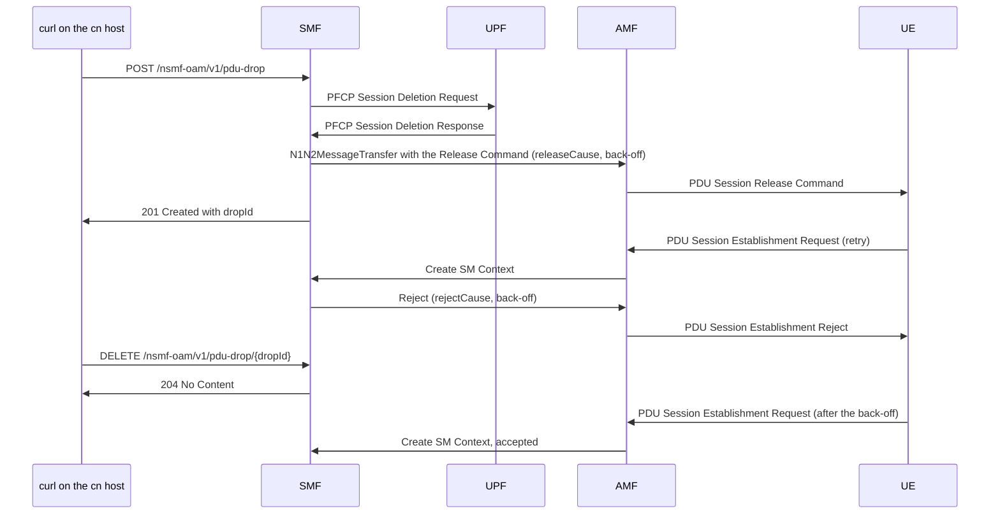

# HOWTO: manually release and restore a PDU session — with a chosen 5GSM cause and back-off timer, through the SMF OAM `pdu-drop` API

| Field | Value |
|---|---|
| Date | 2026-10-29 |
| Repo | `free5gc`, the parent repo, with the NF submodule `NFs/smf` |
| Tree | `/home/loren/Downloads/source_code/free5gc_use_open5gs_ipv6/free5gc` |
| Branch | parent `my-changes-v4.0.1`; `NFs/smf` `my-smf-changes-v1.3.2` |
| Commit | parent `c618c82`; `NFs/smf` `295e327` fix(smf): delete the PFCP session on the UPF before a graceful pdu-drop release |
| Symptom | **Not applicable.** No failure; this is a procedure doc. |
| Scope | Drop one PDU session of one UE from the core network with mode `graceful`, choose the 5GSM cause of the PDU Session Release Command and of the PDU Session Establishment Reject, choose the back-off timer, and restore the session with `DELETE`. Modes `blackhole` and `silent` are not implemented and are not covered. |
| Fix | **Not applicable.** Nothing is being fixed. |
| Rounds | **Not applicable.** No diagnose-and-fix cycle. |
| Status | **Runbook changed, not re-verified.** |
| Prior art | `2026-10-21_wnc_SPEC_manual_pdu_session_drop_on_smf_VIA_oam_api_FOR_graceful_release_blackhole_and_silent_delete.md` |

Terms used in this doc:

- **PDU session** (Protocol Data Unit session) is the 5G data connection between the UE and a data network.
- **DNN** (Data Network Name) is the 5G name for an APN, for example `fast.t-mobile.com`.
- **S-NSSAI** is the network slice, written as `sst` (Slice/Service Type) plus an optional `sd` (Slice Differentiator), for example `sst=1, sd=000001`.
- **SUPI** is the subscriber identity, for example `imsi-310260000013069`.
- **5GSM cause** is the number inside a 5G Session Management message that tells the UE why the network acted.
- **Back-off timer value** is an optional field of the Release Command and the Reject. The UE starts a back-off timer with that value and sends no new request for the blocked DNN or slice until the timer expires.
- **Drop entry** is one record in the SMF's in-memory drop list. One `POST /pdu-drop` call creates one drop entry, and the SMF names it by its `dropId`.

---

## SECTION 0. Prerequisites — what to have in place, or the runbook fails partway

1. **The SMF must be built from `NFs/smf` commit `295e327` or later.** Before that commit the graceful drop sent no PFCP Session Deletion Request, left an orphan session on the UPF, and in live test10 the orphan crashed the UPF. With the UPF gone, every later PDU session was rejected with cause #67, even after `DELETE`. `2026-10-28_wnc_ISSUE_pdu_session_still_rejected_after_delete_pdu_drop_through_API_DUE_TO_upf_crash_on_orphan_session_from_graceful_drop.md` records that failure.

2. **The SMF config must enable the drop routes without OAuth.** `config/smfcfg.yaml` is a symlink to `config/smfcfg_unbound_dns64.yaml`, and that file holds this block under `configuration:`:

   ```yaml
     pduDrop:
       enable: true
       skipOAuth: true
   ```

   With `enable: false`, or with no `pduDrop` block, the SMF does not register the routes, and every call in §1 gets `404`. With `skipOAuth: false`, every call needs an NRF token; §8 covers that route.

3. **Run the commands on the cn host, in a shell that reaches the SMF SBI address `127.0.0.2:8000`.** The test12 commands ran as `root` in the `free5gc` directory on `75N0-01N0SA-sled2-CN`.

4. **Know the SUPI, DNN and slice of the session to drop.** The SMF must match all three exactly. The UDM writes one line for each PDU session request, so this command lists them from the run's log, which sits at `log/<run timestamp>/free5gc.log` under the `free5gc` directory:

   ```
   grep -oE 'getSmDataProcedure: SUPI\[[^]]+\] PLMNID\[[0-9]+\] DNN\[[^]]+\] SNssai\[[^]]+\]' log/<run timestamp>/free5gc.log | sort -u
   ```

   On the test12 log it printed:

   ```
   getSmDataProcedure: SUPI[imsi-310260000013069] PLMNID[310260] DNN[fast.t-mobile.com] SNssai[{\"sst\":1,\"sd\":\"000001\"}]
   getSmDataProcedure: SUPI[imsi-310260000013069] PLMNID[310260] DNN[fast.t-mobile.com] SNssai[{\"sst\":1,\"sd\":\"0007d0\"}]
   getSmDataProcedure: SUPI[imsi-310260000013069] PLMNID[310260] DNN[fast.t-mobile.com] SNssai[{\"sst\":1,\"sd\":\"000bb8\"}]
   ```

## SECTION 1. Runbook — the steps to complete the task, start to finish

1. **Choose the values of the request body.** The SMF reads these fields:

   | Field | Required | Default when left out | What the SMF does with the field |
   |---|---|---|---|
   | `mode` | yes | none | Only `graceful` works. `blackhole` and `silent` get `501 Not Implemented`, and any other value gets `400`. |
   | `dnn` | yes | none | The SMF compares the value exactly against the DNN of each session. |
   | `snssai.sst` | yes | none | The value must be 0-255. |
   | `snssai.sd` | no | none | The value must be 6 hex digits. When `sd` is left out, the entry matches only sessions that have no SD. |
   | `supi` | no | none | When `supi` is present, the entry matches only that UE. When `supi` is left out, the entry matches every UE on that DNN and slice. |
   | `releaseCause` | no | 36, "regular deactivation" | The SMF puts this 5GSM cause in the PDU Session Release Command that ends the existing session. |
   | `rejectCause` | no | 26, "insufficient resources" | The SMF puts this 5GSM cause in the PDU Session Establishment Reject that answers each new request while the entry exists. |
   | `backoffSeconds` | no | 0 | 0 leaves the Back-off timer value out of both messages. A value above 0 goes into both the Release Command and every Reject. The SMF rounds the value up to the nearest value that the timer encoding can carry, and the response reports the result as `encodedBackoffSeconds`. The maximum is 35712000. |

   **Set `releaseCause` and `rejectCause` separately.** The two causes go into two different messages, and the SMF never copies one into the other. `NFs/smf/internal/sbi/processor/pdu_drop.go:87-91` reads each field with its own default:

   ```go
   	releaseCause, reason := pduDropCause(req.ReleaseCause, nasMessage.Cause5GSMRegularDeactivation, "releaseCause")
   	if reason != "" {
   		return nil, reason
   	}
   	rejectCause, reason := pduDropCause(req.RejectCause, nasMessage.Cause5GSMInsufficientResources, "rejectCause")
   ```

   The causes that tell the UE which part of the network is short of resources each start a different back-off timer on the UE. `2026-10-22_wnc_FINDING_ue_pdu_session_retry_NAMELY_3gpp_allows_ue_stops_retrying_when_no_backoff_5x3s_VS_backoff_t3396_60s_3x_VS_no_answer_t3580_16s.md` explains them; in short:

   | Cause | Name in TS 24.501 | Timer the UE starts | What the timer blocks on the UE |
   |---|---|---|---|
   | #26 | insufficient resources | T3396 | every request on that DNN, on any slice |
   | #67 | insufficient resources for specific slice and DNN | T3584 | requests for that one slice and DNN pair |
   | #69 | insufficient resources for specific slice | T3585 | requests for that slice, with any DNN |

   The free5gc `nas` library v1.1.5 defines the two slice causes in `nasMessage/NAS_CommInfoIE.go:43` and `:45`:

   ```go
   	Cause5GSMInsufficientResourcesForSpecificSliceAndDNN                 uint8 = 0x43
   	Cause5GSMInsufficientResourcesForSpecificSlice                       uint8 = 0x45
   ```

2. **Create the drop entry.** This example drops slice `000001` of one UE, with cause #69 in both messages and a 60-second back-off:

   ```
   curl -s -X POST http://127.0.0.2:8000/nsmf-oam/v1/pdu-drop -H 'Content-Type: application/json' -d '{"mode":"graceful","dnn":"fast.t-mobile.com","snssai":{"sst":1,"sd":"000001"},"supi":"imsi-310260000013069","releaseCause":69,"rejectCause":69,"backoffSeconds":60}'
   ```

3. **Read the response before going on.** Write down `dropId`, because step 5 needs it. Check that `releaseCause`, `rejectCause` and `encodedBackoffSeconds` hold the values you meant. Check the `result` of each session in `affected`:

   | `result` | Meaning |
   |---|---|
   | `release-initiated` | The SMF deleted the PFCP session on the UPF and sent the Release Command towards the UE. |
   | `released-ue-idle` | The UE was CM-IDLE, which means it had no radio connection. The SMF deleted the session without an N2 release, which is the release message the AMF sends to the radio network over the N2 interface. The AMF decides whether to page the UE. |
   | `release-failed` | The PFCP Session Deletion or the release failed, and the session stays up. The SMF log line `#WNC PDU-DROP/GRACEFUL-RELEASE dropId=<dropId> release failed` gives the reason. |

   A matching session that was not in the `Active`, `ModificationPending` or `PFCPModification` state is listed in `skipped` with `state=<state name>`, and the SMF does not touch it. When `affected` and `skipped` are both empty, no session matched, but the entry still rejects any matching session that the UE requests later.

4. **Let the UE react.** While the entry exists, the SMF rejects every new matching PDU Session Establishment Request with `rejectCause` and the back-off timer. When the UE retries is the UE's choice; §3 says what that means for the test.

5. **Restore.** Delete the entry by the `dropId` from step 3:

   ```
   curl -s -X DELETE http://127.0.0.2:8000/nsmf-oam/v1/pdu-drop/<dropId>
   ```

   A successful `DELETE` prints nothing, because the SMF answers `204 No Content`. The SMF sends nothing to the UE on restore. The UE's next request, after its back-off timer has expired, is accepted.

To drop several slices, repeat steps 2 and 3 with a different `snssai.sd` for each slice. Each call creates its own `dropId`, and each one must be deleted in step 5.

## SECTION 2. Verify — how to confirm the result is a real success, not a false pass

### The HTTP answers

| Call | Status | Meaning |
|---|---|---|
| `POST /pdu-drop` | `201 Created` | The SMF stored the entry and applied the drop. The body is the entry plus `affected` and `skipped`, and the `Location` header holds `/nsmf-oam/v1/pdu-drop/<dropId>`. |
| `POST /pdu-drop` | `400 Bad Request` | A required field is missing, a value is out of range, or the mode is unknown. The `detail` field names the problem. |
| `POST /pdu-drop` | `409 Conflict` | An entry with the same mode and selector already exists. The `detail` field names its `dropId`. |
| `POST /pdu-drop` | `501 Not Implemented` | The mode is `blackhole` or `silent`. |
| `DELETE /pdu-drop/<dropId>` | `204 No Content` | The SMF removed the entry. |
| `DELETE /pdu-drop/<dropId>` | `404 Not Found` | No entry has that `dropId`. |

The `curl -s` commands in §1 print the body only. Add `-w '\n%{http_code}\n'` to a command to print the status code as well.

### The SMF log lines

A `201` answer does not prove that the UE got the chosen cause. The SMF log does. These are the lines that one drop, one rejected retry and one restore write to `free5gc.log`, in this order:

| Order | Log line pattern | Written by | What the line proves |
|---|---|---|---|
| 1 | `#WNC PDU-DROP/REGISTRY added dropId=<dropId> mode=graceful dnn=... sst=... sd=... supi=...` | SMF | The entry is in the drop list with this selector. |
| 2 | `Sending PFCP Session Deletion Request`, then `sess deleted` | SMF, then UPF | The UPF deleted the session, so no orphan is left behind. |
| 3 | `#WNC PDU-DROP/GRACEFUL-RELEASE dropId=<dropId> PFCP session deleted on the UPF` | SMF | The SMF saw the deletion succeed. |
| 4 | `#WNC PDU-DROP/GRACEFUL-RELEASE dropId=<dropId> release command sent, cause=<releaseCause>` | SMF | The Release Command left the SMF with `releaseCause`. |
| 5 | `#WNC PDU-DROP/REJECT rejecting supi=... dnn=... dropId=<dropId> cause=<rejectCause> backoff=<seconds>s` | SMF | A drop entry blocked a new request, and this line names the entry and the cause it used. |
| 6 | `NAS Error Response: {... [46 <pdu session id> <pti> 195 <cause> 55 1 <timer>] []}` | SMF | These are the bytes of the Reject. `195` (`0xC3`) is the message type PDU Session Establishment Reject, the fifth byte is the 5GSM cause, and `55 1 <timer>` is the Back-off timer value field: tag `0x37`, length 1, and one byte of timer value. |
| 7 | `#WNC SMF-REJECT/FORWARD SMF rejected PDU Session Establishment Request[pduSessionId:<id>] with 5GSM cause #<cause>, forwarding the reject to the UE` | AMF | The AMF forwarded the Reject to the UE. |
| 8 | `#WNC PDU-DROP/RESTORE removed dropId=<dropId> mode=graceful` | SMF | The entry left the drop list. |

The reject check that writes line 5 sits in `HandlePDUSessionSMContextCreate`, at `NFs/smf/internal/sbi/processor/pdu_session.go:161-166`:

```go
	if entry := p.pduDropRejectEntry(smContext); entry != nil {
		smContext.Log.Infof("#WNC PDU-DROP/REJECT rejecting supi=%s dnn=%s dropId=%s cause=%d backoff=%ds",
			smContext.Supi, smContext.Dnn, entry.DropId, entry.RejectCause, entry.EncodedBackoffSeconds)
		p.makeEstRejectResAndReleaseSMContextWithBackoff(c, smContext,
			entry.RejectCause, entry.Backoff, &smf_errors.N1SmError)
		return
```

The timer byte in line 6 holds a unit in its top 3 bits and a count in its low 5 bits. `NFs/smf/internal/context/gsm_build.go:41-50` lists the units the SMF uses, finest first:

```go
var gprsTimer3Units = []struct {
	unit uint8
	step uint32
}{
	// 2 seconds
	{unit: 3, step: 2},
	// 30 seconds
	{unit: 4, step: 30},
	// 1 minute
	{unit: 5, step: 60},
```

For example, test12's byte `126` is `0x7e`, which is `011 11110` in binary. That is unit 3 (2-second steps) and count 30, so the back-off is 60 seconds.

The same order, drawn as messages between the programs:



Run this on the run's log to print lines 1 and 3 to 8 of the table:

```
grep -nE 'PDU-DROP|SMF-REJECT|NAS Error Response' log/<run timestamp>/free5gc.log
```

### Check that the UPF survived

The drop deletes a session on the UPF, so check that the UPF is still alive after the test. This command prints a line for each orphan answer, each UPF crash and each lost heartbeat, and it must print nothing:

```
grep -nE 'rsp SEID is 0|level="fatal"|PFCP Heartbeat error' log/<run timestamp>/free5gc.log
```

## SECTION 3. Limits — what the runbook cannot tell you, and what still needs a full test

- **The SMF log proves what the core network sent, not what the UE did with it.** Whether the UE started the right back-off timer, and when the UE retries, is visible only in the UE's own log, for example a QXDM capture (QXDM is Qualcomm's modem log tool).
- **A restore does not make the UE retry.** In test12, slice `000001` came back at 15:54:07, but slice `0007d0` sent no request at all between its restore at 15:53:18 and the end of the log at 16:10:36. TS 24.501 does not oblige the UE to set the session up again; the FINDING named in §1 step 1 explains this.
- **Only mode `graceful` exists.** A test that needs the UE to keep its IP address while traffic stops (`blackhole`), or a drop with no signaling at all (`silent`), cannot be run yet.
- **Drop entries live only in SMF memory.** Restarting the SMF removes every entry, and no entry expires on its own.

## SECTION 4. Revert — how to get back to a clean state, and what is left behind

1. Delete every entry you created, by `dropId`:

   ```
   curl -s -X DELETE http://127.0.0.2:8000/nsmf-oam/v1/pdu-drop/<dropId>
   ```

2. List the entries that remain. The SMF answers `[]` when the list is empty:

   ```
   curl -s http://127.0.0.2:8000/nsmf-oam/v1/pdu-drop
   ```

   This `GET` has not been run in any recorded test; §10 says so.

What a revert leaves behind:

- **The UE's back-off timer keeps running.** The SMF sends nothing to the UE on restore, so the UE stays blocked until its own timer expires.
- **The released session is not re-established by the core network.** Only the UE can ask for it again.

## SECTION 5. Traps — the result may look correct but is wrong; check before you trust it

- **Setting only `releaseCause` leaves the Reject on #26.** In test12 the Release Commands carried cause=69, and the Reject at 15:53:06 carried cause=26, because the request body had no `rejectCause`. The `POST` response showed this already, as `"releaseCause":69,"rejectCause":26`. Read both fields in the response before trusting the test.
- **Cause #26 with a back-off blocks the whole DNN on the UE.** All three test slices use the DNN `fast.t-mobile.com`. A drop of one slice with a #26 back-off therefore stops the UE from asking for any slice of that DNN until T3396 expires, which is wider than the one slice the SMF blocks. Use #67 to block exactly the slice and DNN pair that the entry selects.
- **A `204` from `DELETE` proves only that the drop list changed.** It says nothing about the UPF. In test10 both `DELETE` calls succeeded while the UPF had already crashed, and every later request got cause #67. Run the UPF check at the end of §2.
- **Only the SMF's `#WNC PDU-DROP/REJECT rejecting` line means that a drop entry caused a reject.** An AMF built before the ISSUE's fix printed `#WNC PDU-DROP/REJECT` for every SMF reject, including the #67 rejects of a dead UPF. A current AMF prints `#WNC SMF-REJECT/FORWARD ... with 5GSM cause #<cause>` instead.
- **One drop is not a test of the UPF's session clean-up.** The UPF crash in test10 needed a freed session slot before an orphan. Drop at least two sessions in a row when testing a change to the release path.
- **A second `POST` with the same selector gets `409`.** Delete the old entry first, or the new cause and back-off are not applied.

## SECTION 6. Why not the normal method — the obvious route is slower, blocked, or silently wrong

In a live operator network a PDU session fails at random and comes back at random, so the UE's automatic recovery cannot be tested on demand by waiting for it. The `pdu-drop` API lets the tester choose the session, the moment of the drop, the moment of the return, and the cause and back-off that the UE receives. Waiting for a real failure gives none of those choices, and the cause it carries is whatever the failing network element sends.

## SECTION 7. The reusable rules — what to carry from this runbook to similar tasks

- **A release and a later reject are two messages, and each carries its own cause.** Any core-network test that ends a session and then blocks its return must set both causes on purpose.
- **Check a cause in the bytes the network sent, not in the request you made.** The fifth byte of the Reject in the SMF's `NAS Error Response` line is what the UE received.
- **A restore on the core network reaches the UE only through the UE's next request.** The test result therefore depends on the UE's retry policy and its running back-off timer, not on the restore alone.

## SECTION 8. Variant routes — when to use an alternate route instead of the runbook, and how

- **When the SMF config has `skipOAuth: false`,** each call needs a Bearer token from the NRF. The SPEC, `2026-10-21_wnc_SPEC_manual_pdu_session_drop_on_smf_VIA_oam_api_FOR_graceful_release_blackhole_and_silent_delete.md`, section 9.3, gives the commands. The SPEC states that those commands were derived from the NRF source and have never been run on the cn host.
- **When every UE on a slice must lose its session,** leave `supi` out of the request body. The entry then matches every UE on that DNN and slice. `NFs/smf/internal/context/pdu_drop.go:33-41` holds the rule:

  ```go
  func (s DropSelector) Matches(supi, dnn string, snssai *models.Snssai) bool {
  	if snssai == nil || s.Dnn != dnn || s.Snssai.Sst != snssai.Sst {
  		return false
  	}
  	if !strings.EqualFold(s.Snssai.Sd, snssai.Sd) {
  		return false
  	}
  	return s.Supi == "" || s.Supi == supi
  }
  ```

  No recorded test has run a drop without `supi`.

## SECTION 9. Worked example — a real run, and the exact output that run printed, to compare against

test12 ran on the cn host `75N0-01N0SA-sled2-CN` on 2026-10-29, with the SMF from `NFs/smf` commit `295e327`. The UE was `imsi-310260000013069`, with three PDU sessions on the DNN `fast.t-mobile.com`, slices `000001`, `0007d0` and `000bb8`. The request bodies set `releaseCause` and `backoffSeconds` but not `rejectCause`, so the Reject used the default #26. The tester recorded no timestamps for the commands; the log times below come from the SMF.

The commands and their output, as pasted from the cn host:

```
[root@75N0-01N0SA-sled2-CN free5gc]#   curl -s -X POST http://127.0.0.2:8000/nsmf-oam/v1/pdu-drop -H 'Content-Type: application/json' -d '{"mode":"graceful","dnn":"fast.t-mobile.com","snssai":{"sst":1,"sd":"000001"},"supi":"imsi-310260000013069","releaseCause":69,"backoffSeconds":60}'
{"dropId":"1","mode":"graceful","selector":{"dnn":"fast.t-mobile.com","snssai":{"sst":1,"sd":"000001"},"supi":"imsi-310260000013069"},"releaseCause":69,"rejectCause":26,"encodedBackoffSeconds":60,"createdAt":"2026-10-29T15:52:06.762365929+08:00","affected":[{"supi":"imsi-310260000013069","pduSessionId":3,"result":"release-initiated"}],"skipped":[]}[root@75N0-01N0SA-sled2-CN free5gc]# 
[root@75N0-01N0SA-sled2-CN free5gc]#   curl -s -X POST http://127.0.0.2:8000/nsmf-oam/v1/pdu-drop -H 'Content-Type: application/json' -d '{"mode":"graceful","dnn":"fast.t-mobile.com","snssai":{"sst":1,"sd":"0007d0"},"supi":"imsi-310260000013069","releaseCause":69,"backoffSeconds":120}'
{"dropId":"2","mode":"graceful","selector":{"dnn":"fast.t-mobile.com","snssai":{"sst":1,"sd":"0007d0"},"supi":"imsi-310260000013069"},"releaseCause":69,"rejectCause":26,"encodedBackoffSeconds":120,"createdAt":"2026-10-29T15:52:55.687242064+08:00","affected":[{"supi":"imsi-310260000013069","pduSessionId":4,"result":"release-initiated"}],"skipped":[]}[root@75N0-01N0SA-sled2-CN free5gc]# 
[root@75N0-01N0SA-sled2-CN free5gc]#   curl -s -X DELETE http://127.0.0.2:8000/nsmf-oam/v1/pdu-drop/1
[root@75N0-01N0SA-sled2-CN free5gc]#   curl -s -X DELETE http://127.0.0.2:8000/nsmf-oam/v1/pdu-drop/2
```

The matching lines of `my_logs/test12-reject-cause-was-changed-when ue-try-to-register-again/free5gc/log/20261029_154502/free5gc.log`, in order:

```
4313:time="2026-10-29T15:52:06.762382377+08:00" level="info" msg="#WNC PDU-DROP/REGISTRY added dropId=1 mode=graceful dnn=fast.t-mobile.com sst=1 sd=\"000001\" supi=\"imsi-310260000013069\"" CAT="PduSess" NF="SMF"
4323:time="2026-10-29T15:52:06.762788674+08:00" level="info" msg="Sending PFCP Session Deletion Request" CAT="PduSess" NF="SMF"
4331:time="2026-10-29T15:52:06.763240070+08:00" level="info" msg="sess deleted" CAT="PFCP" CPNodeID="192.168.0.2" CPSEID="0x1" LAddr="5.5.5.2:8805" NF="UPF" UPSEID="0x1"
4365:time="2026-10-29T15:52:06.783115632+08:00" level="info" msg="#WNC PDU-DROP/GRACEFUL-RELEASE dropId=1 PFCP session deleted on the UPF" CAT="PduSess" NF="SMF" pdu_session_id="3" supi="imsi-310260000013069"
4390:time="2026-10-29T15:52:06.800070469+08:00" level="info" msg="#WNC PDU-DROP/GRACEFUL-RELEASE dropId=1 release command sent, cause=69" CAT="PduSess" NF="SMF" pdu_session_id="3" supi="imsi-310260000013069"
4616:time="2026-10-29T15:52:55.687255634+08:00" level="info" msg="#WNC PDU-DROP/REGISTRY added dropId=2 mode=graceful dnn=fast.t-mobile.com sst=1 sd=\"0007d0\" supi=\"imsi-310260000013069\"" CAT="PduSess" NF="SMF"
4626:time="2026-10-29T15:52:55.687710428+08:00" level="info" msg="Sending PFCP Session Deletion Request" CAT="PduSess" NF="SMF"
4634:time="2026-10-29T15:52:55.688224359+08:00" level="info" msg="sess deleted" CAT="PFCP" CPNodeID="192.168.0.2" CPSEID="0x2" LAddr="5.5.5.2:8805" NF="UPF" UPSEID="0x2"
4670:time="2026-10-29T15:52:55.707193612+08:00" level="info" msg="#WNC PDU-DROP/GRACEFUL-RELEASE dropId=2 PFCP session deleted on the UPF" CAT="PduSess" NF="SMF" pdu_session_id="4" supi="imsi-310260000013069"
4695:time="2026-10-29T15:52:55.724604846+08:00" level="info" msg="#WNC PDU-DROP/GRACEFUL-RELEASE dropId=2 release command sent, cause=69" CAT="PduSess" NF="SMF" pdu_session_id="4" supi="imsi-310260000013069"
4976:time="2026-10-29T15:53:06.843952382+08:00" level="info" msg="#WNC PDU-DROP/REJECT rejecting supi=imsi-310260000013069 dnn=fast.t-mobile.com dropId=1 cause=26 backoff=60s" CAT="PduSess" NF="SMF" pdu_session_id="13" supi="imsi-310260000013069"
4977:time="2026-10-29T15:53:06.844029463+08:00" level="warning" msg="NAS Error Response: {0xc0009531d0 [46 13 43 195 26 55 1 126] []}" CAT="SBI" NF="SMF"
4981:time="2026-10-29T15:53:06.844941431+08:00" level="warning" msg="#WNC SMF-REJECT/FORWARD SMF rejected PDU Session Establishment Request[pduSessionId:13] with 5GSM cause #26, forwarding the reject to the UE" CAT="Gmm" NF="AMF" amf_ue_ngap_id="RU:65540,AU:4(3GPP)" supi="SUPI:imsi-310260000013069"
4996:time="2026-10-29T15:53:10.023391524+08:00" level="info" msg="#WNC PDU-DROP/RESTORE removed dropId=1 mode=graceful" CAT="PduSess" NF="SMF"
5033:time="2026-10-29T15:53:18.266232376+08:00" level="info" msg="#WNC PDU-DROP/RESTORE removed dropId=2 mode=graceful" CAT="PduSess" NF="SMF"
5473:time="2026-10-29T15:54:07.959517145+08:00" level="info" msg="New session" CAT="PFCP" CPNodeID="192.168.0.2" CPSEID="0x4" LAddr="5.5.5.2:8805" NF="UPF" UPSEID="0x2"
5507:time="2026-10-29T15:54:07.962221252+08:00" level="info" msg="Received PFCP Session Establishment Accepted Response" CAT="PduSess" NF="SMF"
```

What the run shows:

- The UE retried slice `000001` at 15:53:06, exactly 60 seconds after the Release Command at 15:52:06, and drop entry 1 rejected that retry with cause #26 and a 60-second back-off. The Reject bytes `[46 13 43 195 26 55 1 126]` carry cause `26` in the fifth byte and the timer byte `126`, which is 60 seconds.
- The UE asked for slices `000001` and `000bb8` again at 15:54:07 and 15:54:08, after both restores, and both sessions were established.
- The UE sent no request for slice `0007d0` between its restore at 15:53:18 and the end of the log at 16:10:36.
- The UPF check at the end of §2 printed nothing for this log.

## SECTION 10. Revisions — update history, and which doc or finding forced each change

2026-10-29 — first written from the test12 run, after the Reject in test12 carried cause #26 while the
  Release Command carried cause #69. Executable: yes. test12 ran §1 steps 2, 3 and 5 on the cn host
  without `rejectCause`. The runbook adds `rejectCause` to the step 2 body, and §4 adds the `GET` list
  call; neither has been run, so `Status` is `Runbook changed, not re-verified`.

## SECTION 11. Related — other docs connected to this doc

- `2026-10-21_wnc_SPEC_manual_pdu_session_drop_on_smf_VIA_oam_api_FOR_graceful_release_blackhole_and_silent_delete.md` — the design of the `pdu-drop` API that this runbook drives, including the `skipOAuth: false` route that §8 points at.
- `2026-10-28_wnc_ISSUE_pdu_session_still_rejected_after_delete_pdu_drop_through_API_DUE_TO_upf_crash_on_orphan_session_from_graceful_drop.md` — the UPF crash that §0 item 1 and the UPF check in §2 guard against.
- `2026-10-22_wnc_FINDING_ue_pdu_session_retry_NAMELY_3gpp_allows_ue_stops_retrying_when_no_backoff_5x3s_VS_backoff_t3396_60s_3x_VS_no_answer_t3580_16s.md` — how the UE treats each cause and back-off timer, and why the UE may never retry after a restore.
