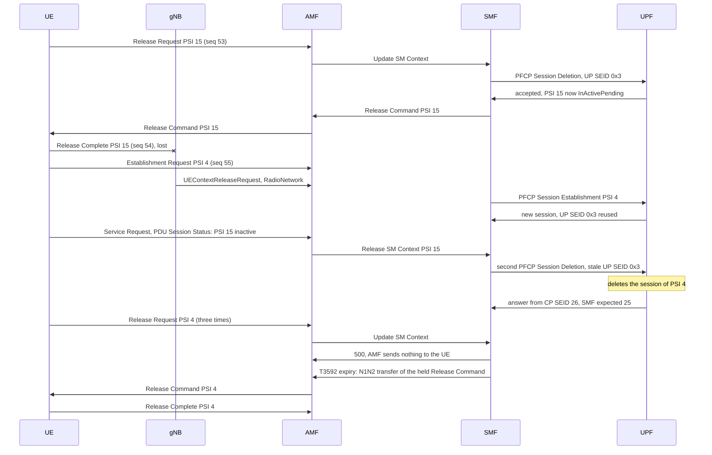
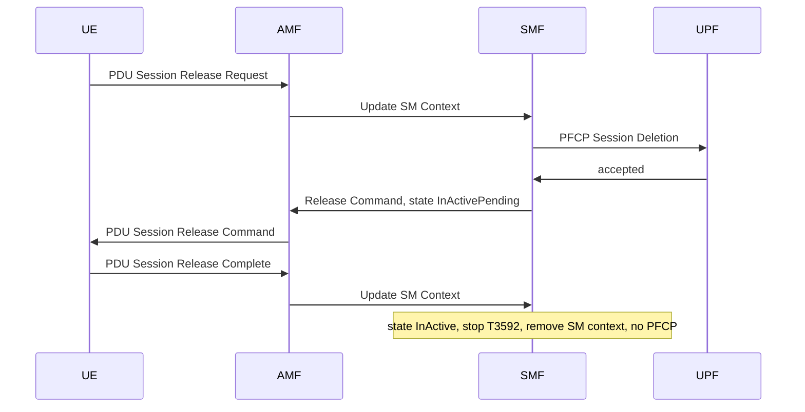
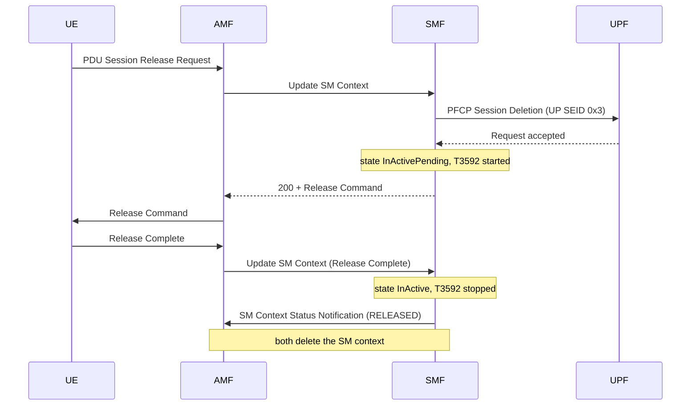
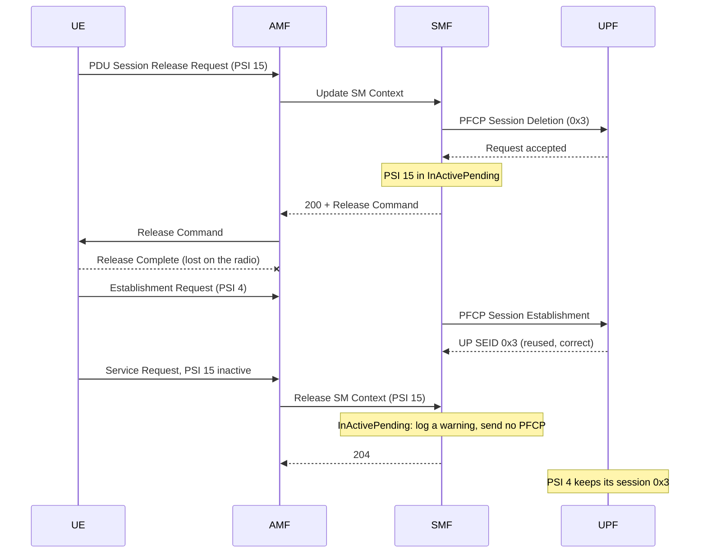
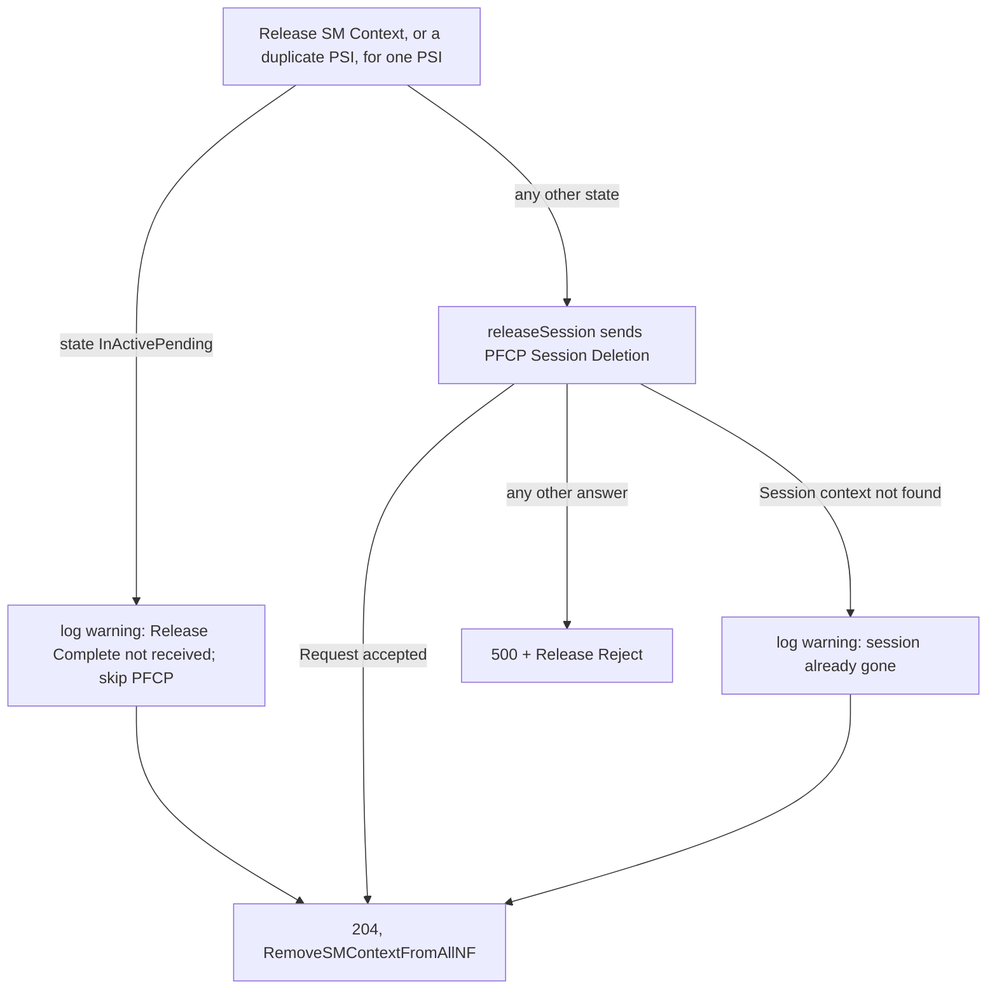

# ISSUE: a new PDU session gets no IPv6 prefix and its release request is not answered — the SMF deleted a reused UP SEID after a lost Release Complete

| Field | Value |
|---|---|
| Date | 2026-10-30 |
| Repo | `free5gc`, the parent repo, with the NF submodules `NFs/smf`, `NFs/upf` and `NFs/amf` |
| Tree | `/home/loren/Downloads/source_code/free5gc_use_open5gs_ipv6/free5gc` |
| Branch | parent `my-changes-v4.0.1`; `NFs/smf` `my-smf-changes-v1.3.2`; `NFs/upf` `my-upf-changes-v1.2.6`; `NFs/amf` `my-amf-changes-v1.3.2` |
| Commit | parent `c618c82` docs: add PLAN, FINDING and ISSUE for the pdu-drop feature; update SPEC. `NFs/smf` `295e327` fix(smf): delete the PFCP session on the UPF before a graceful pdu-drop release. `NFs/upf` `d823190` fix(upf): skip freed session slots in RemoteSess instead of panicking. `NFs/amf` `52ff342` fix(amf): log the 5GSM cause of a forwarded SMF reject instead of a pdu-drop tag. The code quoted in this doc is read from these commits. The NF version lines in the test13 log report a build time of `2026-10-28T07:40` to `07:41` UTC; which commit each binary was built from was not confirmed. |
| Symptom | `Sending PFCP Session Deletion Request error: received unexpected SEID response message: {... SEID:26 ...}, exptcted: 25`, then no Router Advertisement for the new PDU session and `Update SMContext error [pduSessionID: 4], Error[500, Internal Server Error]` for each of its release requests |
| Scope | One UE (`imsi-310260000013069`), one UPF at `5.5.5.2`, slice `sd 000bb8` (`3000`), DNN `fast.t-mobile.com`, IPv6-only PDU sessions. The radio-side cause of the lost uplink message was not investigated. |
| Fix | `NFs/smf` `63b1eeb` fix(smf): recover from a lost PDU Session Release Complete. `NFs/amf` `91f82ec` fix(amf): forward the SMF's 5GSM reject from Update SM Context to the UE. The SMF commit fixes defects 1, 3, 5 and 6, and the AMF commit fixes defect 4; §6 lists the functions. The UPF is not changed. |
| Rounds | 1 |
| Status | **Fixed, partly verified.** The unit tests and the live check of the normal release in test14 passed (§7). The recovery from a lost Release Complete has not run live, because no Release Complete was lost in test14. |
| Prior art | `2026-10-28_wnc_ISSUE_pdu_session_still_rejected_after_delete_pdu_drop_through_API_DUE_TO_upf_crash_on_orphan_session_from_graceful_drop.md` |

---

## SECTION 0. Symptom — evidence collected at the time of the failure

### Verbatim failure output

The tester reported two problems from the UE modem log. The modem log file itself was not captured into
`my_logs`; the two problems below are the tester's words, pasted in the session:

```
  1. Why did PSI 4 get no IPv6 prefix? It was accepted at modem 16:51:28.80, 0.2 s after PSI 15 was released (modem
     16:51:28.58), on the same slice (sd 3000).
  2. Why did the network not answer the release request three times? The UE sent it at modem 16:51:40.81, 16:51:56.78 and
     16:52:12.86. The network answered only the fourth request, at 16:52:28.97, with RELEASE_COMMAND (PTI:31, …
     REGULAR_DEACTIVATION).
```

The tester also pasted these modem log lines, which show that the UE sent PDU Session Release Complete
for PSI 15 before it asked for PSI 4:

```
963912    16:51:28.579801 2026/10/30    NW->MS    VGSM    PDU_SESSION_RELEASE_COMMAND     (PTI:28, PSI:15, 5GSM cause:"VGSM_CAUSE_REGULAR_DEACTIVATION")
963964    16:51:28.579801 2026/10/30    MS->NW    VGSM    PDU_SESSION_RELEASE_COMPLETE     (PTI:28, PSI:15)
964245    16:51:28.579801 2026/10/30    MS->NW    VGMM    UL_NAS_TRANSPORT     (payload container type: N1_SM_INFO)
967906    16:51:28.579801 2026/10/30    MS->NW    VGSM    PDU_SESSION_ESTABLISHMENT_REQUEST     (PTI:29, PSI:4)
968274    16:51:28.579801 2026/10/30    MS->NW    VGMM    UL_NAS_TRANSPORT     (payload container type: N1_SM_INFO)
```

In the core network log,
`my_logs/test13-cn-not-provide-ipv6-prefix-and-not-reply-ue-pdu-release-request/free5gc/log/20261030_133610/free5gc.log`,
the failure starts when the UPF deletes the session of PSI 4 (`CPSEID="0x1a"`) in answer to a deletion
that the SMF sent for PSI 15 (expected SEID 25, which is `0x19`):

```
time="2026-10-30T16:51:30.269057942+08:00" level="info" msg="sess deleted" CAT="PFCP" CPNodeID="192.168.0.2" CPSEID="0x1a" LAddr="5.5.5.2:8805" NF="UPF" UPSEID="0x3"
time="2026-10-30T16:51:30.272426177+08:00" level="warning" msg="Sending PFCP Session Deletion Request error: received unexpected SEID response message: {Version:1 MP:0 S:1 MessageType:55 MessageLength:377 SEID:26 SequenceNumber:1253 MessagePriority:0}, exptcted: 25" CAT="PduSess" NF="SMF"
```

Each later release request for PSI 4 fails in the SMF, and the AMF sends nothing to the UE:

```
time="2026-10-30T16:51:58.111095942+08:00" level="error" msg="handleSessionDeletionRequest: Sess: sess not found (lSeid:0x3)" CAT="PFCP" LAddr="5.5.5.2:8805" NF="UPF"
time="2026-10-30T16:51:58.111302031+08:00" level="warning" msg="Sending PFCP Session Deletion Request error: received unexpected SEID response message: {Version:1 MP:0 S:1 MessageType:55 MessageLength:22 SEID:0 SequenceNumber:1260 MessagePriority:0}, exptcted: 26" CAT="PduSess" NF="SMF"
time="2026-10-30T16:51:58.111943591+08:00" level="error" msg="Update SMContext error [pduSessionID: 4], Error[500, Internal Server Error]" CAT="Gmm" NF="AMF" amf_ue_ngap_id="RU:65552,AU:16(3GPP)" supi="SUPI:imsi-310260000013069"
```

### Variations of the same symptom

- The SEID numbers in `unexpected SEID ... SEID:<n> ..., exptcted: <m>` change with each session. In
  test13 the pairs were `26`/`25`, `27`/`26` and `0`/`26`. `SEID:0` means the UPF found no session at
  all; any other mismatch means the UPF acted on a different PDU session.
- The message type in the same line is `MessageType:55` for a PFCP Session Deletion and
  `MessageType:53` for a PFCP Session Modification. Both happened in test13.
- The PSI values change. The session whose Release Complete was lost is the one in `InActivePending`;
  in test13 that was PSI 15. The sessions hurt by the stale SEID are whichever ones the UPF created next;
  in test13 those were PSI 4 and PSI 7.
- The UPF log line `Mod UpdateFAR error: UpdateFAR: FAR(0x<id>) not found` appears when a stale
  Session Modification reaches a session that does not hold that FAR ID. The ID changes from run to run.

### The confirming state

Four facts together separate this bug from other "no IPv6 prefix" failures:

1. **The UPF gives every new session the same UP SEID.** In test13 PSI 15, PSI 4, PSI 7 and PSI 3 were
   all `UPSEID="0x3"`, with CP SEIDs `0x19`, `0x1a`, `0x1b` and `0x1c`. The UP SEID is the UPF's own
   number for the session, and the CP SEID is the SMF's number.
2. **The UPF logs `sess deleted` with a CP SEID that the SMF did not intend.** At 16:51:30.269 the SMF
   was releasing PSI 15 (`0x19`) and the UPF deleted `0x1a`.
3. **The SMF never logs a Router Solicitation event for the hurt session.** For PSI 4 (CP SEID 26) this
   command returns `0` on the test13 `free5gc.log`:

   ```
   grep -c 'Router Solicitation event received for SEID 26,' free5gc.log
   ```

   The line that would be present for a working session is absent. For comparison, PSI 15 logged
   `WNC: Router Solicitation event received for SEID 25, URR 7` at 16:51:07.655, and PSI 7 logged
   `WNC: Router Solicitation event received for SEID 27, URR 7` at 16:51:30.625.
4. **The UL NAS sequence numbers that the AMF received have a gap at the lost Release Complete.** The
   AMF logged `sequenceNumber 53` (Release Request for PSI 15) at 16:51:29.567 and
   `sequenceNumber 55` (Establishment Request for PSI 4) at 16:51:29.760. Number 54, the Release
   Complete, never arrived.

### The sequence

Legend:

| Label | Source | Clock |
|---|---|---|
| `AMF`, `SMF`, `UPF` | `my_logs/test13-cn-not-provide-ipv6-prefix-and-not-reply-ue-pdu-release-request/free5gc/log/20261030_133610/free5gc.log`; the `NF=` field names the writer, and the line number is given in `Explain` | `logrus` wall clock, nanoseconds, `+08:00`, on the core network host |
| `pcap` | `my_logs/test13-cn-not-provide-ipv6-prefix-and-not-reply-ue-pdu-release-request/free5gc/log/20261030_133610/free5gc.pcap`, decoded with `tshark` | capture clock on the core network host, microseconds |
| `modem` | the tester's modem log, pasted in the session | the modem clock. The modem printed one timestamp, `16:51:28.579801`, for five different messages, so the modem log gives their order but not their times. |
| `code` | source in the tree named in the metadata | none |

The core network clock runs about 1.25 to 1.30 seconds ahead of the modem clock. The UE sent the
release requests for PSI 4 at modem 16:51:40.81 and 16:51:56.78, and the AMF received them at
16:51:42.065 (`sequenceNumber 58`) and 16:51:58.080 (`sequenceNumber 59`).

#### Table A — the lost Release Complete, and how PSI 4 lost its UPF session

| # | From | Time | Evidence | Explain |
|---|---|---|---|---|
| 1 | AMF | 16:51:29.567797 | `sequenceNumber 53` | Line 74762. The AMF received the UE's PDU Session Release Request for PSI 15. |
| 2 | SMF | 16:51:29.584343 | `N1 Message: 2e0f1cd1` with `pdu_session_id="15"` | Line 74781. The bytes are `2e` (5GSM), `0f` (PSI 15), `1c` (PTI 28) and `d1` (PDU Session Release Request). |
| 3 | code | — | `p.sendGSMPDUSessionReleaseCommand(smContext, buf)` | `NFs/smf/internal/sbi/processor/pdu_session.go:451`. The SMF built the Release Command and started T3592, its retransmission timer for that command. T3592 logs nothing when it starts. |
| 4 | SMF | 16:51:29.652827 | `Sending PFCP Session Deletion Request` | Line 74845. The normal release deleted the UPF session of PSI 15. |
| 5 | UPF | 16:51:29.653365 | `sess deleted` with `CPSEID="0x19"` and `UPSEID="0x3"` | Line 74853. UP SEID `0x3` went onto the UPF's free list. |
| 6 | SMF | 16:51:29.671021 | `In case SessionReleaseSuccess` | Line 74888. The SMF set PSI 15 to `InActivePending`, which means the UPF session is gone and the SMF is waiting for the UE's Release Complete. The SMF still kept UP SEID `0x3` for PSI 15. |
| 7 | pcap | 16:51:29.673243 | `PDUSessionResourceReleaseCommand, DL NAS transport, PDU session release command (Regular deactivation)` | The AMF sent the Release Command to the gNB at `192.168.0.184`. |
| 8 | modem | 16:51:28.579801 | `MS->NW    VGSM    PDU_SESSION_RELEASE_COMPLETE     (PTI:28, PSI:15)` | The UE sent Release Complete for PSI 15, with UL NAS sequence number 54. |
| 9 | AMF | — | absent: no `sequenceNumber 54` | **The Release Complete was lost between the UE and the AMF.** The pcap holds no NGAP message for it between 16:51:29.673 and 16:51:29.759. |
| 10 | AMF | 16:51:29.760215 | `sequenceNumber 55` | Line 74913. The AMF received the next uplink NAS message, the PDU Session Establishment Request for PSI 4. |
| 11 | pcap | 16:51:29.759604 | `UEContextReleaseRequest [Cause: RadioNetwork=unspecified]` | The gNB asked to release the UE's radio connection, in the same capture timestamp as `PDUSessionResourceReleaseResponse`. A radio-side failure fits this cause; it was not investigated. |
| 12 | UPF | 16:51:29.985140 | `New session` with `CPSEID="0x1a"` and `UPSEID="0x3"` | Line 75215. The UPF gave PSI 4 the UP SEID that PSI 15 had freed 0.33 seconds earlier. |
| 13 | SMF | 16:51:30.015757 | `Unexpected state, expect: [InActive], actual:[InActivePending]` with `pdu_session_id="15"` | Line 75300. The N2 release response for PSI 15 arrived, but the SMF keeps the SM context until the Release Complete arrives, which it never did. |
| 14 | AMF | 16:51:30.211605 | `Handle Service Request` | Line 75349. The UE came back on a new radio connection. The Service Request's PDU Session Status IE (the list of PSIs that the UE still holds) marks `PSI(15): PDU SESSION INACTIVE` and `PSI(4): Not PDU SESSION INACTIVE` in the pcap. |
| 15 | AMF | 16:51:30.227178 | `Release Inactive PDU Session[15] over  \"3GPP_ACCESS\"` | Line 75363. The AMF still held PSI 15 and the UE did not, so the AMF asked the SMF to release PSI 15 with cause `PDU_SESSION_STATUS_MISMATCH`. |
| 16 | code | — | `pfcpResponseStatus := releaseSession(smContext)` | `NFs/smf/internal/sbi/processor/pdu_session.go:1008`, in `HandlePDUSessionSMContextRelease`. The handler stopped T3592 and called `releaseSession` without checking that the UPF session was already gone. |
| 17 | SMF | 16:51:30.268533 | `Sending PFCP Session Deletion Request` | Line 75397. **This is the faulty step.** The SMF sent a second deletion for PSI 15, addressed to the stale UP SEID `0x3`. |
| 18 | UPF | 16:51:30.269057 | `sess deleted` with `CPSEID="0x1a"` and `UPSEID="0x3"` | Line 75405. **The UPF deleted the session of PSI 4.** A PFCP Session Deletion Request carries only the UP SEID, so the UPF cannot tell that the request was meant for an older session. |
| 19 | SMF | 16:51:30.272426 | `received unexpected SEID response message: {... SEID:26 ...}, exptcted: 25` | Line 75415. The SMF noticed that the answer came from the wrong session only after the UPF had deleted it. The SMF answered `500` to the AMF (line 75419). |
| 20 | UPF | 16:51:30.556891 | `New session` with `CPSEID="0x1b"` and `UPSEID="0x3"` | Line 75734. PSI 7 was created and took UP SEID `0x3` again. |
| 21 | UPF | 16:51:30.587386 | `Mod UpdateFAR error: UpdateFAR: FAR(0x4d) not found` with `CPSEID:0x1b` | Line 75830. The gNB's N2 setup response for PSI 4 made the SMF send a PFCP Session Modification to UP SEID `0x3`, and that request reached PSI 7's session. |
| 22 | SMF | 16:51:30.587885 | `Sending PFCP Session Modification Request to AN UPF error: received unexpected SEID response message: {... SEID:27 ...}, exptcted: 26` | Line 75833. The SMF answered `403` to the AMF (line 75836). PSI 4 now had no UPF session, so no RS-monitor rule existed for it and its Router Solicitation never reached the SMF. |

#### Table B — the four release requests for PSI 4

| # | From | Time | Evidence | Explain |
|---|---|---|---|---|
| 1 | SMF | 16:51:42.080894 | `N1 Message: 2e041fd1` with `pdu_session_id="4"` | Line 75968. Release request 1 (PTI 31). The UE sent it at modem 16:51:40.81. |
| 2 | UPF | 16:51:42.151959 | `sess deleted` with `CPSEID="0x1b"` and `UPSEID="0x3"` | Line 76040. The deletion for PSI 4 went to UP SEID `0x3` and **deleted PSI 7's session**. |
| 3 | SMF, AMF | 16:51:42.155105 | `exptcted: 26`, then `Update SMContext error [pduSessionID: 4], Error[500, Internal Server Error]` | Lines 76050 and 76055. The SMF answered `500`. The AMF sent nothing to the UE. |
| 4 | UPF | 16:51:58.111095 | `handleSessionDeletionRequest: Sess: sess not found (lSeid:0x3)` | Line 76156. Release request 2: no session held `0x3` any more, and the UPF answered with SEID `0`. |
| 5 | SMF, AMF | 16:51:58.111302 | `SEID:0 ... exptcted: 26`, then `Error[500, Internal Server Error]` | Lines 76158 and 76163. Same result as row 3. |
| 6 | UPF, SMF, AMF | 16:52:14.121954 | `sess not found (lSeid:0x3)`, `SEID:0 ... exptcted: 26`, `Error[500, Internal Server Error]` | Lines 76244, 76246 and 76251. Release request 3, same result. |
| 7 | AMF | 16:52:30.124157 | `Handle N1N2 Message Transfer Request` | Line 76344. T3592, started while release request 3 was handled, expired and sent the Release Command it had held since then. Neither the SMF nor T3592 logs this; it is matched by being the only N1N2 transfer for PSI 4 at that time. |
| 8 | SMF | 16:52:30.125972 | `N1 Message: 2e041fd1` | Line 76358. Release request 4 reached the SMF handler 1.8 milliseconds after row 7, and failed like requests 2 and 3 (lines 76376 to 76383). |
| 9 | SMF | 16:52:30.158255 | `N1 Message: 2e041fd4` | Line 76413. The UE answered the Release Command from row 7 with Release Complete (`d4`), and PSI 4 was released. |

The order of the calls in both tables, drawn without timestamps:



### Check command

This command prints a line for every PFCP answer that came from a different session than the SMF
expected. Run it on the `free5gc.log` of a test run:

```
grep -nE 'unexpected SEID response message' <free5gc.log>
```

| Run | Printed |
|---|---|
| test13, without a fix | six lines, 75415, 75833, 76050, 76158, 76246 and 76378, all between 16:51:30 and 16:52:30. The three hours of the same log before 16:51:30 print nothing. |
| test14, with the fix | nothing. test14 lost no Release Complete, so this result covers only the normal release; see §7. |

### What this is NOT

- **An IPv6-only PDU session on the IPv6 N3 tunnel.** That bug, fixed by `NFs/smf` commit `6385550`
  fix(smf): use the IPv4 N3 tunnel for IPv6-only PDU sessions so the RA is sent, also gives no
  Router Advertisement. There the UPF session exists, but the N3 tunnel used an IPv6 address while the
  gNB and the core network talk only IPv4 on N3. Here the UPF session of the PDU session is missing,
  and the `unexpected SEID` line above is present.
- **The UE not sending Release Complete.** The modem log shows the UE sent it, and the AMF's UL NAS
  sequence numbers show it was lost on the way.
- **A UPF crash.** The UPF kept running and answered every PFCP request. The UPF crash on an orphan
  session is a different bug, described in
  `2026-10-28_wnc_ISSUE_pdu_session_still_rejected_after_delete_pdu_drop_through_API_DUE_TO_upf_crash_on_orphan_session_from_graceful_drop.md`.
- **The UE giving up on retries.** The UE kept sending the release request every 16 seconds, and the
  core network received all four. How the test UE retries PDU Session Establishment Requests is described
  in
  `2026-10-22_wnc_FINDING_ue_pdu_session_retry_NAMELY_3gpp_allows_ue_stops_retrying_when_no_backoff_5x3s_VS_backoff_t3396_60s_3x_VS_no_answer_t3580_16s.md`;
  that doc does not cover the retry of a release request.

### Artifacts

| File | Contents |
|---|---|
| `my_logs/test13-cn-not-provide-ipv6-prefix-and-not-reply-ue-pdu-release-request/free5gc/log/20261030_133610/free5gc.log` | 86194 lines; all NF logs of the run from 13:36:10, with the failure at lines 74762 to 76417 |
| `my_logs/test13-cn-not-provide-ipv6-prefix-and-not-reply-ue-pdu-release-request/free5gc/log/console_free5gc.log` | 120738 lines; the same run's console output, with colour codes |
| `my_logs/test13-cn-not-provide-ipv6-prefix-and-not-reply-ue-pdu-release-request/free5gc/log/20261030_133610/free5gc.pcap` | the core network capture of the same run, with NGAP and PFCP; NAS uses `NEA0`, so `tshark` decodes the NAS payload |
| `my_logs/test13-cn-not-provide-ipv6-prefix-and-not-reply-ue-pdu-release-request/free5gc/config/` | the NF config files of the run, including `smfcfg.yaml` with the T3592 settings |
| `my_logs/test13-cn-not-provide-ipv6-prefix-and-not-reply-ue-pdu-release-request/plat/plat_log/` | the PLAT logs of the run (`journal_unbound.txt`, `kernel_jool.txt`, `plat_info.txt`); not used in this investigation |

## SECTION 1. Summary — what broke, in one paragraph

The UE released PSI 15, and its PDU Session Release Complete was lost on the radio side, so the SMF kept
PSI 15 in `InActivePending` with the UPF's session number `0x3` still stored, although the UPF had
already deleted that session. The UPF hands out the most recently freed number first, so it gave `0x3`
to the next session, PSI 4, 0.33 seconds later. When the UE came back with a Service Request that listed
PSI 15 as inactive, the AMF asked the SMF to release PSI 15. The SMF sent a second PFCP Session
Deletion to `0x3`, and the UPF deleted PSI 4's session instead. The fault is in the SMF: the UPF had
already accepted the SMF's first deletion of `0x3`, so the SMF knew that PSI 15 owned no UPF session
and should not have deleted anything again. PSI 4 therefore had no UPF session, so
its Router Solicitation never reached the SMF and the UE got no IPv6 prefix. Each later release request
for PSI 4 went to `0x3` again and failed, and the AMF dropped the SMF's `500` answer, so the UE got no
reply. The fourth request was answered only because T3592, the SMF's retransmission timer for the
Release Command, expired a few milliseconds before that request arrived. The problem looks temporary
because it needs a lost uplink message, a new session within a fraction of a second, and two 16-second
timers that line up.

## SECTION 2. Background — how the system is meant to behave

### Interface names used in this doc

| Name | What it carries in test13 |
|---|---|
| N1 | NAS messages between the UE and the core network, such as the 5GSM PDU Session Release Request (`N1 Message: 2e...` in the SMF log). The AMF relays them to the SMF. |
| N2 | NGAP messages between the gNB at `192.168.0.184` and the AMF, such as `UEContextReleaseRequest` |
| N3 | the GTP-U user-plane tunnel between the gNB and the UPF at `5.5.5.2` |
| N1N2MessageTransfer | the AMF service that the SMF calls to send an N1 message, an N2 message or both to the UE or the gNB |

### PFCP sessions and their two SEIDs

The SMF controls the UPF over PFCP, the Packet Forwarding Control Protocol. In test13 the SMF node is
`192.168.0.2` and the UPF listens on `5.5.5.2:8805`. Each PDU session has one PFCP session, and each side
gives that session its own SEID (Session Endpoint Identifier). The UPF logs the SMF's number as `CPSEID`
and its own number as `UPSEID`. A request from the SMF carries the UPF's number in its header, and the
UPF's answer carries the SMF's number.

| PDU session | CP SEID (SMF) | UP SEID (UPF) |
|---|---|---|
| PSI 15 | `0x19` (25) | `0x3` |
| PSI 4 | `0x1a` (26) | `0x3` |
| PSI 7 | `0x1b` (27) | `0x3` |
| PSI 3 | `0x1c` (28) | `0x3` |

### The UPF reuses the most recently freed UP SEID first

`NewSess`, at `NFs/upf/internal/pfcp/node.go:671-679`, takes the last entry of the free list before it
grows the session slice:

```go
	last := len(n.free) - 1
	if last >= 0 {
		s.LocalID = n.free[last]
		n.free = n.free[:last]
		n.sess[s.LocalID-1] = s
	} else {
		n.sess = append(n.sess, s)
		s.LocalID = uint64(len(n.sess))
	}
```

With one PDU session at a time, every session gets the same UP SEID. A UP SEID that the SMF still holds
for a deleted session therefore points at the next live session.

PFCP lets the UPF choose its own SEIDs, and PFCP does not ask the UPF to wait before it reuses a freed
one. After the UPF deletes a session at the SMF's request, the UP SEID of that session belongs to no
session, so giving it to the next session is correct behaviour.

### A PFCP Session Deletion Request carries only the UP SEID

The SMF fills the header with the stored UP SEID and checks the SMF's own SEID in the answer only after
the UPF has acted. `NFs/smf/internal/pfcp/message/send.go:314-321` and `:338-346`:

```go
	remoteSEID := ctx.PFCPContext[nodeIDtoIP.String()].RemoteSEID
	message := &pfcp.Message{
		Header: pfcp.Header{
			Version:         pfcp.PfcpVersion,
			MP:              1,
			S:               pfcp.SEID_PRESENT,
			MessageType:     pfcp.PFCP_SESSION_DELETION_REQUEST,
			SEID:            remoteSEID,
```

```go
	if resMsg.MessageType() != pfcp.PFCP_SESSION_DELETION_RESPONSE {
		return resMsg, fmt.Errorf("received unexpected type response message: %+v", resMsg.PfcpMessage.Header)
	}

	localSEID := ctx.PFCPContext[nodeIDtoIP.String()].LocalSEID
	if resMsg.PfcpMessage.Header.SEID != localSEID {
		return resMsg, fmt.Errorf("received unexpected SEID response message: %+v, exptcted: %d",
			resMsg.PfcpMessage.Header, localSEID)
	}
```

The UPF finds the session by the header SEID alone and answers with the SMF's SEID of whichever session
it deleted. When no session holds that number, the UPF answers with SEID `0` and cause
`Session context not found`. `NFs/upf/internal/pfcp/session.go:343-355`:

```go
	lSeid := req.SEID()
	sess, err := s.lnode.Sess(lSeid)
	if err != nil {
		s.log.Errorf("handleSessionDeletionRequest: %v", err)
		rsp := message.NewSessionDeletionResponse(
			0, // mp
			0, // fo
			0, // seid
			req.Header.SequenceNumber,
			0, // pri
			ie.NewCause(ie.CauseSessionContextNotFound),
			ie.NewReportType(0, 0, 1, 0),
		)
```

So `unexpected SEID ... SEID:<another session>` means the UPF already deleted another session, and
`unexpected SEID ... SEID:0` means the session was already gone.

### The normal UE-requested release

The release takes three messages, and only the UE's PDU Session Release Request makes the SMF send
PFCP:

| Step | Message | What the SMF does | SMF state after |
|---|---|---|---|
| 1 | UE PDU Session Release Request | builds the Release Command, starts T3592, deletes the UPF session | `InActivePending` |
| 2 | gNB N2 PDU Session Resource Release Response | clears the AN tunnel; removes the SM context only if the state is already `InActive` | unchanged |
| 3 | UE PDU Session Release Complete | stops T3592, removes the SM context | `InActive` |

Step 1 is in `NFs/smf/internal/sbi/processor/pdu_session.go:445-451` and `:466-468`:

```go
			if buf, err = smf_context.
				BuildGSMPDUSessionReleaseCommand(smContext, cause, true); err != nil {
				smContext.Log.Errorf("Build GSM PDUSessionReleaseCommand failed: %+v", err)
			} else {
				response.BinaryDataN1SmMessage = buf
				response.JsonData.N1SmMsg = &models.RefToBinaryData{ContentId: "PDUSessionReleaseCommand"}
				p.sendGSMPDUSessionReleaseCommand(smContext, buf)
			}
```

```go
			smContext.SetState(smf_context.PFCPModification)

			pfcpResponseStatus = releaseSession(smContext)
```

and the success branch at `:892-897` sets `InActivePending`:

```go
		case smf_context.SessionReleaseSuccess:
			p.ReleaseChargingSession(smContext)

			smContext.Log.Traceln("In case SessionReleaseSuccess")
			smContext.SetState(smf_context.InActivePending)
			c.Render(http.StatusOK, openapi.MultipartRelatedRender{Data: response})
```

Step 3 is at `:469-481`, and sends no PFCP message:

```go
		case nas.MsgTypePDUSessionReleaseComplete:
			smContext.CheckState(smf_context.InActivePending)
			// Wait till the state becomes Active again
			// TODO: implement sleep wait in concurrent architecture

			smContext.SetState(smf_context.InActive)
			response.JsonData.UpCnxState = models.UpCnxState_DEACTIVATED
			smContext.StopT3592()

			// If CN tunnel resource is released, should
			if smContext.Tunnel.ANInformation.IPAddress == nil {
				p.RemoveSMContextFromAllNF(smContext, true)
			}
```

So `InActivePending` means two things at once: the UPF session is already deleted, and the SMF is still
waiting for Release Complete.



### T3592, the retransmission timer for the Release Command

`my_logs/test13-cn-not-provide-ipv6-prefix-and-not-reply-ue-pdu-release-request/free5gc/config/smfcfg.yaml`
holds the same T3592 settings as `config/smfcfg.yaml:987-990` in the tree:

```yaml
  t3592:
    enable: true # true or false
    expireTime: 16s # default is 6 seconds
    maxRetryTimes: 3 # the max number of retransmission
```

`sendGSMPDUSessionReleaseCommand`, at `NFs/smf/internal/sbi/processor/pdu_session.go:1204-1207` and
`:1218-1236`, stops any running T3592 and starts a new one. On each expiry it sends the held Release
Command through N1N2MessageTransfer, and after the last retry it only notifies the AMF:

```go
	if smContext.T3592 != nil {
		smContext.T3592.Stop()
		smContext.T3592 = nil
	}
```

```go
		smContext.T3592 = smf_context.NewTimer(t3592.ExpireTime, t3592.MaxRetryTimes, func(expireTimes int32) {
			smContext.SMLock.Lock()
			rspData, errMsgTransfer := p.Consumer().
				N1N2MessageTransfer(ctx, smContext.Supi, n1n2Request, smContext.CommunicationClientApiPrefix)
			if errMsgTransfer != nil {
				logger.ConsumerLog.Warnf("N1N2MessageTransfer for GSMPDUSessionReleaseCommand failed: %+v", errMsgTransfer)
				return
			}

			if rspData.Cause == models.N1N2MessageTransferCause_N1_MSG_NOT_TRANSFERRED {
				smContext.Log.Warnf("%v", rspData.Cause)
			}

			smContext.SMLock.Unlock()
		}, func() {
			smContext.Log.Warn("T3592 Expires 3 times, abort notification procedure")
			smContext.SMLock.Lock()
			smContext.T3592 = nil
			p.SendReleaseNotification(smContext)
```

T3592 logs nothing when it starts, when it is stopped, or when it resends the command. Only the AMF's
`Handle N1N2 Message Transfer Request` line shows that a resend happened.

### How the AMF learns that the UE no longer holds a PSI

A Service Request or a Registration Request carries the PDU Session Status IE, which marks each PSI as
active or inactive in the UE. When the AMF holds a PSI that the UE marks inactive, the AMF asks the SMF
to release it. `NFs/amf/internal/gmm/handler.go:1581-1589`:

```go
		// perform a local release of all those PDU session which are in 5GSM state PDU SESSION ACTIVE
		// on the AMF side associated with the access type the REGISTRATION REQUEST message is sent over,
		// but are indicated by the UE as being in 5GSM state PDU SESSION INACTIVE
		cause := models.SmfPduSessionCause_PDU_SESSION_STATUS_MISMATCH
		causeAll := &context.CauseAll{
			Cause: &cause,
		}
		ue.GmmLog.Infof("Release Inactive PDU Session[%d] over  %q", pduSessionID, smContext.AccessType())
		problemDetail, err := consumer.GetConsumer().SendReleaseSmContextRequest(ue, smContext, causeAll, "", nil)
```

This is the normal way for the core network to clean up a PSI whose Release Complete it never received.

### What each log line can and cannot tell

| Log line | Proves | Does not prove |
|---|---|---|
| UPF `sess deleted` with `CPSEID=...` | which session the UPF deleted | which session the SMF meant to delete; compare the CP SEID with the PSI in the SMF lines around it |
| SMF `unexpected SEID ... SEID:<n>` | the answer came from a different session than expected | that the request failed; the UPF has already acted on session `<n>` |
| SMF `unexpected SEID ... SEID:0` | no UPF session held that UP SEID | that the release goal failed; the session was already gone |
| AMF `sequenceNumber <n>` | the AMF received uplink NAS message number `<n>` | that a missing number was never sent; the UE counts every message it sends |
| modem `MS->NW ... PDU_SESSION_RELEASE_COMPLETE` | the UE's NAS layer sent the message | that the message reached the gNB or the AMF |

## SECTION 3. Investigation — how the root cause was tracked down

Every command runs from the test13 log folder,
`my_logs/test13-cn-not-provide-ipv6-prefix-and-not-reply-ue-pdu-release-request/free5gc/log/20261030_133610`,
unless it names another path. The investigation used `console_free5gc.log` first; the line numbers in
this doc come from `free5gc.log`, which holds the same lines in `logrus` format.

1. **Command:** `grep -nE 'Handle Pdu Session Release Request|N1 Message: 2e' free5gc.log` for the
   time range 16:51 to 16:52.

   **Purpose:** match the tester's modem times to core network log lines, and find out whether the core
   network received the three unanswered release requests.

   **Outcome:**
   ```
   75968:time="2026-10-30T16:51:42.080894806+08:00" level="trace" msg="N1 Message: 2e041fd1" CAT="PduSess" NF="SMF" pdu_session_id="4" supi="imsi-310260000013069"
   76138:time="2026-10-30T16:51:58.096398883+08:00" level="trace" msg="N1 Message: 2e041fd1" CAT="PduSess" NF="SMF" pdu_session_id="4" supi="imsi-310260000013069"
   76226:time="2026-10-30T16:52:14.108641278+08:00" level="trace" msg="N1 Message: 2e041fd1" CAT="PduSess" NF="SMF" pdu_session_id="4" supi="imsi-310260000013069"
   76358:time="2026-10-30T16:52:30.125972461+08:00" level="trace" msg="N1 Message: 2e041fd1" CAT="PduSess" NF="SMF" pdu_session_id="4" supi="imsi-310260000013069"
   ```

   **Meaning:** all four release requests for PSI 4 reached the SMF, about 1.27 seconds after the modem
   times. The network did not lose them; the SMF failed to answer them.

2. **Command:** `grep -nE 'Sending PFCP Session Deletion Request|sess deleted|sess not found|New session|unexpected SEID' free5gc.log`
   for the same range.

   **Purpose:** find why the SMF failed each release request.

   **Outcome:** the lines quoted in §0 Table A rows 4, 5, 12, 17 to 20 and Table B rows 2 to 6. Every new
   session got `UPSEID="0x3"`, and the deletion at 16:51:30.268 for PSI 15 produced
   `sess deleted` with `CPSEID="0x1a"`.

   **Meaning:** the UPF reused UP SEID `0x3`, and the SMF's second deletion for PSI 15 deleted the
   session of PSI 4. Every later PFCP request for PSI 4 also went to `0x3`, and reached PSI 7's session
   or no session.

3. **Command:** `grep -nE 'Release Inactive PDU Session|Handle Service Request|UEContextReleaseRequest \(|Cause RadioNetwork' free5gc.log`

   **Purpose:** find what made the SMF release PSI 15 a second time.

   **Outcome:**
   ```
   75310:time="2026-10-30T16:51:30.016873729+08:00" level="warning" msg="Cause RadioNetwork[0]" CAT="Ngap" NF="AMF" ran_addr="192.168.0.184:38412"
   75349:time="2026-10-30T16:51:30.211605924+08:00" level="info" msg="Handle Service Request" CAT="Gmm" NF="AMF" amf_ue_ngap_id="RU:65552,AU:16(3GPP)" supi="SUPI:imsi-310260000013069"
   75363:time="2026-10-30T16:51:30.227178627+08:00" level="info" msg="Release Inactive PDU Session[15] over  \"3GPP_ACCESS\"" CAT="Gmm" NF="AMF" amf_ue_ngap_id="RU:65552,AU:16(3GPP)" supi="SUPI:imsi-310260000013069"
   ```

   **Meaning:** the gNB dropped the UE's radio connection, the UE came back with a Service Request, and
   the AMF released PSI 15 because the UE no longer held it. The AMF code that does this is quoted in §2.

4. **Command:** read `HandlePDUSessionSMContextRelease` in
   `NFs/smf/internal/sbi/processor/pdu_session.go`.

   **Purpose:** find why a release of a PSI in `InActivePending` sends PFCP at all.

   **Outcome:** the handler calls `releaseSession` in every state; §4 quotes `:1005-1008`.

   **Meaning:** nothing in the SMF records that the UPF session of PSI 15 was already deleted. The
   stored UP SEID `0x3` is used again.

5. **Command:** `grep -c 'Router Solicitation event received for SEID 26,' free5gc.log`, and the same
   for SEIDs 25, 27 and 28.

   **Purpose:** check whether PSI 4 ever sent a Router Solicitation that reached the SMF.

   **Outcome:** `0` for SEID 26 (PSI 4); one line each for SEID 25 (PSI 15, at 16:51:07.655), SEID 27
   (PSI 7, at 16:51:30.625) and SEID 28 (PSI 3, at 16:52:30.945).

   **Meaning:** the SMF never built a Router Advertisement for PSI 4, because PSI 4 had no UPF session to
   report the Router Solicitation. This answers the tester's first question.

6. **Command:** `grep -nE 'Handle N1N2 Message Transfer Request|n1-n2-messages' free5gc.log` for the
   range, and read `sendGSMPDUSessionReleaseCommand`.

   **Purpose:** find why only the fourth release request got a Release Command.

   **Outcome:** the AMF received an N1N2 transfer at 16:52:30.124157 (line 76344), 1.8 milliseconds
   before the SMF logged release request 4 (line 76358). No N1N2 transfer for PSI 4 appears at 16:51:58
   or 16:52:14.

   **Meaning:** T3592 sent the Release Command it had held since release request 3. Release requests 2
   and 3 each restarted T3592 shortly before it would have expired, because the UE resends its request
   every 16 seconds and T3592 also runs for 16 seconds. This is **probable, not proven**: T3592 logs
   neither its start nor its expiry, so the times are matched only by the AMF line.

7. **Command:** read the AMF's handling of an Update SM Context answer in
   `NFs/amf/internal/gmm/handler.go:384-392` and the error mapping in
   `NFs/amf/internal/sbi/consumer/smf_service.go:495-500`.

   **Purpose:** find why the UE got no reply at all to release requests 1 to 3.

   **Outcome:** quoted in §4. Every non-2xx answer sets `err`, and the `err != nil` branch returns before
   the branch that sends the SMF's N1 message to the UE.

   **Meaning:** the SMF built a PDU Session Release Reject for each failure, and the AMF dropped it. This
   answers the tester's second question, together with step 6.

8. **Command:** after the tester pasted the modem lines that show `PDU_SESSION_RELEASE_COMPLETE` for
   PSI 15, `grep -nE 'sequenceNumber 5[3-9]' free5gc.log`.

   **Purpose:** an earlier statement in the session said the UE never sent Release Complete. The modem
   log contradicted it, so the check moved to what the AMF received.

   **Outcome:**
   ```
   74762:time="2026-10-30T16:51:29.567797290+08:00" level="trace" msg="sequenceNumber 53" CAT="Gmm" NF="AMF" amf_ue_ngap_id="RU:65551,AU:15(3GPP)" supi="SUPI:imsi-310260000013069"
   74913:time="2026-10-30T16:51:29.760215742+08:00" level="trace" msg="sequenceNumber 55" CAT="Gmm" NF="AMF" amf_ue_ngap_id="RU:65551,AU:15(3GPP)" supi="SUPI:imsi-310260000013069"
   75342:time="2026-10-30T16:51:30.210505168+08:00" level="trace" msg="sequenceNumber 56" CAT="Gmm" NF="AMF" amf_ue_ngap_id="RU:65552,AU:16(3GPP)" supi="SUPI:imsi-310260000013069"
   ```

   **Meaning:** the UE sent Release Complete as UL NAS message 54, and the AMF never received it. The
   earlier statement was wrong; the message was lost between the UE and the AMF.

9. **Command:**
   `tshark -r free5gc.pcap -t ad -Y 'ngap && frame.time >= "2026-10-30 16:51:29.5" && frame.time <= "2026-10-30 16:51:30.3"' -T fields -e frame.time -e ip.src -e ip.dst -e _ws.col.Info`

   **Purpose:** check whether the gNB forwarded the Release Complete to the AMF.

   **Outcome** (the NGAP rows between the gNB `192.168.0.184` and the AMF `192.168.0.2`):
   ```
   2026-10-30T16:51:29.567040000+0800	192.168.0.184	192.168.0.2	UplinkNASTransport, UL NAS transport, PDU session release request
   2026-10-30T16:51:29.673243000+0800	192.168.0.2	192.168.0.184	SACK (Ack=174, Arwnd=106496) , PDUSessionResourceReleaseCommand, DL NAS transport, PDU session release command (Regular deactivation) [Cause: Nas=normal-releas
   2026-10-30T16:51:29.759550000+0800	192.168.0.184	192.168.0.2	UplinkNASTransport, UL NAS transport, PDU session establishment request
   2026-10-30T16:51:29.759604000+0800	192.168.0.184	192.168.0.2	PDUSessionResourceReleaseResponse
   2026-10-30T16:51:29.759604000+0800	192.168.0.184	192.168.0.2	UEContextReleaseRequest [Cause: RadioNetwork=unspecified]
   ```

   **Meaning:** the gNB never sent an `UplinkNASTransport` with the Release Complete. The message was
   lost on the radio side or inside the gNB, and the gNB released the UE with a RadioNetwork cause 86
   milliseconds after the Release Command. The capture cannot tell a radio decode failure from a loss
   inside the gNB.

10. **Command:**
    `tshark -r free5gc.pcap -Y 'ngap && frame.time >= "2026-10-30 16:51:30.20" && frame.time <= "2026-10-30 16:51:30.21"' -V | grep -iE "PDU session status|PSI\(([0-9]+)\)"`

    **Purpose:** confirm why the AMF released PSI 15.

    **Outcome** (the PDU Session Status part):
    ```
                                                            PDU session status
                                                                0... .... = PSI(7): PDU SESSION INACTIVE
                                                                .0.. .... = PSI(6): PDU SESSION INACTIVE
                                                                ..0. .... = PSI(5): PDU SESSION INACTIVE
                                                                ...1 .... = PSI(4): Not PDU SESSION INACTIVE
                                                                .... 0... = PSI(3): PDU SESSION INACTIVE
                                                                .... .0.. = PSI(2): PDU SESSION INACTIVE
                                                                .... ..0. = PSI(1): PDU SESSION INACTIVE
                                                                0... .... = PSI(15): PDU SESSION INACTIVE
    ```

    **Meaning:** the UE marked PSI 15 inactive and PSI 4 active. The AMF's release of PSI 15 was the
    correct reaction to the lost Release Complete; the fault is what the SMF did with it.

## SECTION 4. Root cause — the defect, and what it does

> **Three defects lie on this failure's path, and defect 1 in the SMF starts it. Fixing defect 1 alone
> would have kept PSI 4's UPF session, so PSI 4 would have got its Router Advertisement and its release
> would have worked. Defects 3 and 4 hide the damage from the UE. Defects 5 and 6 were found while
> reading the same code and did not run in test13.**

The lost Release Complete is the trigger, not a defect in this tree; §5 covers it.

The UPF's immediate reuse of a freed UP SEID was listed as defect 2 when this doc was first written. It
is a hardening point, not a defect: the UPF deleted the session that the SMF named, and then reused a
number that belonged to no session (§2). The SMF did not need to be told about the reuse. The SMF had
already received `Request accepted` for its deletion of `0x3` at 16:51:29.653, so the SMF knew that
PSI 15 no longer owned any UP SEID. The number 2 is left unused, so that defects 3 to 6 keep the
numbers the session used for them.

| # | Defect | Program | Proven or probable |
|---|---|---|---|
| 1 | A release of a PSI in `InActivePending` sends a second PFCP Session Deletion with the stale UP SEID | SMF | Proven by Table A rows 15 to 19 |
| (2) | A freed UP SEID is given to the next session at once | UPF | Hardening point, not a defect. The reuse is seen in Table A rows 5, 12 and 20. |
| 3 | A deletion answer of `Session context not found` (SEID `0`) is treated as a failed release | SMF | Proven by Table B rows 4 to 6 |
| 4 | The SMF's `500` answer with a Release Reject is dropped, and nothing reaches the UE | AMF | Proven by Table B rows 3, 5 and 6 |
| 5 | After the last T3592 expiry the SMF notifies the AMF but keeps its own SM context | SMF | Read in the code; not exercised in test13 |
| 6 | The T3592 expiry callback returns without `SMLock.Unlock()` when N1N2MessageTransfer fails | SMF | Read in the code; not exercised in test13 |

### Defect 1 — the SMF deletes an already deleted UPF session again

`HandlePDUSessionSMContextRelease`, at `NFs/smf/internal/sbi/processor/pdu_session.go:968-972` and
`:1005-1008`, stops T3592 and then calls `releaseSession` whatever the state is:

```go
	smContext.SMLock.Lock()
	defer smContext.SMLock.Unlock()

	smContext.StopT3591()
	smContext.StopT3592()
```

```go
	if !smContext.CheckState(smf_context.InActive) {
		smContext.SetState(smf_context.PFCPModification)
	}
	pfcpResponseStatus := releaseSession(smContext)
```

In `InActivePending` the UPF session was already deleted when the Release Request arrived (§2). The
SMF still holds `PFCPContext[...].RemoteSEID`, so `SendPfcpSessionDeletionRequest` sends the deletion to
that number (§2). In test13 the number had already been given to PSI 4, and the UPF deleted PSI 4's
session. Stopping T3592 in the same handler also removed the chance that a resent Release Command would
end the wait in the normal way.

`HandlePDUSessionSMContextLocalRelease`, which runs when a new Establishment Request reuses a PSI that
the SMF still holds, calls `releaseSession` in every state as well. §6 quotes it. test13 did not take
that path.

### Hardening point — the UPF reuses a freed UP SEID immediately

`NewSess` takes the most recently freed UP SEID first (§2, `NFs/upf/internal/pfcp/node.go:671-679`).
In test13 the UP SEID `0x3` freed at 16:51:29.653 went to PSI 4 at 16:51:29.985. This is correct UPF
behaviour, and it decides only how much damage defect 1 does.

| UP SEID `0x3` when the second deletion arrived | What the UPF does |
|---|---|
| not reused | answers `Session context not found`; with defect 3 the release of PSI 15 fails with `500`, and no other session is touched |
| reused by PSI 4, as in test13 | deletes PSI 4's session |

A UPF that never reused a UP SEID would have kept PSI 4's session in test13. Such a UPF would not stop
the SMF from sending the stale deletion, so the change protects other sessions but does not fix
defect 1.

### Defect 3 — `Session context not found` fails the release

When the UPF has no session for the UP SEID, it answers with SEID `0` (§2). The SEID check in
`SendPfcpSessionDeletionRequest` (§2, `NFs/smf/internal/pfcp/message/send.go:342-346`) rejects that
answer before the cause is read, and `deletePfcpSession` reports `SessionReleaseFailed`. For a release,
"no such session" is the state the release wanted. In test13 this turned release requests 2, 3 and 4
for PSI 4 into `500` answers.

### Defect 4 — the AMF drops the SMF's Release Reject

For each failed release the SMF answers `500` with a PDU Session Release Reject in the body. The AMF's
consumer sets `err1` for every non-2xx answer, at
`NFs/amf/internal/sbi/consumer/smf_service.go:495-500`:

```go
	updateSmContextReponse, localErr := client.IndividualSMContextApi.
		UpdateSmContext(ctx, &updateSmContextRequest)
	if localErr == nil {
		response = &updateSmContextReponse.UpdateSmContextResponse200
	} else {
		err1 = localErr
```

and the caller returns on `err` before the branch that would forward the N1 message, at
`NFs/amf/internal/gmm/handler.go:384-392`:

```go
	response, errResponse, problemDetail, err := consumer.GetConsumer().SendUpdateSmContextRequest(smContext,
		&smContextUpdateData, smMessage, nil)

	if err != nil {
		// TODO: error handling
		ue.GmmLog.Errorf("Update SMContext error [pduSessionID: %d], Error[%v]", pduSessionID, err)
		return nil
	} else if problemDetail != nil {
		ue.GmmLog.Errorf("Update SMContext failed [pduSessionID: %d], problem[%v]", pduSessionID, problemDetail)
```

So the UE got neither a Release Command nor a Release Reject for release requests 1 to 3. The fourth got
a Release Command only through T3592, as Table B rows 7 to 9 show.

### Defect 5 — the last T3592 expiry leaves the SM context behind

The cancel function of T3592 (§2, `NFs/smf/internal/sbi/processor/pdu_session.go:1232-1236`) calls only
`SendReleaseNotification`, which sends the SM Context Status Notification to the AMF and nothing else.
`NFs/smf/internal/sbi/processor/sm_common.go:46-49`:

```go
func (p *Processor) SendReleaseNotification(smContext *smf_context.SMContext) {
	// Use go routine to send Notification to prevent blocking the handling process
	problemDetails, err := p.Consumer().SendSMContextStatusNotification(smContext.SmStatusNotifyUri)
	if problemDetails != nil || err != nil {
```

When a Release Complete is lost and no Service Request arrives, the SM context therefore stays in the
SMF in `InActivePending`, with its stale UP SEID, after T3592 gives up.

### Defect 6 — the T3592 expiry callback can keep `SMLock` held

The expiry callback (§2, `NFs/smf/internal/sbi/processor/pdu_session.go:1218-1231`) takes
`smContext.SMLock.Lock()` and returns on an N1N2MessageTransfer error without unlocking. Every later
request for that PDU session would then wait on the lock for ever.

## SECTION 5. Trigger — what changed to make this bug surface

**The defects were always there, and test13 was the first run known to reach them.** Defects 1, 3 and
4 need a release of a PSI in `InActivePending`, which happens only when a Release Complete does not
reach the SMF. Nothing in the core network changed; three conditions lined up on the radio side and in
timing:

| Condition | In test13 |
|---|---|
| The UE's Release Complete is lost before the AMF | UL NAS message 54 never reached the AMF (Table A row 9) |
| The AMF learns that the UE dropped the PSI before T3592 can resend the Release Command | the Service Request came 0.54 seconds after the release, and T3592 runs 16 seconds |
| A new PFCP session takes the freed UP SEID before the second deletion | PSI 4 took `0x3` 0.33 seconds after PSI 15 freed it |

The answer to the fourth release request depends on a fourth condition, a race between two 16-second
timers: the UE's retransmission of the release request and T3592. In test13 T3592 won by about 2
milliseconds at the fourth attempt.

The bug comes back whenever a Release Complete is lost and the UE then sends a Service Request or a
Registration Request whose PDU Session Status lists the PSI as inactive. A radio link that drops uplink
messages, as in the field, is enough. Whether another PDU session is hurt depends only on whether a new
session took the freed UP SEID in between.

## SECTION 6. The fix — what was changed, location, diff, revert

The tester decided not to debug the gNB, the DU or the radio layer, and asked for the core network to
recover by itself from a lost Release Complete. On 2026-11-02 the tester agreed on the changes below.
`2026-11-02_wnc_PLAN_recover_from_lost_release_complete_FOR_smf_stale_up_seid_release_and_t3592.md`
holds the implementation plan, and the changes were committed on 2026-11-03:

| Commit | Defect | Function that changed |
|---|---|---|
| `NFs/smf` `63b1eeb` | 1 | `HandlePDUSessionSMContextRelease` and `HandlePDUSessionSMContextLocalRelease` in `NFs/smf/internal/sbi/processor/pdu_session.go` call the new `upfSessionAlreadyDeleted`. In `InActivePending` that function logs `#WNC LOST-RELEASE-COMPLETE/SKIP-PFCP` with the stale UP SEIDs, and the release skips `releaseSession`. |
| `NFs/smf` `63b1eeb` | 3 | `SendPfcpSessionDeletionRequest` in `NFs/smf/internal/pfcp/message/send.go` lets an answer with SEID `0` and cause `Session context not found` through, by calling the new `isDeletionSessionNotFound`. `deletePfcpSession` in `NFs/smf/internal/sbi/processor/datapath.go` calls the new `deletionStatus`, counts that answer as released, and logs `#WNC LOST-RELEASE-COMPLETE/NOT-FOUND`. |
| `NFs/smf` `63b1eeb` | 5 | The new `releaseOnLastT3592Expiry` in `pdu_session.go` runs on the last T3592 expiry. It calls `RemoveSMContextFromAllNF(smContext, true)` and logs `#WNC LOST-RELEASE-COMPLETE/T3592-LAST-EXPIRY`. |
| `NFs/smf` `63b1eeb` | 6 | The new `resendReleaseCommand` in `pdu_session.go` runs on every earlier T3592 expiry, and it unlocks `SMLock` with `defer`, so an N1N2MessageTransfer error no longer leaves the lock held. |
| `NFs/amf` `91f82ec` | 4 | `forward5GSMMessageToSMF` in `NFs/amf/internal/gmm/handler.go` calls the new `smfUpdateRejectN1Message` before it looks at `err`. When the SMF's answer carries an N1 reject, the AMF logs `#WNC SMF-REJECT/FORWARD` and sends the reject to the UE in a DL NAS Transport. |

To revert, run `git revert 63b1eeb` in `NFs/smf` and `git revert 91f82ec` in `NFs/amf`. The two
commits do not depend on each other. The line numbers in the table below refer to the code before these
commits.

### The decision, item by item

§4 lists six items. Five are defects. Item (2), the UPF's reuse of a freed UP SEID, is a hardening
point, not a defect.

| # | Item | Decision | Change | Place |
|---|---|---|---|---|
| 1 | The SMF sends a second PFCP deletion with a stale UP SEID | Fix, with change 1a (see "1a compared with 1b" below) | In `InActivePending`, do not call `releaseSession`; treat the release as successful, and log a `#WNC` warning | SMF: `HandlePDUSessionSMContextRelease` (`pdu_session.go:1008`) and `HandlePDUSessionSMContextLocalRelease` (`pdu_session.go:1105-1107`) |
| (2) | The UPF gives a freed UP SEID to the next session at once | No change. The UPF behaves correctly (§2, §4). | none | UPF: `LocalNode.NewSess` stays as it is |
| 3 | `Session context not found` fails the release | Fix, and keep a log line | Accept an answer with SEID `0` and cause `Session context not found` as a successful release, and log a `#WNC` warning with the PSI and the UP SEID. The session to be removed is gone, but the answer is still abnormal, because it can mean that the SMF looked up the wrong session. | SMF: the SEID check in `SendPfcpSessionDeletionRequest` (`NFs/smf/internal/pfcp/message/send.go:342-346`) and `deletePfcpSession` (`NFs/smf/internal/sbi/processor/datapath.go:455-486`) |
| 4 | The AMF drops the SMF's Release Reject | Fix, in the same way as AMF commit `a3caee8` | Look for the SMF's N1 Release Reject first, and forward it to the UE in a DL NAS Transport before handling `err` | AMF: `NFs/amf/internal/gmm/handler.go:384-392` |
| 5 | The last T3592 expiry leaves the SM context in the SMF | Fix | Call `RemoveSMContextFromAllNF(smContext, true)` in place of `SendReleaseNotification`; "The last T3592 expiry and the specs" below explains why | SMF: the last-expiry function in `sendGSMPDUSessionReleaseCommand` (`pdu_session.go:1232-1237`) |
| 6 | The T3592 expiry callback can keep `SMLock` held | Fix, because free5gc must not wait for ever | Call `smContext.SMLock.Unlock()` before the error return | SMF: `pdu_session.go:1222-1225` |

This decision replaces the approaches A, B and C proposed in the first version of this doc. The UPF
change of approach A was dropped, and the AMF change of approach C was kept.

### What `InActivePending` means

The SMF sets `InActivePending` in exactly three places. In all three, the UPF session is already gone
before the state is set:

| Where the SMF sets `InActivePending` | Why the UPF session is already gone |
|---|---|
| `NFs/smf/internal/sbi/processor/pdu_session.go:896`, the UE asked to release the session | the UPF had just answered `Request accepted` to the deletion |
| `pdu_session.go:1114`, a new Establishment Request reused the PSI | the UPF had just answered `Request accepted` |
| `NFs/smf/internal/sbi/processor/association.go:311`, a pdu-drop or a lost UPF association | the pdu-drop deletes the session first (`pdu_drop.go:181`); after a lost UPF association the UPF itself is gone, and the SMF sends no deletion at all (`association.go:221-243`) |

**So `InActivePending` reliably means two things: the UPF session is gone, and the SMF is only waiting
for the UE.**

### How the abnormal case is told apart

**The SMF cannot know at once that a Release Complete was lost.** A lost Release Complete and a late
one look the same. The SMF finds out when a release trigger arrives while the PSI (PSI 15 in test13) is
still in `InActivePending`. A normal release can never be in that state when a trigger arrives, because
the Release Complete stops T3592 and removes the SM context first. The new `#WNC` warning line records
that moment, so each occurrence is visible in the log.

Three events can end the wait, and whichever comes first ends it:

| Event | Exists today | What happens today | After the fix |
|---|---|---|---|
| 1. T3592 resends the Release Command and the UE answers with Release Complete | yes | the normal path in §2 finishes the release | unchanged |
| 2. The AMF calls Release SM Context because a PDU Session Status lists the PSI as inactive, or the UE reuses the PSI in a new Establishment Request | yes | the SMF sends a second PFCP deletion to the stale UP SEID (defect 1) | the SMF logs the warning, skips the PFCP deletion and finishes the release |
| 3. T3592 expires for the last time | yes | the SMF notifies the AMF and keeps the SM context (defect 5) | the SMF releases the SM context locally, then notifies the AMF |

test13 went through event 2.

For event 2, `HandlePDUSessionSMContextRelease` already does every cleanup step of a release: it stops
T3592 (`:971-972`), terminates the SM Policy Association (`:975`), unsubscribes from UDM (`:983`),
deregisters from UDM's UE context management (`:992`) and calls `RemoveSMContextFromAllNF` (`:1065`).
The only wrong step is the PFCP deletion at `:1008`, so change 1a removes only that step in
`InActivePending`. For event 3, `RemoveSMContextFromAllNF(smContext, true)` does what the Release
Complete branch does at `pdu_session.go:480`. None of these steps sends a PFCP message. A Release
Complete that arrives after this finds no SM context in the AMF and is dropped there, which changes
nothing.

#### The normal release, unchanged by the fix



The normal release never calls Release SM Context. It ends in the Release Complete branch at
`pdu_session.go:469-481`, so the check of change 1a is never reached.

#### A lost Release Complete, with change 1a



Compare Table A rows 15 to 19 in §0. Without the fix, the Release SM Context for PSI 15 sends a PFCP
deletion to `0x3`, and the UPF deletes PSI 4's session.

#### The decision inside the SMF



The arrow from `R` to `W` is change 1a, for defect 1. The arrow labelled `Session context not found` is
the change for defect 3; today that answer leads to `500 + Release Reject`. For a duplicate PSI the
answer goes to the new Establishment Request instead of to a Release SM Context, but the decision is
the same.

### 1a compared with 1b

Two changes were proposed for defect 1. Change 1a checks the state of the SM context. Change 1b would
set a "deleted" flag on the `PFCPContext` entry of a UPF when that UPF accepts a deletion, and
`deletePfcpSession` would skip a flagged entry.

| | **1a: check the state** (chosen) | **1b: flag each UPF as deleted** |
|---|---|---|
| Change | In `InActivePending`, do not call `releaseSession`, and treat the release as successful; in 2 handlers | A new field in `NFs/smf/internal/context/pfcp_session_context.go`, set and read in `datapath.go` |
| The test13 case | fixed | fixed |
| A UPF association that is lost and then set up again | **fixed**, because the state is `InActivePending` | **not fixed.** No deletion was ever accepted, so no flag is set. A restarted UPF hands out UP SEIDs from 1 again, so the stale deletion reaches a new session. |
| Two UPFs on one PDU session, where one accepts the deletion and the other fails | not fixed | fixed. test13 has one UPF (`5.5.5.2`), so this case does not arise here. |
| Says when the abnormal case happens | yes, with one log line at the state check | no natural place for a log line |

Change 1a was chosen because it covers every path to this failure in this setup, including the
UPF-restart path that 1b misses, and because its state check is the place where the abnormal case is
logged.

### The last T3592 expiry and the specs

**When the AMF receives a `RELEASED` notification, the spec requires it only to drop its own record of
that PDU session.** free5gc's AMF already does exactly that, so the AMF complies. The SMF is the side
that does not comply: the spec requires it to release the PDU session itself on the final T3592 expiry,
and free5gc's SMF only sends the notification. The SMF therefore cannot wait for the AMF to ask for the
release, because the AMF will never ask.

**`RELEASED` is a report that the SMF has already released its SM context. It is not a request for the
AMF to start a release.** TS 29.502 V16.14.0 §5.2.2.5.1, Notify SM Context Status, says:

> The Notify SM Context Status service operation shall be used by the SMF to notify the NF Service
> Consumer about the status of an SM context related to a PDU session (e.g. when the SM context is
> released and the release is not triggered by a Release SM Context Request, …)

The same spec defines the value as:

> `"RELEASED"` — The SM context or PDU session resource is released.

TS 29.502 §5.2.2.4.1 lists the procedures in which the AMF calls Release SM Context: deregistration,
some handovers and SMF changes, and a network-requested release, for example after "a mismatch of the
PDU session status between the UE and the [AMF]". A received `RELEASED` notification is not among them.
The mismatch case is the one test13 took in event 2.

TS 24.501 §6.3.3.5, on the expiry of T3592, says:

> on the fifth expiry of timer T3592, the SMF shall abort the procedure and perform a local release of
> the PDU session

| Program | Duty in the spec | free5gc today | Complies |
|---|---|---|---|
| AMF | On `RELEASED`, drop its own record of the PDU session | `ue.SmContextList.Delete(pduSessionID)` in `NFs/amf/internal/sbi/processor/callback.go:74-82` | yes |
| SMF | On the final T3592 expiry, release the PDU session locally, then report `RELEASED` | sends `RELEASED` (`pdu_session.go:1236`) and keeps the SM context | no: the SMF reports a release that it did not do |

The SM context left behind stays in `InActivePending`, with its stale UP SEID, for as long as the SMF
runs. If the UE later reuses that PSI, `HandlePDUSessionSMContextLocalRelease` finds the old context and
calls `releaseSession` with the stale UP SEID, which is the second form of defect 1. Change 1a blocks
that deletion, but only the fix for defect 5 removes the context itself.

TS 24.501 resends the Release Command four times and gives up on the fifth expiry. `smfcfg.yaml` sets
`maxRetryTimes: 3` for T3592. This is a configuration choice and is not part of this bug.

### Effect on the normal release

| Change | Normal UE-requested release |
|---|---|
| 1a: skip PFCP in `InActivePending` (defect 1) | not reached: the normal release never gets a release trigger in `InActivePending` |
| Accept `Session context not found` (defect 3) | not reached: the UPF finds the session and answers `Request accepted` |
| The AMF forwards the Release Reject (defect 4) | not reached: the SMF answers `200` with a Release Command |
| Local release on the last T3592 expiry (defect 5) | not reached: the Release Complete stops T3592 first |
| Unlock `SMLock` on the error return (defect 6) | not reached unless N1N2MessageTransfer fails during a T3592 resend |

Two other callers of `releaseSession` release only sessions whose UPF session still exists, so none of
the changes alters them. `NFs/smf/internal/sbi/processor/pdu_session.go:848` and `:859` release only in
the states `ActivePending`, `ModificationPending` and `Active`:

```go
		case smf_context.ActivePending, smf_context.ModificationPending, smf_context.Active:
```

```go
			pfcpResponseStatus = releaseSession(smContext)
```

The OAM PDU drop, at `NFs/smf/internal/sbi/processor/pdu_drop.go:181`, releases an active session:

```go
	if status := releaseSession(smContext); status != smf_context.SessionReleaseSuccess {
```

The third caller has the same defect as `HandlePDUSessionSMContextRelease`. When a new Establishment
Request reuses a PSI that the SMF still holds, `NFs/smf/internal/sbi/processor/pdu_session.go:53-55`
calls `HandlePDUSessionSMContextLocalRelease`:

```go
	// Check duplicate SM Context
	if dup_smCtx := smf_context.GetSMContextById(createData.Supi, createData.PduSessionId); dup_smCtx != nil {
		p.HandlePDUSessionSMContextLocalRelease(dup_smCtx, createData)
```

and that function, at `:1105-1107`, sends the PFCP deletion whatever the state is:

```go
	smContext.SetState(smf_context.PFCPModification)

	pfcpResponseStatus := releaseSession(smContext)
```

If the old context is in `InActivePending`, this path would also send the deletion to a stale UP SEID.
test13 did not take this path, because the UE did not reuse PSI 15.

## SECTION 7. Verified — how the fix was proven

**Partly verified.** The unit tests cover every changed path. The live run test14 covers only the normal
release, because no Release Complete was lost in it.

### Unit tests

Each new test failed before the fix for the reason that the test checks, and passed after the fix. The commands below
were run again on the committed code on 2026-11-03:

```sh
cd NFs/smf && go test -count=1 ./internal/sbi/processor/ ./internal/pfcp/message/ -v \
  -run 'TestReleaseSMContext|TestLocalRelease|TestUpfSessionAlreadyDeleted|TestStaleUpSeids|TestDeletionStatus|TestResendReleaseCommand|TestLastT3592|TestIsDeletionSessionNotFound'
cd NFs/amf && go test -count=1 ./internal/gmm/ -run TestSmfUpdateRejectN1Message -v
```

```
--- PASS: TestReleaseSMContextInActivePendingSendsNoPfcp (0.01s)
--- PASS: TestLocalReleaseInActivePendingSendsNoPfcp (0.01s)
--- PASS: TestUpfSessionAlreadyDeleted (0.00s)
--- PASS: TestReleaseSMContextActiveStillSendsPfcp (0.00s)
--- PASS: TestStaleUpSeids (0.00s)
--- PASS: TestDeletionStatus (0.00s)
--- PASS: TestResendReleaseCommandUnlocksOnTransferError (0.00s)
--- PASS: TestLastT3592ExpiryReleasesSMContext (0.01s)
ok  	github.com/free5gc/smf/internal/sbi/processor	0.038s
--- PASS: TestIsDeletionSessionNotFound (0.00s)
ok  	github.com/free5gc/smf/internal/pfcp/message	0.006s
--- PASS: TestSmfUpdateRejectN1Message (0.00s)
ok  	github.com/free5gc/amf/internal/gmm	0.007s
```

| Test | Defect | What it checks |
|---|---|---|
| `TestReleaseSMContextInActivePendingSendsNoPfcp` | 1 | A Release SM Context in `InActivePending` sends no PFCP deletion, answers `204` and removes the SM context. |
| `TestLocalReleaseInActivePendingSendsNoPfcp` | 1 | A new Establishment Request that reuses the PSI of an SM context in `InActivePending` sends no PFCP deletion. |
| `TestUpfSessionAlreadyDeleted` | 1 | Only `InActivePending` skips the deletion; `Active`, `ActivePending`, `ModificationPending` and `InActive` do not. |
| `TestReleaseSMContextActiveStillSendsPfcp` | 1 | A release in `Active` still sends one PFCP deletion. |
| `TestStaleUpSeids` | 1 | The `SKIP-PFCP` log line lists each UPF and UP SEID, for example `127.0.0.8=0x3,127.0.0.9=0x1a`. |
| `TestIsDeletionSessionNotFound` | 3 | Only an answer with SEID `0` and cause `Session context not found` passes the SEID check. |
| `TestDeletionStatus` | 3 | `Session context not found` counts as released and is flagged for the warning; `Request rejected` and a missing cause still fail. |
| `TestLastT3592ExpiryReleasesSMContext` | 5 | The last T3592 expiry removes the SM context and sets it to `InActive`. |
| `TestResendReleaseCommandUnlocksOnTransferError` | 6 | `SMLock` is free after an N1N2MessageTransfer error during a T3592 resend. |
| `TestSmfUpdateRejectN1Message` | 4 | The AMF finds the SMF's N1 reject in an Update SM Context error answer. |

The full packages also pass: `go test ./internal/sbi/processor/ ./internal/pfcp/message/` in `NFs/smf`,
and `go test ./internal/gmm/` in `NFs/amf`. `go test -race` on the two SMF packages reports no data race.

### Live check of the normal release — test14

test14 ran on the cn host on 2026-11-03 from 11:14 to 11:32, with the binaries built from these changes.
The SMF and the AMF in `bin/` were built on 2026-11-02 and contain the new `#WNC` tags. The log is
`my_logs/test14-verify-lost-release-complete-ota-message/free5gc/log/20261103_111458/free5gc.log`.

| Check | Result |
|---|---|
| `grep -c 'Router Solicitation event received for SEID' free5gc.log` | `9`, one for each of the 9 PFCP Session Establishments, SEIDs 1 to 9 |
| `grep -nE 'Received PFCP Session Deletion Accepted Response\|#WNC LOST-RELEASE-COMPLETE\|unexpected SEID response message' free5gc.log` | 6 `Accepted` lines, one for each UE release of PSIs 3, 5, 7, 9, 1 and 11; no `#WNC LOST-RELEASE-COMPLETE` line; no `unexpected SEID response message` line |
| `grep -n 'sess deleted' free5gc.log` | 6 lines, one per release |
| UPF session reports at the end of the log | still sent at 11:32:41 for UP SEID `0x3`, so the sessions that were not released kept running |

The UPF reused a freed UP SEID three times, and every deletion still hit the PDU session that the UE
released:

| Time | PSI | CP SEID | UP SEID | Earlier owner of the UP SEID |
|---|---|---|---|---|
| 11:19:19 | 7 | `0x4` | `0x2` | PSI 3 |
| 11:21:38 | 9 | `0x5` | `0x3` | PSI 5 |
| 11:22:11 | 11 | `0x6` | `0x2` | PSI 7 |

In every release of test14, the UE's Release Complete arrived, so the SMF moved the SM context from
`InActivePending` to `InActive`, deleted it, and sent the `RELEASED` notification. The AMF's
`Release SmContext[<psi>]` line that follows comes from the notification handler at
`NFs/amf/internal/sbi/processor/callback.go:79`, which deletes only the AMF's own record. No Release SM
Context request reached the SMF, so the code changed for defect 1 did not run, and no `SKIP-PFCP` line
appears. For PSI 3, the log shows this sequence; each line is cut to its time, its NF and its message:

```
11:18:45.111 SMF State[InActivePending] -> State[InActive]
11:18:45.124 SMF [SMF] Send SMContext Status Notification
11:18:45.126 AMF Release SmContext[3] (Cause: )
11:18:45.126 SMF smContext[urn:uuid:b71b94dc-472c-41a9-b645-46436a1f80db] is deleted from pool
```

### Not verified yet

The recovery path has not run live. test14 lost no Release Complete, so the live system has never run
the skipped deletion of change 1a, the `Session context not found` answer, or the forwarded Release
Reject. The last T3592 expiry has not run live either.

### The diagnosis

The diagnosis rests on §0 Tables A and B and on §3 steps 2, 5, 8, 9 and 10. The UPF's `sess deleted`
line with `CPSEID="0x1a"` during the release of PSI 15 is the direct proof of defect 1, and it also
shows that PSI 4 held the reused UP SEID. The missing
`Router Solicitation event received for SEID 26` line is the proof that PSI 4 lost
its UPF session.

The next run that loses a Release Complete should show:

| Check | Expected after the fix |
|---|---|
| `grep -nE 'unexpected SEID response message' free5gc.log` | nothing |
| `grep -n '#WNC LOST-RELEASE-COMPLETE/SKIP-PFCP' free5gc.log` | one line for the PSI whose Release Complete was lost, naming its stale UP SEID |
| the AMF's `Release Inactive PDU Session[<psi>]` for a PSI in `InActivePending` | an SMF answer of `204`, with no `Sending PFCP Session Deletion Request` between them |
| the UPF's `sess deleted` lines | one per PDU session, each with the CP SEID of the PDU session being released |
| `Router Solicitation event received for SEID <n>` | one line for every IPv6 PDU session, including the one set up right after the lost Release Complete |
| each UE release request | answered with a Release Command within the same second |

How to make a Release Complete get lost on demand has not been worked out; see §13.

## SECTION 8. Handoff — Ownership — who owns each defect, and the evidence that assigns ownership

**Not applicable.** The five defects in §4 are in the `NFs/smf` and `NFs/amf` submodules of this tree,
the hardening point is in the `NFs/upf` submodule, and this team owns all three submodules. The trigger, the uplink Release Complete lost between the UE and the
AMF, is on the RAN side (the UE radio, the DU, the CU or the gNB), and the tester decided not to
investigate it. A lost uplink message can happen in the field, so the core network has to recover from it
whoever owns the loss.

## SECTION 9. Handoff — Demonstration — how to prove the defect belongs to a third party

**Not applicable.** No defect was handed to a third party, so no exhibit set was built.

## SECTION 10. Handoff — Stopgap — how to keep running until the owner ships a fix

**None.** No temporary measure was put in place. The failure clears by itself once the UE's release
request is answered through T3592, as Table B rows 7 to 9 show, and the next PDU session works, as PSI 3
did at 16:52:30.

## SECTION 11. Ruled out — dead hypotheses

- **The UE never sent Release Complete for PSI 15.** The modem log shows
  `MS->NW    VGSM    PDU_SESSION_RELEASE_COMPLETE     (PTI:28, PSI:15)`, and the AMF's UL NAS sequence
  numbers skip 54. The UE sent it and the message was lost on the way.
- **The core network never received PSI 4's release requests.** The SMF logged all four
  `N1 Message: 2e041fd1` lines (§3 step 1).
- **The UPF crashed or lost its association.** The UPF answered every PFCP request in the range, including
  the ones with `sess not found`.
- **The SMF built no Router Advertisement because of the IPv6 N3 tunnel bug.** PSI 15, PSI 7 and PSI 3 got
  their Router Solicitation events on the same build; only PSI 4, which had no UPF session, did not.
- **The AMF released PSI 15 by mistake.** The Service Request's PDU Session Status marks PSI 15 inactive
  (§3 step 10), so the AMF's release follows the UE's state.

## SECTION 12. Traps — what slowed the debugging down, and how to avoid the same delay next time

- **Do not conclude from the SMF log that the UE did not send a message.** The SMF sees only what the AMF
  passes on. Check the AMF's `sequenceNumber <n>` lines for a gap first, and then the NGAP messages from
  the gNB in the pcap. This investigation first said the UE never sent Release Complete, and the tester's
  modem log proved that wrong.
- **An `unexpected SEID` warning is not a failed request.** The SMF checks the answer's SEID after the
  UPF has already acted. Read the UPF's `sess deleted` or `UpdateFAR error` line next to it to see which
  session was hit.
- **T3592 is silent.** The SMF logs nothing when T3592 starts, is stopped, or resends the Release
  Command. The only trace is the AMF's `Handle N1N2 Message Transfer Request` line; look for it when a UE
  gets a Release Command that no request handler sent.
- **The modem log's timestamp is not a send time.** Five modem messages carry `16:51:28.579801`; use the
  modem log for order only, and the core network log and pcap for time.
- **The two clocks differ by about 1.27 seconds.** Match modem events to core network lines by message
  content (PSI and PTI) first, and then measure the offset from the matches.

## SECTION 13. Open / not done — known gaps, what is left, and the next step

- **Highest value — verify the recovery in a live run.** The fix for defects 1, 3, 4, 5 and 6 is in
  `NFs/smf` `63b1eeb` and `NFs/amf` `91f82ec` (§6), and the unit tests and the normal-release check of
  test14 passed (§7). The next run that loses a Release Complete should be checked against the table at
  the end of §7.
- **Known gap — no way yet to lose a Release Complete on demand.** A live check of the recovery needs
  the sequence of Table A without relying on the radio. The unit tests in §7 call
  `HandlePDUSessionSMContextRelease` and `HandlePDUSessionSMContextLocalRelease` for a context in
  `InActivePending`, but they replace the PFCP send, so they do not show what the UPF does.
- **Known defects, not on this failure's path — defects 5 and 6.** Both were found by reading
  `sendGSMPDUSessionReleaseCommand`; neither has been triggered in a run. Both are fixed in `63b1eeb`
  and covered by unit tests, and neither has run live.
- **Hypothesis, not investigated — where the Release Complete was lost.** The capture shows only that
  the gNB never forwarded it, and that the gNB released the UE with `RadioNetwork=unspecified` 86
  milliseconds after the Release Command. DU and CU logs around core network time 16:51:29.6 to
  16:51:29.8, or the modem's RLC and RRC logs, would show whether the uplink message failed to decode.
  The tester chose not to debug the RAN side.

## SECTION 14. Related — other docs connected to this doc

- `2026-10-28_wnc_ISSUE_pdu_session_still_rejected_after_delete_pdu_drop_through_API_DUE_TO_upf_crash_on_orphan_session_from_graceful_drop.md` — an earlier failure between the SMF and the UPF over PFCP SEIDs; its §2 describes the UPF's session slots and free list, which the hardening point in §4 of this doc depends on.
- `2026-10-22_wnc_FINDING_ue_pdu_session_retry_NAMELY_3gpp_allows_ue_stops_retrying_when_no_backoff_5x3s_VS_backoff_t3396_60s_3x_VS_no_answer_t3580_16s.md` — how the test UE retries a PDU Session Establishment Request; it does not cover the 16-second release-request retries in Table B.
