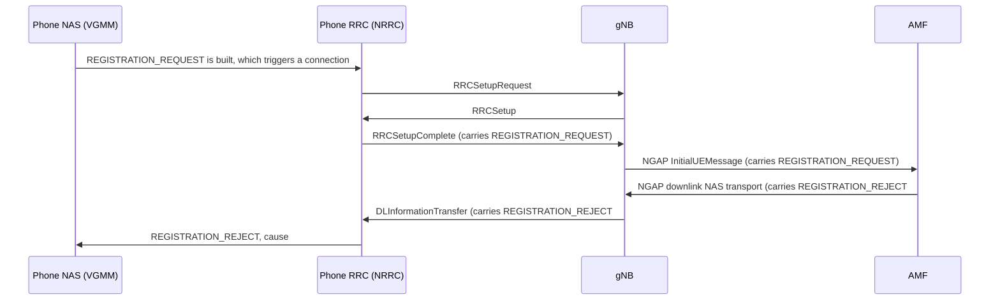
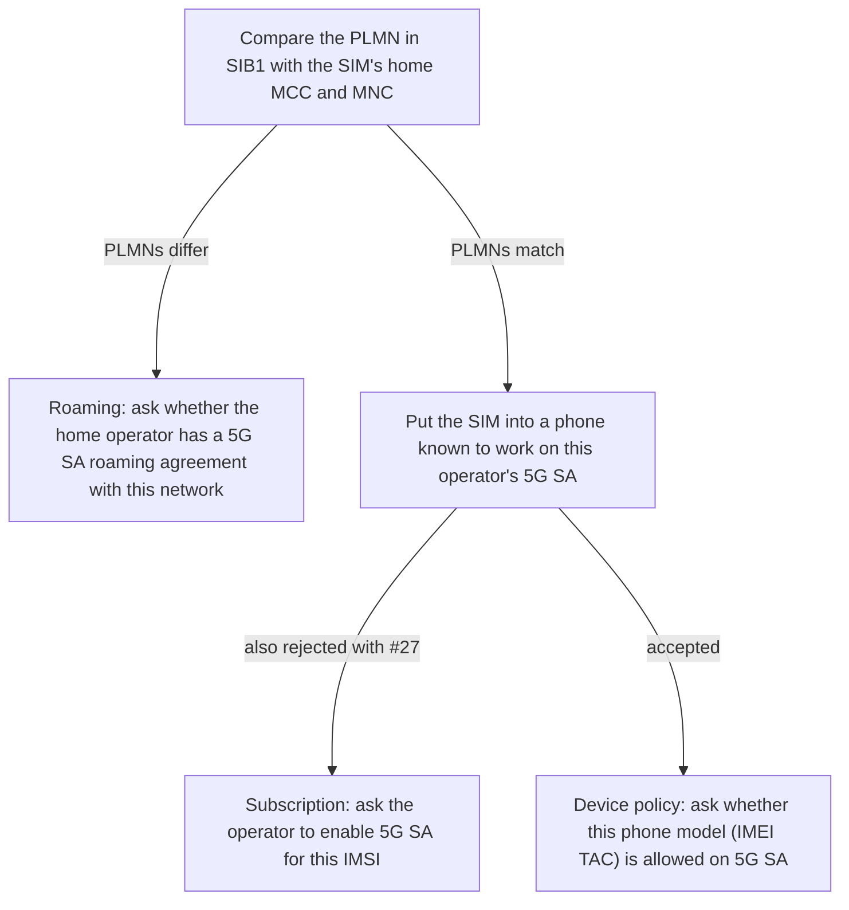

# FINDING: Registration Reject cause #27 "N1 mode not allowed" on the live TMO network — the 5G core bars this SIM or its home network, and the reject must follow RRC Setup

| Field | Value |
|---|---|
| Date | 2026-11-04 |
| Repo | free5gc. Only the grep in §2 and §3 used this tree. Every log in this doc comes from a phone on the live TMO operator network, not from free5gc. |
| Tree | `/home/loren/Downloads/source_code/free5gc_use_open5gs_ipv6/free5gc` |
| Branch | `my-changes-v4.0.1` (parent repo); `my-amf-changes-v1.3.2` (submodule `NFs/amf`) |
| Commit | `2af3098` (parent repo); `91f82ec` (submodule `NFs/amf`) |
| Symptom | **Not applicable.** Nothing in free5gc failed; this records what a live-network reject means. |
| Scope | What N1 mode is, what 5GMM cause #27 tells the phone, the likely reasons a live network sends it, and why the reject arrives after RRC Setup. It does not establish which of the reasons applies to this SIM; the operator has not answered yet. |
| Fix | **Not applicable.** Nothing is being fixed in free5gc. |
| Rounds | **Not applicable.** No diagnose-and-fix cycle took place. |
| Status | **Confirmation not recorded.** |
| Prior art | none |

---

## SECTION 0. The summary — what the topic is, in plain words, before any detail

**N1** is the 3GPP name for the link between the phone and the AMF (Access and Mobility Management
Function) of a **5G core (5GC)**. A phone in **N1 mode** registers with a 5G core, which is 5G
Standalone (SA). A phone in **S1 mode** attaches to a 4G core (EPC, Evolved Packet Core) instead.
5G Non-Standalone (NSA) also uses S1 mode, because NSA keeps the 4G core.

A `REGISTRATION_REJECT` with cause `VGMM_CAUSE_N1_MODE_NOT_ALLOWED` is 5GMM cause #27 from 3GPP
TS 24.501. With this cause, the live network says that this subscriber may not use the 5G core at all.
The cause does not say the phone lacks 5G, and it does not concern the radio cell. The phone is
expected to stop trying 5G SA and fall back to LTE or NSA.

The reject arriving after `RRCSetup` is normal. The gNB (the 5G base station) owns RRC (Radio Resource
Control) and holds no subscriber data, so the gNB accepts every radio connection it can serve. Only
the AMF can refuse the subscriber, and the AMF's answer can only reach the phone over an RRC
connection that already exists.

In the capture in §2, no authentication took place before the reject. That points at a decision the
AMF made from the SIM's home network identity, such as a missing 5G SA roaming agreement or an
operator rule for this SIM range. A missing 5G SA option on the subscription itself is also possible.
Only the operator can say which one applies.

## SECTION 1. How it works — the mechanism, in enough detail to reason about the topic

### N1 mode and S1 mode

| Attribute | N1 mode | S1 mode |
|---|---|---|
| Core network | 5G core (5GC) | 4G core (EPC) |
| Core node that handles the phone's signaling | AMF | MME (Mobility Management Entity) |
| Interface name for that signaling | N1 | S1 |
| Service the user sees | 5G SA | LTE, or 5G NSA (5G radio together with the 4G core) |

NAS (Non-Access Stratum) is the signaling layer between the phone and the core node. In N1 mode, NAS
messages such as `REGISTRATION_REQUEST` and `REGISTRATION_REJECT` travel between the phone and the AMF.
The modem log labels this layer `VGMM`, which appears to be the log tool's name for the 5GMM (5G
Mobility Management) part of NAS.

### What cause #27 tells the phone

Cause #27 ("N1 mode not allowed") is a decision about which core network type the subscriber may use.
TS 24.501 tells the phone to do the following when it receives this cause:

- The phone deletes its 5G-GUTI (temporary 5G identity) and its TAI list (the list of tracking areas
  where the phone is registered).
- The phone **disables its N1 mode capability** for 3GPP access, so the phone stops trying 5G SA.
- The phone falls back to S1 mode, which means LTE or NSA, if the phone supports S1 mode.

How long N1 mode stays disabled depends on the 3GPP release and on the modem vendor. Possible ends are
a power cycle, a SIM change, or a timer.

A radio restriction uses a different cause. For example, a restriction on NR (5G radio) in one area
can be signaled with cause #15 ("No suitable cells in tracking area") while the 5G core stays allowed.
Because the phone received #27, the AMF made a decision about the subscriber, not about the cell.

### Why a live network sends cause #27

| Reason | What happens in the network | How to tell it apart |
|---|---|---|
| The subscription does not include 5G SA | In the UDM (Unified Data Management), the subscriber's Access and Mobility Subscription data holds a field `coreNetworkTypeRestrictions`. When that field contains `5GC`, the AMF must reject with #27. This happens when the plan is 4G-only or when 5G SA was never activated on the account. | The AMF normally reads this field after authentication, so an authentication exchange would usually appear before the reject. |
| Roaming without a 5G SA agreement | The visited operator offers 5G SA roaming only to some home operators. When the SIM's home operator is not one of them, the visited AMF rejects with #27, and the phone roams on LTE or NSA instead. | The PLMN (operator network ID, MCC plus MNC) broadcast in SIB1 differs from the SIM's home MCC and MNC. |
| Operator device policy | Some operators allow 5G SA only for approved phone models. The operator identifies the model from the IMEI (the device serial number) or its TAC (the model prefix of the IMEI). A test phone or an engineering build can be rejected even when the SIM has 5G SA. | The same SIM is accepted in another phone that is known to work on this operator's 5G SA. |
| Home network configuration | The home UDM does not support 5GC for this IMSI range, or the subscriber is not provisioned there. Some operators answer this case with #27 instead of a more specific cause. | Only the operator can confirm this case. |

### Why the reject must come after RRC Setup

RRC and NAS are separate layers, and each layer answers to a different node. The gNB owns RRC and
knows only about radio. The AMF owns NAS and knows about the subscriber.

When `RRCSetupRequest` arrives, it carries only a random number or part of a temporary ID
(`5G-S-TMSI`), plus an establishment cause such as `mo-Signalling`. Nothing in that message tells the
gNB that the subscriber is barred from 5G SA, so the gNB accepts the radio connection.

The phone's NAS layer builds `REGISTRATION_REQUEST` first. The request cannot be sent while no radio
connection exists, so building it is what makes RRC open a connection. That is why the modem log shows
`REGISTRATION_REQUEST` before `RRCSetupRequest`. The request then travels inside `RRCSetupComplete`, in
the `dedicatedNAS-Message` field. The gNB forwards it to the AMF in an NGAP `InitialUEMessage`. NGAP is
the protocol between gNB and AMF. The AMF's reject travels back to the gNB over NGAP, and the gNB
delivers it to the phone inside an RRC `DLInformationTransfer`.



### Why a reject before authentication points at the home network identity

The AMF normally fetches the subscription from the UDM after authentication. In the capture in §2,
no `AUTHENTICATION_REQUEST` and no `SECURITY_MODE_COMMAND` appear between `RRCSetupComplete` and the
reject. The AMF can still read the home network's MCC and MNC (country code and operator code) from the
SUCI (the concealed subscriber ID), because that part of the SUCI is sent in clear. So the capture
points at the roaming reason, or at an operator rule for this home network or IMSI range. The
subscription reason is less likely, because the AMF usually reads `coreNetworkTypeRestrictions` only
after authentication.

### free5gc does not send cause #27

A grep of the free5gc AMF source (`NFs/amf`) for the cause's constant name returned nothing; §2 holds
the command. This free5gc build therefore would not send this reject, even when a subscriber's
`CoreNetworkTypeRestrictions` in the UDM/UDR subscription data contains `5GC`.

## SECTION 2. Evidence — how the mechanism was established: which tree was read, and what was seen on a unit

**Provenance.** On 2026-11-04 the free5gc tree at
`/home/loren/Downloads/source_code/free5gc_use_open5gs_ipv6/free5gc` was searched, at parent commit
`2af3098` on branch `my-changes-v4.0.1`, with submodule `NFs/amf` at `91f82ec` on branch
`my-amf-changes-v1.3.2`. The two modem logs below were pasted by the user. The user identified the
network as the live TMO operator network. The phone model and the SIM's home PLMN were not recorded.

**Capture 1** — the first reject the user saw, a single line from the modem log:

```
45786    34679825    10:02:17.385536 2026/11/4    NW->MS    VGMM    REGISTRATION_REJECT     (cause: VGMM_CAUSE_N1_MODE_NOT_ALLOWED)
```

**Capture 2** — the full sequence from cell discovery to the reject, on band 25, SSB ARFCN 396250,
PCI 557:

```
13371    02:14:20.988647 2026/11/4    NW->MS    NRRC_SI    MasterInformationBlock     (DL_FREQ_BAND[25], SSB_ARFCN[396250], PCI[557], SCS[NR_SCS_15])
13452    02:14:20.988647 2026/11/4    NW->MS    NRRC_SI    SystemInformationBlockType1     (DL_FREQ_BAND[25], SSB_ARFCN[[396250], PCI[557], SCS[NR_SCS_15])
18229    02:14:21.203341 2026/11/4    NW->MS    NRRC_SI    SystemInformationBlockType2     (DL_FREQ_BAND[25], SSB_ARFCN[[396250], PCI[557], SCS[NR_SCS_15], Stored[KAL_TRUE], Dedicated[KAL_FALSE])
18281    02:14:21.203341 2026/11/4    NW->MS    NRRC_SI    SystemInformationBlockType4     (DL_FREQ_BAND[25], SSB_ARFCN[[396250], PCI[557], SCS[NR_SCS_15], Stored[KAL_TRUE], Dedicated[KAL_FALSE])
18296    02:14:21.203341 2026/11/4    NW->MS    NRRC_SI    SystemInformationBlockType5     (DL_FREQ_BAND[25], SSB_ARFCN[[396250], PCI[557], SCS[NR_SCS_15], Stored[KAL_TRUE], Dedicated[KAL_FALSE])
24994    02:14:21.203341 2026/11/4    MS->NW    VGMM    REGISTRATION_REQUEST     (registration type: INITIAL_REGISTRATION, FOR bit: 1, NAS message container included: KAL_FALSE)
25520    02:14:21.203341 2026/11/4    MS->NW    NRRC    RRCSetupRequest     (SSB_ARFCN[396250], PCI[557])
26651    02:14:21.203341 2026/11/4    NW->MS    NRRC    RRCSetup     (SSB_ARFCN[396250], PCI[557])
27817    02:14:21.203341 2026/11/4    MS->NW    NRRC    RRCSetupComplete     (SSB_ARFCN[396250], PCI[557])
30087    02:14:21.436884 2026/11/4    NW->MS    NRRC    DLInformationTransfer     (NARFCN[396250], PCI[557])
30093    02:14:21.436884 2026/11/4    NW->MS    VGMM    REGISTRATION_REJECT     (cause: VGMM_CAUSE_N1_MODE_NOT_ALLOWED)
```

The reject arrived about 233 ms after `RRCSetupComplete`. No authentication message appears in the
capture.

**free5gc grep**, run from the free5gc repo root; the command printed nothing:

```sh
grep -rn "N1ModeNotAllowed\|Cause5GMMN1ModeNotAllowed" NFs/amf --include=*.go | grep -v _test | head -20
```

## SECTION 3. Check it yourself — what to run on your own unit today, and what the commands should print

**On the phone's modem log**, follow these steps in order. The diagram after the list shows which
answer leads where.

1. Expand the `SystemInformationBlockType1` entry and read the PLMN list it broadcasts. Compare that
   MCC and MNC with the SIM's home MCC and MNC, which are the first 5 or 6 digits of the IMSI.
2. When the two differ, the phone is roaming. Ask the operator whether the home operator has a 5G SA
   roaming agreement with this network.
3. When the two match, put the same SIM into a phone that is known to work on this operator's 5G SA.
   When that phone is rejected with #27 too, the cause is the subscription. When that phone is
   accepted, the cause is a device policy for the phone model under test.
4. Expand the `REGISTRATION_REQUEST` entry and note which identity the phone sent, SUCI or 5G-GUTI.
   §8 explains why that matters.



**On the free5gc tree**, run this from the repo root. It should print nothing, which confirms the AMF
source does not use the cause #27 constant:

```sh
grep -rn "N1ModeNotAllowed\|Cause5GMMN1ModeNotAllowed" NFs/amf --include=*.go | grep -v _test | head -20
```

## SECTION 4. Effect on your plan — does what you were about to do still work?

The plan is to ask the operator about the SIM card subscription. That plan still works, but the
question should be wider than the subscription alone. The capture in §2 shows a reject before any
authentication, which points more at roaming or at an operator rule for the SIM's home network or IMSI
range. Ask the operator three questions: whether 5G SA is enabled for this IMSI, whether this network
allows 5G SA for the SIM's home operator, and whether this phone model is allowed on 5G SA.

## SECTION 5. Alternatives — other ways to reach the same goal, when the planned route is ruled out

| When | Do this |
|---|---|
| The operator says 5G SA is enabled for the SIM | Put the SIM into a phone known to work on this operator's 5G SA, to test the device policy reason in §1. |
| The SIB1 PLMN differs from the SIM's home MCC and MNC | Use a SIM issued by this network's own operator, so the test does not depend on a roaming agreement. |
| 5G SA testing is not needed right now | Let the phone run on LTE or NSA. Cause #27 bars only the 5G core, so S1 mode service stays available. |
| The test has to reproduce the reject in a lab | Use a core that sends cause #27. The free5gc build in this tree does not send it, as §2 shows. |

## SECTION 6. The reusable rules — what to carry from this finding to similar situations

- A rejection about the subscriber always arrives after a successful radio setup. The gNB owns RRC and
  holds no subscriber data, so a successful `RRCSetup` says nothing about whether the core will accept
  the phone.
- In a modem log, a NAS message logged before `RRCSetupRequest` is normal. Building the NAS message is
  what makes RRC open the connection, and the message is sent later inside `RRCSetupComplete`.
- A NAS reject with no authentication before it was decided from what the AMF can read in clear, such
  as the home network's MCC and MNC in the SUCI. A reject after authentication can also rest on the
  subscriber's profile in the UDM.
- Cause #27 bars the core network type, not a radio technology. A radio restriction uses a different
  cause.

## SECTION 7. Traps — what looks true and is not; check each claim before trusting it

- **`RRCSetup` looks like the network accepting the phone for 5G.** The gNB accepts the radio
  connection without knowing the subscriber. Only the NAS answer from the AMF says whether the core
  accepts the phone.
- **`REGISTRATION_REQUEST` before `RRCSetupRequest` looks like NAS was sent with no radio connection.**
  The log line marks the moment the modem built the message. The message left the phone inside
  `RRCSetupComplete`.
- **"N1 mode not allowed" reads as if the phone does not support 5G.** In capture 2 the phone decoded
  the NR cell and completed RRC setup on NR. The cause bars the 5G core for this subscriber; the phone's
  5G radio works.
- **Eight lines in capture 2 share the timestamp `02:14:21.203341`.** That timestamp cannot order those
  lines. The first column, the log sequence number, gives the order.
- **A free5gc lab cannot reproduce this reject.** Setting `5GC` in a subscriber's
  `CoreNetworkTypeRestrictions` in free5gc does not make this AMF send cause #27, because the AMF
  source does not use that cause.

## SECTION 8. Limits — what this finding does not establish, and what would settle the open question

- **Which reason applies to this SIM is not established.** The operator's answer to the three questions
  in §4 would settle it, as would the SIM-swap test in §3.
- **The SIB1 PLMN and the SIM's home PLMN were not recorded**, so whether the phone was roaming is
  unknown. Expanding `SystemInformationBlockType1` in capture 2 and reading the IMSI would settle it.
- **The identity the phone sent was not recorded.** The argument in §1 about a reject before
  authentication assumes the AMF read the home MCC and MNC from a SUCI. Expanding
  `REGISTRATION_REQUEST` would show whether the phone sent a SUCI or a 5G-GUTI.
- **The behavior of the phone after the reject was not observed.** Both captures end at the reject.
  The steps in §1 (delete 5G-GUTI, disable N1 mode, fall back to S1 mode) come from TS 24.501 as
  stated in the conversation that produced this doc, not from a quote of the spec text, and were not
  seen in a log.
- **The NGAP messages between gNB and AMF were not captured.** The phone's modem log cannot show them.
  §1's diagram names them from the NGAP procedure, not from a capture.
- **The free5gc grep searched only the AMF's own Go source**, excluding tests, for the constant name. A
  cause written as the number 27, or code outside `NFs/amf`, would not match.
- **`VGMM` as the 5GMM layer is an inference** from the message names, not from the log tool's
  documentation.

## SECTION 9. Revisions — update history, and what forced each change

```
2026-11-04 — first written, from two modem logs captured on the live TMO network and a grep of the
  free5gc AMF source. Claim band: yes. Status: "Confirmation not recorded", because §3 has not yet
  been run and the operator has not answered.
```

## SECTION 10. Related — other docs connected to this doc

**None.** A search of the docs directory found no other doc about N1 mode, cause #27 or Registration
Reject.
